# ReconBench — App Flow

**Version** 0.1 (draft) · **Date** 30 Sep 2026
**Derived from** ReconBench PRD v0.1 and TRD (both dated 29 Sep 2026)
**Audience** Product, Design, Engineering, QA, Finance/AP

---

## 1. About this document

This document shows **how a person moves through ReconBench**: the screens, what the user does on each, how the system responds, and how one screen hands off to the next. It also shows what happens in the background at each step. It does not repeat the matching rules (PRD §7.5) or the schema (TRD §6); it points to them.

**Conventions**
- **P0** = MVP · **P1** = v1.1 · **P2** = later. Anything untagged is P0.
- Requirement IDs in brackets, such as `ING-5` or `TR-REV-4`, point to the PRD or TRD source.
- *(proposed)* = the TRD proposes it and it still needs a decision.
- *(suggested)* = not stated in the PRD or TRD; added here only to complete the flow. Please confirm.
- Diagrams are Mermaid. They render in GitHub, GitLab, Obsidian and VS Code with a Mermaid extension.
- **Case** = one invoice plus the PO and GRN evidence linked to it.

---

## 2. App at a glance

**In one line:** upload a month of POs, GRNs and invoices → confirm who belongs to whom → run the 3-way match → clear only the exceptions → export to Excel.

### 2.1 Navigation

Left sidebar, always visible: **Home · Ingestion · Mapping · Reconciliation**, with a small **⚙ Settings** at the bottom. The top bar holds the batch / period selector. Desktop-first: latest Chrome or Edge, minimum width 1366 px.

| Screen | Question it answers | Main output | PRD flow steps |
|---|---|---|---|
| **Home** | Where are we this period? | KPIs, next step, AI Assist setup | overview |
| **Ingestion** | Did all my files get read? | Parsed documents and warnings | A–C (upload, parse, normalize) |
| **Mapping** | Who belongs to whom? | Vendors and invoice ↔ PO ↔ GRN links | D–E (group by vendor, link) |
| **Reconciliation** | Are the numbers right? | Case verdicts, overrides, Excel workbook | F–I (ledger, checks, review, export) |
| **Settings** | What are the rules? | Tolerances, synonyms, UOM map, entities, aliases, payment terms, users | — |

### 2.2 Rules that shape every flow

1. **The invoice is the spine.** One case = one invoice; PO and GRN are evidence looked up for it.
2. **The server computes, the screen formats.** Statuses, variances, payable, at-risk and ledger boxes all come from the API (`TR-API-3`).
3. **Long work is a job.** The app starts it, gets `202`, then polls every 2 s. Progress survives a page reload and is never cancelled by leaving the page (`TR-API-8`).
4. **One bad file never blocks the rest** (`ING-5`).
5. **The pool is persistent.** A batch is only a label and filter. Invoices can link to POs and GRNs from earlier months, and ingestion order never changes results (`ING-7`, scenario 18).
6. **Precision over recall.** Shaky data ends in *Needs Review*, never in a silent pass.
7. **Human decisions are events, not edits.** Approve, hold, reject and notes sit beside the computed result (`TR-REV-1`).
8. **No silent overwrites.** A stale write returns 409; the app shows what changed and offers a reload (`TR-API-6`).
9. **A Mapping change makes cases stale** until Re-run. A newly ingested GRN re-evaluates *Pending* cases on its own *(proposed, OQ-3)*.

---

## 3. Users and access

| Role | Typical journey |
|---|---|
| **AP Executive** (daily) | Upload the dump → fix mapping → clear exceptions → export |
| **AP Manager / Finance Controller** | Set tolerances and AI mode → approve overrides, including Exceptions → read the summary |
| **Auditor** (read-only) | Open any case → trace the verdict to source documents, evidence and config → export |

**P0** ships with one login role that holds every capability. Every action already passes a role check and records the actor, so **P1** only has to switch the matrix below on (`TR-REV-8`, `TR-SEC-4`).

| Capability | AP Executive | Manager | Auditor |
|---|:---:|:---:|:---:|
| Upload and process files | ✔ | ✔ | — |
| Confirm / change links, merge vendors | ✔ | ✔ | — |
| Run reconciliation | ✔ | ✔ | — |
| Approve Matched (flags), hold, reject, add notes | ✔ | ✔ | — |
| Approve Exceptions | — | ✔ | — |
| Change tolerances and settings | — | ✔ | — |
| Manage AI key and mode | — | ✔ | — |
| Manage users | — | ✔ | — |
| Export to Excel | ✔ | ✔ | ✔ |
| View documents, evidence and audit trail | ✔ | ✔ | ✔ |

A control the role lacks is shown disabled with a short reason *(suggested)*. The server is the authority and answers 403.

---

## 4. Sitemap

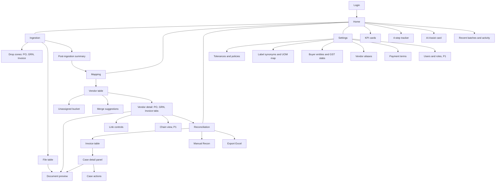

**Deep links** exist for a document, a vendor and a case, so an audit trail can be shared with a colleague or auditor (`TR-API-1`).

---

## 5. End-to-end flow

### 5.1 The user's journey

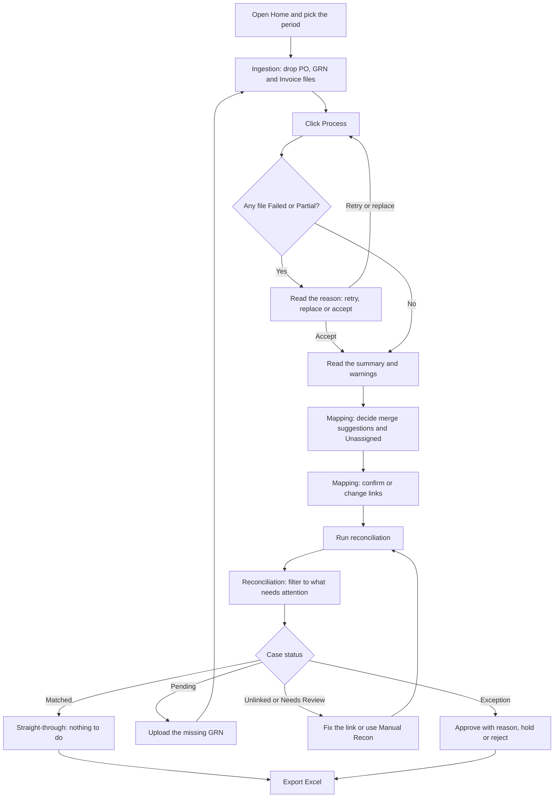

### 5.2 What happens behind the screens

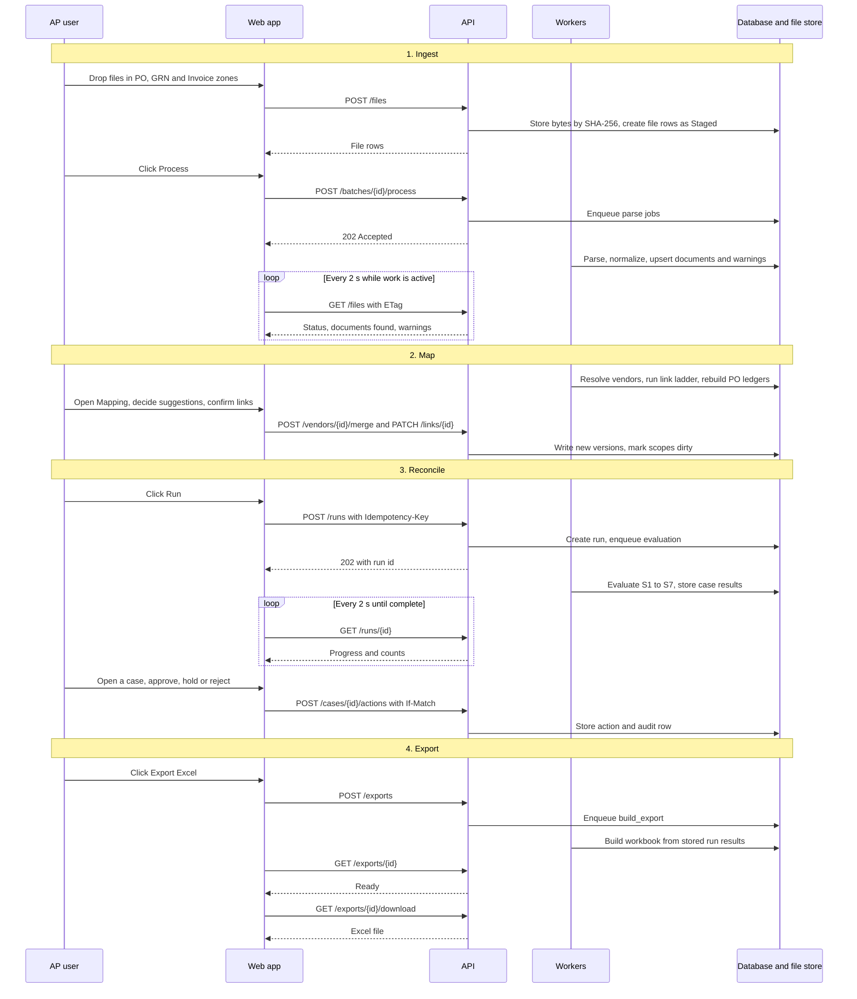

---

## 6. Screen flows

Each screen lists its purpose, how the user gets there, what the user can do, how the system responds, and where the user goes next.

### 6.1 Login and session

**Requirements:** `TR-SEC-3`, `TR-SEC-4`, TRD §7.1 · **Endpoints:** `POST /auth/login`, `POST /auth/logout`, `GET /auth/me`

| Step | User | System |
|---|---|---|
| 1 | Opens the app, or a shared deep link, without a session | API answers 401; the app shows Login |
| 2 | Enters email and password | `POST /auth/login`, rate limited with lockout. Sets an HttpOnly, Secure, SameSite=Lax session cookie. Unsafe requests then carry an `X-CSRF-Token` header |
| 3 | Lands in the app | `GET /auth/me` returns name and role. The UI enables or disables actions from it; the server still enforces |
| 4 | Works, then is idle for 30 min or reaches 12 h | Next request returns 401 and the app returns to Login. Both timeouts are proposed and configurable |
| 5 | Signs out | `POST /auth/logout` |

- Jobs already running (parsing, runs, exports) keep going on the server if the session ends (`TR-API-8`).
- P0 uses local accounts. Single sign-on (OIDC) is P2.
- PRD question 8 (is login required in v1?) is still open. The TRD proposes login with one role in P0 (OQ-7).

---

### 6.2 Home

**Purpose:** orient the user, show KPIs for the selected period, point to the next step, and hold the AI Assist setup.
**Entry:** after login, or sidebar → Home.
**Data:** `GET /kpis` (period from the top bar), `GET /batches`, `GET /ai/settings`.

| Element | What it shows or does |
|---|---|
| Period selector (top bar) | Filters KPIs by **invoice date**. A batch is only a label (`TR-ING-7`) |
| KPI cards | Invoices · Matched % · Pending · Exceptions · Unlinked · At-risk ₹ · GRNI ₹. Built from the same SQL views as the Excel Summary sheet, so screen and workbook agree |
| 4-step tracker | Ingest → Map → Reconcile → Export, with a **Next step** button that opens the following screen |
| AI Assist card | Mode, provider, API key (masked), model, budget cap, Test, status pill. Flow below |
| Recent batches / activity | Jump back to a batch or a recent run |

**How the KPIs are counted** (TRD §11.3)
- *Invoices* = invoices in the period that have a current case, so run-based cards stay empty until the first run.
- *Matched %* = Matched plus Matched (flags), as a share of invoices, using the **effective** status (computed status overlaid by overrides) *(proposed)*. Straight-through rate = Matched with no human action.
- *Pending, Exceptions, Unlinked* = counts of current cases by effective status.
- *At-risk ₹* = sum of `at_risk` over current cases. Duplicate and Unlinked value is shown as a separate "blocked" value, not inside At-risk *(proposed, OQ-6)*. GST on at-risk is shown beside it, not inside it *(proposed, OQ-4)*.
- *GRNI ₹* = for each PO line, the larger of zero and (accepted GRN qty − billed qty), times PO rate, from the ledger as it stands now. The month-end accrual by date is the P1 GRNI report.

**States:** first visit or no data → empty cards, tracker points to step 1 *(suggested)*. Data present → cards populated. API error → card-level retry *(suggested)*.

#### AI Assist card flow

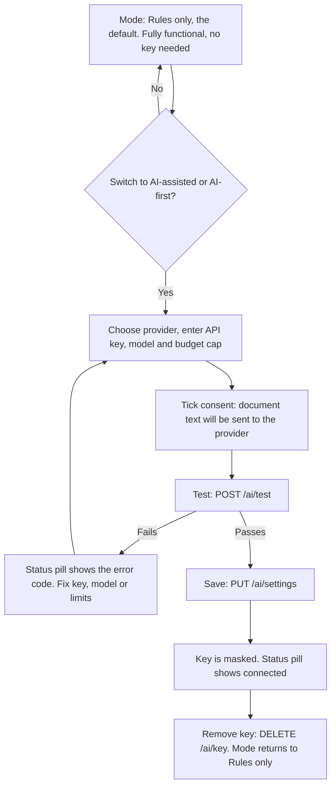

| Field | Behaviour |
|---|---|
| Mode | **Rules only** (default) · **AI-assisted** (AI used only at the hooks, only when rules are unsure) · **AI-first extraction** (AI reads every PDF; rules still validate the output) |
| Provider | Claude, OpenAI or Gemini. The provider's data-use terms are shown beside the key field |
| API key | Write-only. Masked after saving; never returned to the browser, logged or exported; excluded from autofill; never kept in browser storage. Stored *session only* (default) or *saved encrypted*. **Remove key** button |
| Model, budget cap | Per-run budget cap with a live token and cost estimate (`GET /ai/usage`). Calls stop at the cap |
| Consent | Required for both AI modes. Save is blocked without it. Stored with each run |
| Redaction | Bank account, IFSC, phone and email are removed before any call. On by default |
| Test | `POST /ai/test`, rate limited |
| Status pill | Reflects the current state, such as Rules only, Connected or Error *(suggested values)* |

Entering the key before Test and Save is the natural order, but the PRD does not fix it. AI failures never block work: the run falls back to rules (see §7.3).

---

### 6.3 Ingestion

**Purpose:** bring a month's documents in, parse them, and show what was found. PRD flow steps A–C.
**Entry:** sidebar → Ingestion, or Home tracker step 1.
**Screen parts:** three drop zones (PO · GRN · Invoice) with a **Process** button · file table · post-ingestion summary.

#### Accepted input

| Zone | Formats | Notes |
|---|---|---|
| PO | XML, CSV, PDF | One XML or CSV may hold hundreds of documents across many vendors. It is split into one document per voucher / PO number |
| GRN | XML, CSV, PDF | Same splitting, per GRN number |
| Invoice | PDF | One PDF = one invoice. Splitting multi-invoice PDFs is P1 |

- Multi-file drag-and-drop, folder upload and ZIP are all accepted (`ING-1`). Anything else is rejected with a clear reason (`ING-2`).
- Limits (both are settings): 25 MB and 100 pages per file. ZIP: at most 5,000 entries, 2 GB uncompressed, 100:1 compression ratio. Nested archives and absolute or `..` paths are rejected; `__MACOSX` and dotfiles are skipped (`TR-ING-1`, `TR-ING-2`).
- The file's real type and format come from its content, not its extension (`TR-ING-3`).

#### Step-by-step flow

| # | User does | System does |
|---|---|---|
| 1 | Names the batch, or leaves it for later *(suggested UI)* | `POST /batches`. The label is suggested from the month of the most common invoice date once invoices are read, and stays editable (`PATCH /batches/{id}`) (`TR-ING-7`) |
| 2 | Drags files, a folder or a ZIP into the PO, GRN or Invoice zone | `POST /files` streams to the object store, keyed by SHA-256. Each ZIP entry becomes its own file row with a parent link. Rows appear as **Staged**. Unsupported formats, oversize files and unsafe ZIPs are rejected with a reason. Identical bytes are skipped |
| 3 | Sees Staged rows, some with a warning | Content sniffing checks each file against its zone. If it looks like another type (a PO in the Invoice zone) the row gets **TYPE_MISMATCH** with the suggested type. The chosen zone stands until the user accepts the change (`ING-3`) |
| 4 | Clicks **Process** | `POST /batches/{id}/process` returns 202. Staged files are queued |
| 5 | Watches the file table | The app polls `GET /files` every 2 s with ETag. Rows move Queued → Parsing → Parsed / Partial / Failed. A progress bar covers the batch |
| 6 | For a CSV with unrecognised headers, confirms the column mapping once | The mapping is remembered per layout signature and reused for the same layout later (PRD §7.2). *The PRD does not say where this prompt appears; suggested: a dialog opened from the file row* |
| 7 | Reads each row's result | **Parsed n docs**, **Partial** or **Failed**, with reason code and message |
| 8 | Fixes problems using the row actions | See "File table" below |
| 9 | Opens the summary panel | `GET /batches/{id}/summary` |
| 10 | Clicks **Go to Mapping** | Vendor resolution and linking have already run in the background |

#### File status

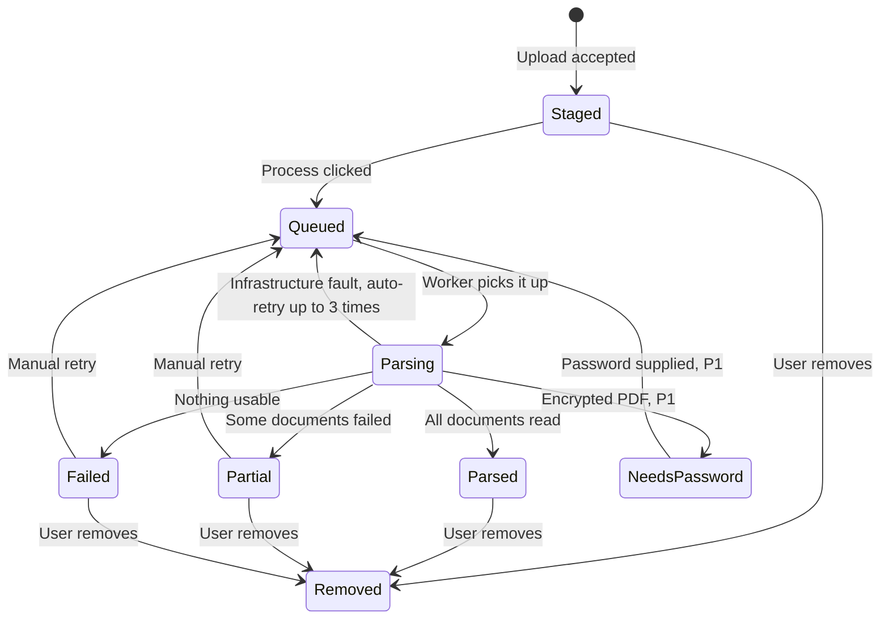

Parse failures are deterministic, so they fail once with a reason and wait for a manual retry. Only infrastructure faults retry automatically, three times with backoff (`TR-ING-5`).

#### What happens to each file while it is Parsing

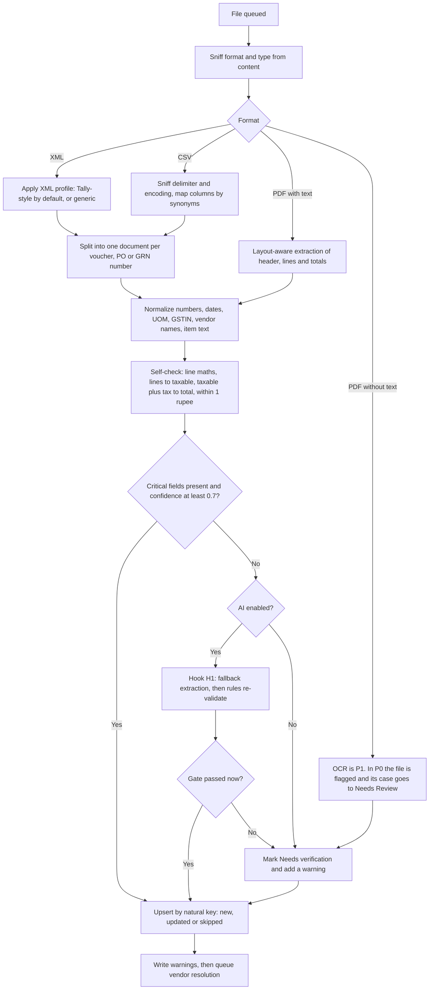

Critical fields: invoice number, date, vendor (name or GSTIN), at least one line with quantity and (rate or amount), and grand total. A document that fails the gate is saved as *Needs verification*; its case will be *Needs Review*. The engine never computes a silent pass or fail on shaky numbers.

#### File table

| Column | Notes |
|---|---|
| Name · Type · Format · Size | Type is PO, GRN or Invoice; format is XML, CSV or PDF |
| Status | Staged · Queued · Parsing · Parsed · Partial · Failed · NeedsPassword (P1) |
| Docs found | Number of documents extracted from the file |
| Warnings | Chips such as TYPE_MISMATCH, LOW_CONFIDENCE (list below) |
| Actions | **Preview** · **Retry** · **Remove**, plus error-log download |

| Action | Available on | Effect |
|---|---|---|
| Preview | Any row | Opens the document preview (§6.6) via `GET /files/{id}/content` |
| Retry | Failed, Partial | `POST /files/{id}/retry` puts the file back in the queue |
| Remove | Any row | `DELETE /files/{id}`. For a parsed file its documents are withdrawn (soft, audited) and the affected vendor and PO scopes are marked dirty, so linked cases become stale |
| Download error log | Failed, Partial | `GET /files/{id}/errors`, JSON lines |

#### Warnings raised at ingestion (`TR-ING-8`)

| Warning | Meaning | Typical next move |
|---|---|---|
| NO_PO_REF | No PO reference found on the document | None yet. The link ladder tries other evidence in Mapping |
| NO_GSTIN | No GSTIN found | Vendor resolves by name or alias; check it in Mapping |
| LOW_CONFIDENCE | A critical field is unreliable | Preview the document; ask the vendor for a better copy; inline correction is P1 |
| UNPARSEABLE | The file could not be read | Retry, replace the file, or read the error log |
| TYPE_MISMATCH | Content looks like a different document type | Accept the suggested type or keep the zone |

#### Post-ingestion summary (`ING-8`)

Counts by type, format and vendor, plus every warning above with a **jump link** to the document. The main button is **Go to Mapping**.

#### Re-uploading, late files and removal

| Situation | Result |
|---|---|
| Same bytes uploaded again | Skipped (same SHA-256) |
| Same document, changed content | **Updated**: a new document version is stored and the old one is kept |
| Same document, same content in another file | **Skipped** |
| A PO revision | The highest revision governs the ledger; older ones are kept for history |
| Re-uploading a whole month | Summary shows new / updated / skipped, never duplicates (`ING-6`) |
| Uploading an earlier month later (say October before September) | Identical final results |
| Removing a file | Documents withdrawn softly and audited; affected cases go stale |

**States:** *Empty* → three empty drop zones and no table. *Processing* → rows show status and a progress bar. *Partial success* → the user may continue to Mapping with what parsed. *Upload storage unavailable* → the upload answers 503 and the user retries later.

---

### 6.4 Mapping

**Purpose:** answer "who belongs to whom". Group documents by vendor and link every invoice (and GRN) to its PO. PRD flow steps D–E. Mapping never judges numbers; that is Reconciliation.
**Entry:** Ingestion summary → Go to Mapping, sidebar, or Home tracker step 2.

#### Screen parts

- **Vendor table:** Vendor · GSTIN(s) · #PO · #GRN · #Invoice · link-health bar (linked / unlinked / orphan) · Open. Search, a "has issues" filter, the **Unassigned** bucket pinned on top, and a merge-suggestions banner.
- **Vendor detail:** tabs **PO · GRN · Invoice**. Each row shows number, date, amount, link and a **Preview** icon. Chain view is P1: `PO-0142 [100] → GRN-011 [90], GRN-047 [10] → INV-2201 [90], INV-2260 [10]`.
- **Link controls:** confirm, change, unlink, and bulk "confirm all ≥ 0.95".
- **Main button:** Run reconciliation, for this vendor or for all.

#### A. Vendor grouping (runs automatically after parsing)

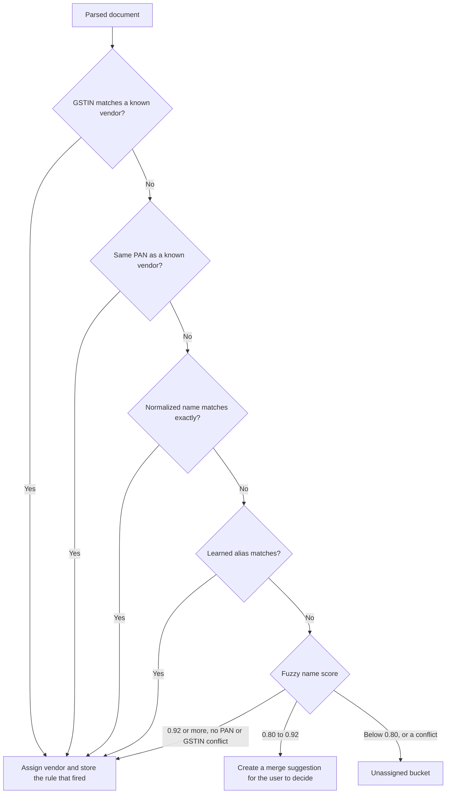

- Two different PANs **never** auto-merge, whatever the names look like (`TR-VEN-2`).
- Results do not depend on ingestion order: documents are processed in a sorted order, and ties become suggestions, not merges (`TR-VEN-3`).
- *Gap:* the PRD and TRD do not say how a first-time vendor (new GSTIN, no match) is created, or how a user moves a document out of Unassigned. See §9.

#### B. Merge suggestions

| Step | User | System |
|---|---|---|
| 1 | Sees the banner "n merge suggestions" and opens it | `GET /vendor-merge-suggestions` returns fuzzy pairs (0.80 to 0.92) with their score |
| 2 | Compares the pair: names, GSTIN(s), PAN | — |
| 3 | **Accepts** (merge) | `POST /vendor-merge-suggestions/{id}/decision` and `POST /vendors/{id}/merge`. Writes a vendor alias and a `merged_into` pointer (soft, reversible). Audited |
| 3 | **Rejects** | The decision is saved |
| 4 | — | The vendor scope is marked dirty. Linking re-runs for that vendor, counts and link health refresh, and affected cases go stale. Next month the alias applies on its own |

Splitting a merged vendor is P1 (`TR-VEN-5`).

#### C. Linking: the Anchor Resolution Ladder

Linking is invoice-centric. For each invoice the system looks for its PO(s), then its GRN(s), using evidence from most to least certain.

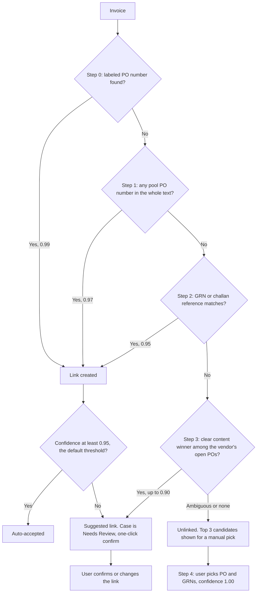

| Step | Method | Confidence | Notes |
|---|---|---|---|
| 0 | Labeled reference at header or line level | 0.99 | Labels come from the editable synonym table |
| 1 | Reverse lookup: search the invoice's whole text for any PO number already in the pool | 0.97 | A hit must sit on word boundaries and be at least 5 characters (unless a PO-like label is nearby). Hits equal to the invoice number, GSTIN, IRN, e-way bill, HSN or an amount are ignored |
| 2 | Via GRN or challan | 0.95 | A GRN records this invoice or challan number, or the invoice cites a GRN / DC number |
| 3 | Content inference among the vendor's open POs | up to 0.90 | Suggested only if the best score is at least 0.80 **and** leads the runner-up by 0.15. Rate is a soft signal, so a price hike shows up as RATE_HIGH, not as "wrong PO" |
| 4 | Manual pick | 1.00 | Same as Manual Recon |

- PO numbers are canonicalised before matching, so `PO/26-27/0142`, `PO-26-27-142` and `po 26 27 142` are the same PO. Non-exact matches are allowed only inside the same vendor.
- GRNs use the same ladder: their PO label, reverse lookup, a record of the invoice or challan number, content, then manual.
- **Multi-PO invoices** link at line level. A line inherits the header PO when there is exactly one; otherwise it is inferred among the invoice's candidate POs.
- **PO not in pool:** if an invoice cites a PO the pool does not hold, the case shows "PO not in pool — upload the earlier PO file" (NO_PO_LINK with detail PO_NOT_IN_POOL) rather than a generic failure.
- **Ingestion order:** links from steps 0, 1, 2 and 4 are resolved first for every document. Step 3 then runs per vendor in invoice date and number order, so results stay order-independent (`TR-LNK-7`).

What the user sees for each outcome:

| Outcome | Link state | Case shows | User does |
|---|---|---|---|
| Confidence at or above 0.95 | auto | Linked, no flag | Nothing, or confirm |
| Step 3 suggestion | suggested | Needs Review, LINK_INFERRED | One-click confirm, or change |
| No clear winner | none | Unlinked, top 3 candidates | Manual pick |
| PO cited but not in pool | none | Unlinked with the PO-not-in-pool message | Upload the earlier PO file, then re-link |
| AI re-rank (hook H3) | suggested, tagged AI-suggested | Needs Review, unless auto-accept above a threshold is enabled | Confirm or change |

#### D. Link states and controls

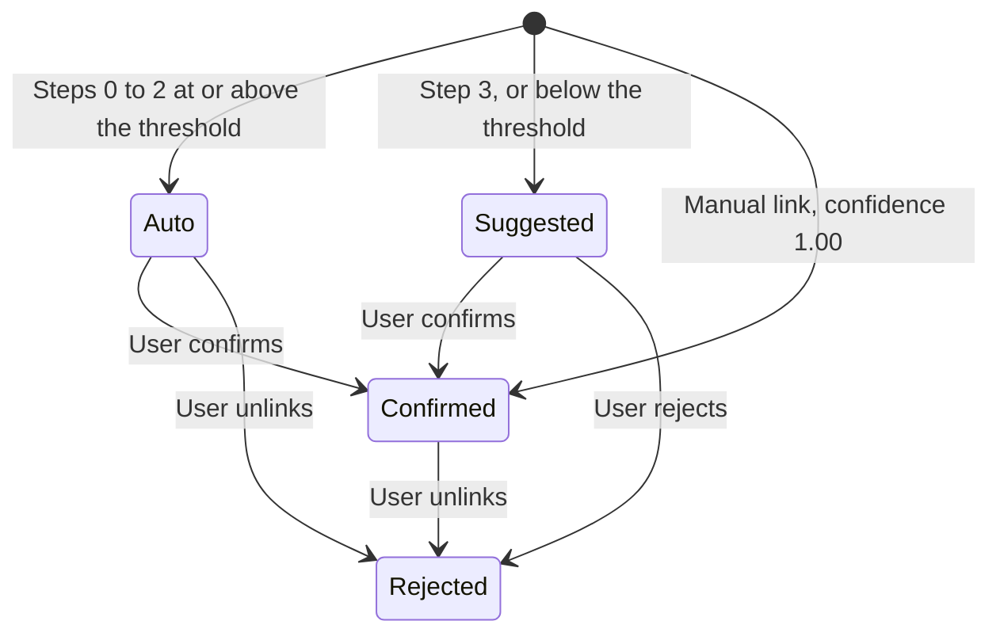

Links are append-only: every change writes a new link version and keeps the old one (`TR-LNK-1`).

| Control | Behaviour |
|---|---|
| **Confirm** | Marks the link confirmed. `PATCH /links/{id}` with `If-Match` |
| **Change** | Opens a searchable picker of the vendor's POs and GRNs from the whole pool. Creates a manual link at confidence 1.00 (`POST /links`) |
| **Unlink** | Rejects the link. The invoice becomes Unlinked at the next run |
| **Confirm all ≥ 0.95** | `POST /links/bulk-confirm` for one vendor or all, with an `Idempotency-Key`. Returns a result per link. One failure never rolls back the rest |
| **Preview** | Opens the document preview (§6.6) |
| **Run reconciliation** | Starts a run for this vendor or all (`POST /runs`) and opens Reconciliation to show progress |

**What Mapping changes elsewhere:** PO ledgers rebuild automatically. Existing cases become **stale** until the next Re-run, and Reconciliation shows the stale banner.

**States:** *No documents yet* → prompt to go to Ingestion *(suggested)*. *All linked* → health bars full. *Work waiting* → banner for merge suggestions and a count of Unassigned documents.

---

### 6.5 Reconciliation

**Purpose:** answer "are the numbers right". Run the 3-way match, review only what needs attention, record decisions, export. PRD flow steps F–I.
**Entry:** Mapping's Run button, sidebar, or Home tracker step 3.

#### Screen parts

- **Toolbar:** vendor · status · date filters · **Run / Re-run** · **Export Excel**. A **Manual Recon** button sits here too *(suggested placement)*.
- **Stale banner:** shown when Mapping (or Settings) changed after the last run. **Re-run** is scoped to the affected vendors (`TR-API-7`).
- **Invoice table:** one row per invoice: Invoice · Date · Vendor · PO(s) · GRN(s) · Invoice amt · Expected · Variance · Status chip · Issue chips. Server-side filter, sort and keyset pagination; rows are virtualised so 10,000 rows scroll smoothly.
- **Case detail panel:** opens from a row. Deep-linkable.

#### A. Running the match

| # | User | System |
|---|---|---|
| 1 | Sets the scope (vendor filter, or all) and clicks **Run** or **Re-run** | `POST /runs` with an `Idempotency-Key` returns 202 and a run id. The run stores engine version, rules hash, config snapshot, a manifest of every input version, and whether AI was on |
| 2 | Watches progress | `GET /runs/{id}` every 2 s with ETag: progress and counts by status. Survives a reload; leaving the page does not cancel it |
| 3 | Sees results | The table refreshes, the stale banner clears for the vendors re-run, and Home KPIs update |

The engine is deterministic: the same inputs give the same outputs, whatever order the files arrived in. Target: 5,000 invoices in 60 s or less.

#### B. What the engine does for each invoice

| Stage | Question it answers | Typical reason codes |
|---|---|---|
| **S1 Gate** | Critical fields present? Vendor resolved? PO open? Duplicate? | DUP_INVOICE, LOW_CONFIDENCE_DATA, PO_NOT_OPEN, NO_PO_LINK |
| **S2 Links** | Which PO and GRN(s) does Mapping say this invoice belongs to? | LINK_INFERRED |
| **S3 Line alignment** | Which PO line is each invoice line? (never uses quantity or rate) | ITEM_NOT_ON_PO, ITEM_UNSURE |
| **S4 Quantity ledger** | Is cumulative billed quantity within the PO cap and within GRN accepted? | QTY_OVER_PO, QTY_OVER_GRN, GRN_PENDING, GRN_OVER_PO |
| **S5 Price and amount** | Rate vs PO, line maths, expected total (Σ billed qty × PO rate), cumulative PO value | RATE_HIGH, RATE_LOW, TOTAL_MISMATCH, MATH_ERROR, PO_VALUE_EXCEEDED, EXTRA_CHARGE |
| **S6 Tax and compliance** | Tax rate and type, HSN, GSTIN, vendor, buyer, dates, currency, UOM, payment due date | TAX_RATE_DIFF, TAX_TYPE_MISMATCH, HSN_DIFF, GSTIN_INVALID, VENDOR_MISMATCH, DATE_ORDER, LATE_DELIVERY, CURRENCY_DIFF, UOM_MISMATCH |
| **S7 Verdict** | Status, payable ₹, at-risk ₹, reason codes | — |

Payable and at-risk: `payable_taxable = Σ eligible qty × payable_rate + approved charges` and `at_risk = invoice taxable − payable_taxable`, where the payable rate is the lower of the invoice net rate and the PO rate (switchable: hold, or pay at PO rate). At-risk covers excess quantity, rate hikes and rejected goods.

#### C. How the status is decided (first match wins)

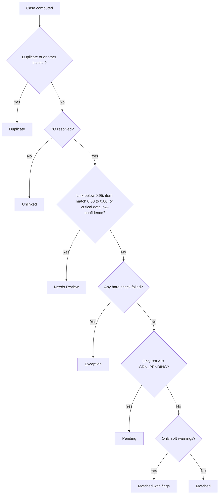

A multi-PO invoice takes the status of its **worst line**. Users can overlay **Approved (override)**, **On hold** or **Rejected** on any status.

| Status | Means | User usually |
|---|---|---|
| **Duplicate** | Exact duplicate of an earlier invoice (same vendor PAN, canonical number and financial year, or same IRN). Consumes no PO balance. A *suspected* duplicate is instead Needs Review with DUP_SUSPECTED *(proposed, OQ-5)* | Checks it is a re-scan or re-send and keeps the original |
| **Unlinked** | No PO resolved | Picks the PO and GRNs (change link or Manual Recon). If "PO not in pool", uploads the earlier PO file |
| **Needs Review** | Link below 0.95, item match between 0.60 and 0.80, or critical data with low confidence | Confirms or changes the link, checks the highlighted fields in preview, then approves or re-runs |
| **Exception** | A hard check failed | Reads the reason and suggested action, then approves with a reason (Manager only in P1), holds, rejects, or raises it with the vendor |
| **Pending** | Only issue is GRN_PENDING: billed more than received so far | Uploads the missing GRN. It turns Matched by itself and ages into an exception after 30 days |
| **Matched (flags)** | All hard checks pass; only soft warnings | Skims the flags, bulk-approves if acceptable |
| **Matched** | All pass, variances inside tolerance | Nothing. Straight-through |

#### D. Case detail panel

One call (`GET /cases/{id}`) loads everything, so the Invoice, PO and GRN sit side by side without further waiting (`TR-API-5`). The PDF viewer loads only the page in view.

1. **Header checks:** vendor, dates, tax type, currency, totals.
2. **Line grid:** Invoice, PO and GRN columns with a pass or fail mark on each cell.
3. **Ledger box:** for example *"PO ordered 100 · billed before 90 · this invoice 10 · GRN accepted 100 · balance 0"*.
4. **Evidence and preview:** the source snippet and page for each value; fields below the confidence threshold are highlighted.
5. **Actions:** confirm link, change link, approve, hold, reject, note.

Reason codes show a plain-language message and a suggested action, taken from the same catalogue the Excel export uses (`TR-API-4`).

#### E. Case actions and overrides

| Action | Rules | Effect |
|---|---|---|
| **Confirm link** | For suggested or below-threshold links | Link becomes confirmed |
| **Change link** | Searchable PO / GRN picker over the whole pool | Manual link at 1.00 |
| **Approve** | A reason is mandatory. Only a Manager may approve an Exception (P1) | Overlay *Approved (override)*. A fingerprint of the case inputs is stored |
| **Hold** | — | Overlay *On hold* |
| **Reject** | — | Overlay *Rejected*. A rejected invoice consumes no PO balance |
| **Add note** | Free text | Stored with actor and time |
| **Bulk actions** | Confirm all links ≥ 0.95; approve selected *Matched (flags)* | Run on the server with an `Idempotency-Key`. A result per item; one failure never rolls back the rest |

- The **effective status** is the computed status overlaid by the latest action. Actions are stored beside the computed result and never edit it (`TR-REV-1`).
- Every action writes an audit row: who, when, before and after, reason, hash-chained. The audit screen is P1; the writing starts in P0.
- An override whose inputs later change becomes *stale — re-review* and stops overlaying the status (P1).
- If someone else changed the same case first, the write returns 409. The app shows what changed and offers a reload (`TR-REV-4`, `TR-API-6`).
- A link change made here marks the case stale until the scoped Re-run *(proposed)*. **Manual Recon** evaluates straight away.

#### F. Manual Recon

| # | User | System |
|---|---|---|
| 1 | Opens Manual Recon from the toolbar, or from an Unlinked or Needs Review case *(suggested entry points)* | — |
| 2 | Picks an invoice, then its PO, then the GRN(s) from the whole pool | Searchable pickers backed by trigram indexes on vendor and document numbers |
| 3 | Submits | `POST /manual-recon` writes manual links at confidence 1.00 and runs the **same engine** on that component. There is no second code path |
| 4 | Reads the result | The case returns with status, ledger box and reason codes, and the action is audited |

#### G. Pending cases and late GRNs

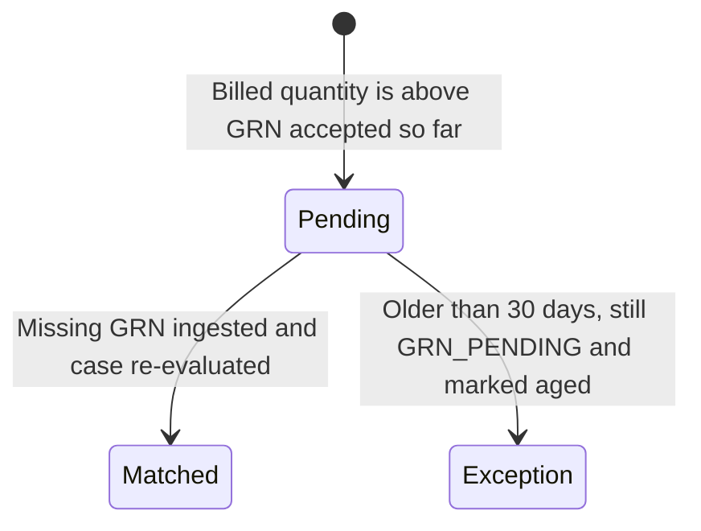

The GRN upload → link → ledger rebuild → re-evaluation chain runs on its own for Pending cases; other cases wait for Re-run *(proposed, OQ-3)*. The 30-day ageing runs from invoice date to run date and is a setting.

#### H. Export to Excel

| # | User | System |
|---|---|---|
| 1 | Clicks **Export Excel**, choosing "current filters" or "all" | `POST /exports` with an `Idempotency-Key`. The filter is stored as JSON and re-applied on the server, so the file always matches the screen |
| 2 | Watches the export | `GET /exports/{id}`. A `build_export` job builds the workbook from stored run results |
| 3 | Downloads | `GET /exports/{id}/download`. Authenticated link that expires after a retention period. A failed build shows *Failed* with a message |

If the run is stale, the app should warn and offer Re-run first *(suggested)*.

| Sheet | Contents | Priority |
|---|---|---|
| Summary | Batch, run time, counts by status, ₹ invoiced / payable / at-risk, engine version, tolerances used, AI on or off | P0 |
| Invoice Recon | One row per invoice with links, amounts, variance, payable, at-risk, status, reason codes, override info, payment due date | P0 |
| Line Recon | One row per invoice line with PO qty, billed before, this qty, GRN accepted (cumulative), balance after, rates and result | P0 |
| Exceptions | Only Exception, Pending, Needs Review and Unlinked, with reason text and suggested action | P0 |
| Vendor Summary | Per vendor: counts, status counts, ₹ invoiced, ₹ at-risk | P0 |
| PO Status · GRNI · Orphans · Audit | Per-PO-line balances, received-not-invoiced, unlinked documents, overrides and manual link changes | P1 |

Formatting: frozen header, filters, ₹ number format, status colours. Variance, total and at-risk columns are **live formulas** with cached values, so Finance can audit them. Text from vendor documents is always written as text and never evaluated as a formula.

**States:** *No run yet* → prompt to run. *Running* → progress bar and live counts. *Stale* → banner with Re-run. *No matches for the filter* → empty table with a clear-filters link *(suggested)*.

---

### 6.6 Document preview (shared)

Preview opens from Ingestion (per file), Mapping (any document row) and Reconciliation (Invoice, PO and GRN side by side).

| Content | How it is shown |
|---|---|
| **PDF** | In-app viewer (pdf.js, scripting disabled) with page navigation and zoom. Loads only the page in view; served with range requests and short-lived signed access |
| **XML / CSV record** | A readable document card (header plus line table) with a **View raw** toggle. Raw view is size-capped and paged |
| **Confidence** | Each extracted field shows its confidence. Fields below the threshold are highlighted |

- Click a value to highlight its source location in the PDF: P2.
- Inline correction of a low-confidence field: P1. It stores a manual value, re-runs linking and evaluation for that component, and remembers the corrected label position for the vendor's layout.

---

### 6.7 Settings

**Entry:** ⚙ at the bottom of the sidebar. Managers only once roles are enforced (P1).

| Section | What it holds |
|---|---|
| **Tolerances and policies** | Selected P0 defaults: invoice qty vs GRN accepted 0 · cumulative qty vs PO 0% over · unit rate ±0.5% or ±INR 1 · invoice total vs expected ±1% or ±INR 10 · arithmetic ±INR 1 · cumulative PO value 0% / INR 0 (strict) · item alignment ≥ 0.80 auto, 0.60–0.80 review · vendor-name fuzzy ≥ 0.92 · link auto-accept ≥ 0.95 · Pending ageing 30 days. Initial `limit_mode=or` (`both` selectable); DATE_ORDER fail by default (`warn` selectable); both payable modes available, initially `pay_at_po_rate`. Per-vendor and per-item overrides resolve item, then vendor, then global |
| **Label synonyms** | Label lists for PO number, GRN reference, invoice number, quantity, totals and so on, seeded from PRD Appendix B |
| **UOM map** | NOS / PCS / EA → NOS, KG / KGS → KG, and optional conversions such as BOX → NOS × n |
| **Buyer entities** | Buyer GSTIN list used by the buyer and tax-type checks |
| **GST slab list** | P0 seed selected from the PRD: 5 / 12 / 18 / 28, with no date boundaries in the initial config |
| **Vendor aliases** | Learned from merges, plus manual entries |
| **Payment-terms defaults** | For example Net 30 / Net 60; feeds the payment due date |
| **Users and roles** | P1 |

Save flow: edit → **Save** (`PUT /config` with `If-Match`) → a new immutable `config_version` is written and becomes active. If someone else saved first, the app gets 409 and shows what changed. Existing cases keep the config snapshot of their run, are marked stale, and pick up the new settings on Re-run. AI settings live on Home, not here.

---

## 7. Cross-cutting flows

### 7.1 Background jobs

Work runs in workers, not in the API. The API writes rows and jobs to the database; workers pick them up (`TRD §3.3`).

| Job | Starts when | What the user notices |
|---|---|---|
| `ingest_file` | A file is uploaded | Row appears as Staged; ZIPs expand into one row per entry |
| `parse_file` | Each source file is processed | Queued → Parsing → Parsed / Partial / Failed |
| `resolve_vendors` | Files are parsed | Vendors appear in Mapping; merge-suggestions banner |
| `link_vendor` | A document or vendor changes | Links and link-health bars refresh |
| `recompute_po` | A link or document changes | Ledger-box numbers change |
| `evaluate_cases` | The user runs, or Pending cases after a new GRN | Run progress; Pending cases flip |
| `build_export` | An export is requested | Export progress, then a download link |
| `ai_hook` | Rules are unsure and AI is on | *AI-suggested* tags |

**Failure behaviour**
- Infrastructure faults retry with backoff. Parse failures fail once with a reason and wait for a manual retry.
- Every job is safe to run twice, so an interrupted run can simply be repeated.
- Two workers never touch the same vendor or PO at once.
- A job is queued in the same transaction as the data it belongs to, so nothing is lost between a write and its follow-up.

### 7.2 What changes what

Ledgers refresh automatically. Case verdicts belong to a run, so most changes mark cases **stale** until Re-run. Staleness is tracked with a sequence number per vendor and per PO; a case records the numbers it used (`TRD §7.3`).

| Event | Updates automatically | Needs the user |
|---|---|---|
| New or changed document ingested | Vendor assignment, links, PO ledgers | Cases on affected vendors go stale; Re-run |
| New GRN ingested | Same, and **Pending** cases re-evaluate themselves *(proposed, OQ-3)* | Re-run for any other affected cases |
| File removed | Documents withdrawn (soft, audited), scopes marked dirty | Affected cases go stale; Re-run |
| Vendor merge or alias change | Vendor counts and link inference for that vendor's unresolved invoices | Cases go stale; Re-run |
| Link confirm, change or unlink | Ledgers of the affected POs | Cases go stale; Re-run |
| Settings change | A new config version becomes active | Cases go stale; Re-run applies it |
| Approve, hold, reject, note | Effective status = latest action over the computed status | Rejected invoices stop consuming PO balance |
| Override inputs change later | — | Override becomes *stale — re-review* (P1) |
| Opening-balance import (P1) | Ledger seed events | Cases go stale; Re-run |

### 7.3 AI assist flow

AI is optional, runs only on the server, and only advises. Code decides every number and every pass or fail.

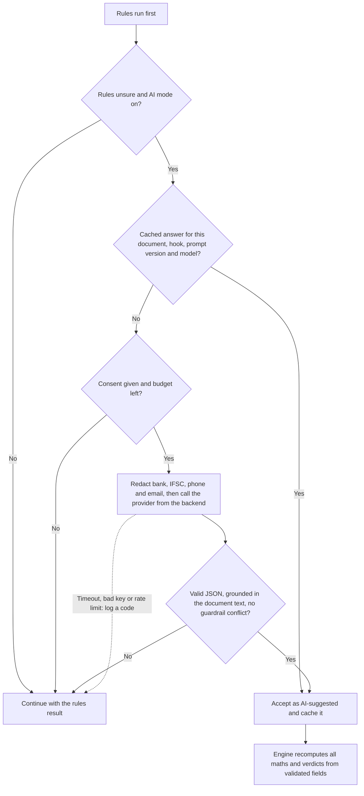

| Hook | Fires when | Returns | What the user sees |
|---|---|---|---|
| **H1** PDF extraction fallback | Critical-field failure or confidence below 0.7 | Values in the canonical schema, each with a source snippet | Fields marked as AI-sourced. Anything not grounded in the text is dropped |
| **H2** Item similarity | Item match in the 0.60–0.80 band | Same, different or unsure, plus a reason | An opinion beside the line. It cannot override a spec-token conflict such as 16GB vs 8GB |
| **H3** PO inference re-rank | Step 3, top 5 candidates | A chosen PO, or abstain | Link tagged *AI-suggested*; case stays Needs Review unless auto-accept above a threshold is enabled |
| **H4** Vendor merge | A fuzzy vendor pair | Same or different | An opinion on the merge suggestion. It cannot override a PAN conflict |
| **H5** Explanations and vendor email drafts | P2 | Text | — |

Any AI failure falls back to rules and is logged with a code. A run never blocks on AI. Turning AI on or off gives identical maths and verdicts (scenario 20).

### 7.4 Errors and edge cases

| Situation | What the user sees | What they can do |
|---|---|---|
| Unsupported format or wrong format for the zone | File rejected at upload with a reason | Convert and re-upload |
| File over 25 MB or 100 pages | Rejected with a reason. The limits are settings | Split the file, or ask a Manager to raise the limit |
| Unsafe ZIP (bad paths, too many entries, extreme compression, nested archive) | Archive rejected with a reason | Re-create the ZIP |
| Document looks like another type | TYPE_MISMATCH with the suggested type | Accept the change or keep the zone |
| Same file uploaded again | Skipped (same SHA-256) | Nothing |
| Parse failure | Failed with a reason; error log available | Retry, replace the file, or continue without it |
| Encrypted PDF (P1) | NeedsPassword | Enter the password (held in memory for one job, never stored) |
| PDF with no text layer (P0) | Flagged; case goes to Needs Review *(NO_TEXT_LAYER, proposed)* | Ask the vendor for a text PDF. OCR arrives in P1 |
| Critical field missing or under 0.7 confidence | LOW_CONFIDENCE; document *Needs verification*; case is Needs Review | Preview it; inline correction is P1 |
| Invoice states no PO | NO_PO_REF at ingestion; ladder tries other evidence | Confirm the suggestion, or pick manually |
| PO cited but not in the pool | "PO not in pool — upload the earlier PO file" | Upload the earlier file, then re-link |
| GRN not uploaded yet | Pending (GRN_PENDING) | Upload the GRN; it flips by itself |
| Earlier months missing | Ledger completeness warning | Upload earlier files; opening-balance import is P1 |
| Duplicate invoice | Duplicate; consumes no PO balance | Keep the original |
| Two people edit the same item | 409 with the current state | Reload and re-apply |
| Session expired | Return to Login; running jobs continue | Sign in again |
| Action not allowed for the role | 403; control disabled with a reason | Ask a Manager |
| AI key wrong, rate limited, or provider down | Status pill shows a code; run continues on rules | Fix the key or budget |
| Export fails | Export shows *Failed* with a message | Retry |
| Page reloaded during a long job | Progress is restored from the job | Nothing |

### 7.5 Concurrency and repeat requests

| Mechanism | Where | What the user notices |
|---|---|---|
| `If-Match` / ETag | Cases, links, vendors, config | A stale write gets 409 and the current state; nothing is silently overwritten |
| `Idempotency-Key` (kept 24 h) | Runs, exports, bulk actions | A double-click or retry returns the first result, not a second run |
| ETag polling | File table, runs, exports | Unchanged answers cost almost nothing |
| Advisory locks | Vendor and PO scopes | Invisible: two workers never work on the same one |

---

## 8. Worked walkthroughs

These follow the examples in PRD Appendix C.

### 8.1 Month-end, happy path (the laptop case)

PO **BM-PO-0142**: Acer India Pvt Ltd, 100 laptops at ₹48,000. GRN-2609-011 accepted 90, GRN-2609-047 accepted 10. Invoices ACR/26-27/2201 (90) and ACR/26-27/2260 (10).

1. **Ingestion:** PO file into the PO zone, both GRNs into the GRN zone, both invoice PDFs into the Invoice zone. Click **Process**. All rows reach *Parsed*.
2. **Mapping:** everything sits under the vendor Acer. Each invoice names its PO on a label, so the ladder links at Step 0 (0.99) and auto-accepts. The user clicks **Confirm all ≥ 0.95**, then **Run reconciliation**.
3. **Reconciliation:** invoice 2201 has 90 billed against 100 ordered and 90 received, so it is **Matched**. Invoice 2260 brings the cumulative total to 100, within both limits, so it is **Matched** too. The PO is fully billed.
4. **Export:** the user clicks **Export Excel** and downloads the workbook.

### 8.2 Variations on invoice 2260

| Change | Case shows | Typical next step |
|---|---|---|
| Bills 15 units | **Exception**: QTY_OVER_PO and QTY_OVER_GRN. Eligible 10; at-risk 5 × ₹48,000 = ₹2,40,000 (+ GST) | Approve with a reason, hold or reject |
| GRN-047 not uploaded | **Pending**: GRN_PENDING | Upload GRN-047; it turns Matched by itself. It ages into an exception after 30 days |
| GRN-047 has 8 accepted, 2 rejected | **Exception**: QTY_OVER_GRN. Payable 8; at-risk 2 × ₹48,000 = ₹96,000 (+ GST) | Ask the vendor for a credit note |
| Rate ₹49,000 | **Exception**: RATE_HIGH (+2.08%). At-risk 10 × ₹1,000 = ₹10,000 (+ GST) | Hold, or pay at PO rate, per policy |

### 8.3 PO number missing on the invoice

1. **Ingestion** flags NO_PO_REF on invoice 2260.
2. **Mapping** runs the ladder. Step 0 finds no label. Step 1 finds no pool PO number in the text. Step 2 finds that GRN-047 records "ACR/26-27/2260", so the invoice links through the GRN to BM-PO-0142 at 0.95 and is auto-accepted.
3. If the GRN is silent too, Step 3 sees that the only open Acer PO is BM-PO-0142, its lines align, quantity is feasible, rate is equal and 10 units are uninvoiced. The score is about 0.94 with no runner-up. The link is **suggested** and the case is **Needs Review**. The user confirms with one click and runs.

### 8.4 A late GRN

1. The user uploads invoice 2260 before GRN-047 and runs. The case is **Pending** (GRN_PENDING).
2. Later the user drops GRN-047 into the GRN zone and clicks **Process**.
3. The system parses it, resolves the vendor, links it to the PO and rebuilds the PO ledger. The Pending case re-evaluates by itself and becomes **Matched** *(proposed, OQ-3)*. Other stale cases still wait for Re-run.

### 8.5 One invoice, two POs

A vendor bills 10 monitors (PO-A) and 5 docks (PO-B) on one invoice. Each line links to its own PO, using a label on the line or inference among the invoice's candidate POs, and runs its own ledger. The case takes the status of its worst line, and the Line Recon sheet lists both POs.

---

## 9. Open items that affect the flow

### 9.1 Open items and recorded decisions in the PRD / TRD

| Ref | Question | Proposed default | Affects |
|---|---|---|---|
| PRD Q8, OQ-7 | Is login required in v1, and with how many roles? | Login required, one role in P0, role matrix in P1 | §3, §6.1 |
| OQ-3 | Should a new GRN re-evaluate Pending cases on its own? | Yes, for Pending only | §6.5 G, §7.2 |
| OQ-5 | How are suspected duplicates treated? | Needs Review with DUP_SUSPECTED; still consumes balance until a person decides | §6.5 C |
| OQ-6 | Does Duplicate or Unlinked value count toward At-risk ₹? | No; show it as separate blocked value | Home KPIs |
| OQ-8 | Approve new reason codes DUP_SUSPECTED, ITEM_UNSURE, NO_TEXT_LAYER | Add all three at level Review | Case status, scanned PDFs in P0 |
| PRD Q4 | Payable policy and tolerances | Resolved (1 Oct 2026): use PRD defaults; support both `hold` and `pay_at_po_rate`, initially `pay_at_po_rate`; `limit_mode=or` initially, with `both` selectable | Payable and at-risk numbers |
| PRD Q9, Q10 | May documents go to an AI provider, and which providers first? | Decided later | AI Assist card |

### 9.2 Gaps found while drawing the flow

| # | Gap | What this document assumes |
|---|---|---|
| 1 | How a first-time vendor is created, and how a user moves a document out of **Unassigned** | Only merging is defined for P0; per-document assignment is not specified |
| 2 | Where the **batch** is chosen or created on Ingestion (the endpoints exist, the interaction is not defined) | An optional batch name on the Ingestion screen, with the label suggested later |
| 3 | Where the **CSV column-mapping confirmation** appears | A dialog opened from the file row |
| 4 | What "complete" means for each step of the **4-step tracker**, so Next step knows where to go | Not defined here; needs a rule from Product |
| 5 | Whether a **link change inside a case** re-evaluates at once or waits for Re-run | Waits for the scoped Re-run; Manual Recon is immediate |
| 6 | Whether KPI cards and status chips act as **click-through filters** into Reconciliation | Recommended, not required |
| 7 | What **Export** does when the run is stale | Warn and offer Re-run first |
| 8 | The TRD names the reason-code endpoint two ways (`/reasoncodes` in §7.2, `/reason-codes` in `TR-API-4`) | Pick one before the client is generated |

---

## Appendix A — Screen-to-API map

| Screen | Endpoints |
|---|---|
| Login | `POST /auth/login`, `POST /auth/logout`, `GET /auth/me` |
| Home | `GET /kpis`, `GET /batches`, `GET /ai/settings`, `PUT /ai/settings`, `POST /ai/test`, `DELETE /ai/key`, `GET /ai/usage` |
| Ingestion | `POST /batches`, `PATCH /batches/{id}`, `POST /files`, `POST /batches/{id}/process`, `GET /files`, `POST /files/{id}/retry`, `DELETE /files/{id}`, `GET /files/{id}/content`, `GET /files/{id}/errors`, `GET /batches/{id}/summary` |
| Mapping | `GET /vendors`, `GET /vendors/{id}`, `GET /vendors/{id}/documents`, `POST /vendors/{id}/merge`, `GET /vendor-merge-suggestions`, `POST /vendor-merge-suggestions/{id}/decision`, `GET /links`, `POST /links`, `PATCH /links/{id}`, `POST /links/bulk-confirm` |
| Reconciliation | `POST /runs`, `GET /runs/{id}`, `GET /cases`, `GET /cases/{id}`, `POST /cases/{id}/actions`, `POST /cases/bulk-actions`, `POST /manual-recon`, `POST /exports`, `GET /exports/{id}`, `GET /exports/{id}/download` |
| Document preview | `GET /documents`, `GET /documents/{id}`, `GET /documents/{id}/raw`, `GET /files/{id}/content` |
| Settings | `GET /config`, `PUT /config`, reason-code catalogue |
| System | `GET /admin/errors`, `GET /healthz`, `GET /readyz` |

All paths sit under `/api/v1`. Mutable resources return an ETag and need `If-Match` on writes; runs, exports and bulk actions take an `Idempotency-Key`. Decimals travel as strings and dates as ISO 8601.

## Appendix B — Reason codes by level

The full messages and suggested actions come from the reason-code catalogue, which the screens and the Excel export share.

| Level | Codes | Case outcome |
|---|---|---|
| **Block** | DUP_INVOICE · NO_PO_LINK (detail PO_NOT_IN_POOL) | Duplicate / Unlinked |
| **Review** | LINK_INFERRED · LOW_CONFIDENCE_DATA · *proposed:* DUP_SUSPECTED · ITEM_UNSURE · NO_TEXT_LAYER | Needs Review |
| **Fail** | VENDOR_MISMATCH · PO_NOT_OPEN · ITEM_NOT_ON_PO · QTY_OVER_PO · QTY_OVER_GRN · RATE_HIGH · TOTAL_MISMATCH · MATH_ERROR · PO_VALUE_EXCEEDED · CURRENCY_DIFF · UOM_MISMATCH · DATE_ORDER (fail by default, configurable to warn) | Exception |
| **Pending** | GRN_PENDING | Pending |
| **Warn** | RATE_LOW · TAX_RATE_DIFF · TAX_TYPE_MISMATCH · HSN_DIFF · GSTIN_INVALID · EXTRA_CHARGE · GRN_OVER_PO | Matched (flags) |
| **Info** | LATE_DELIVERY | No change to status |
