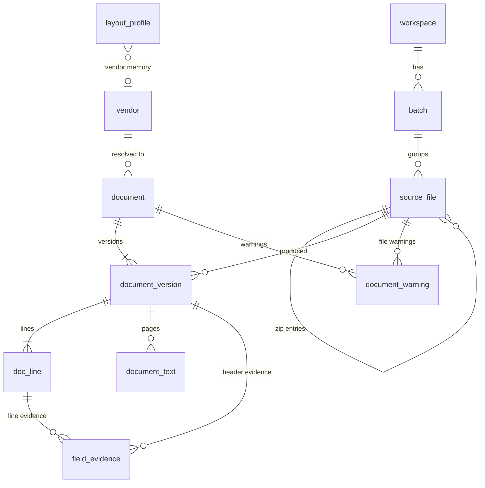
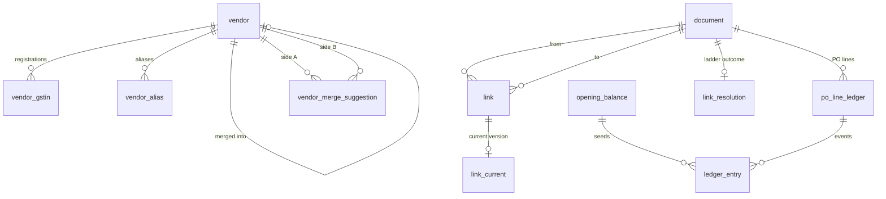
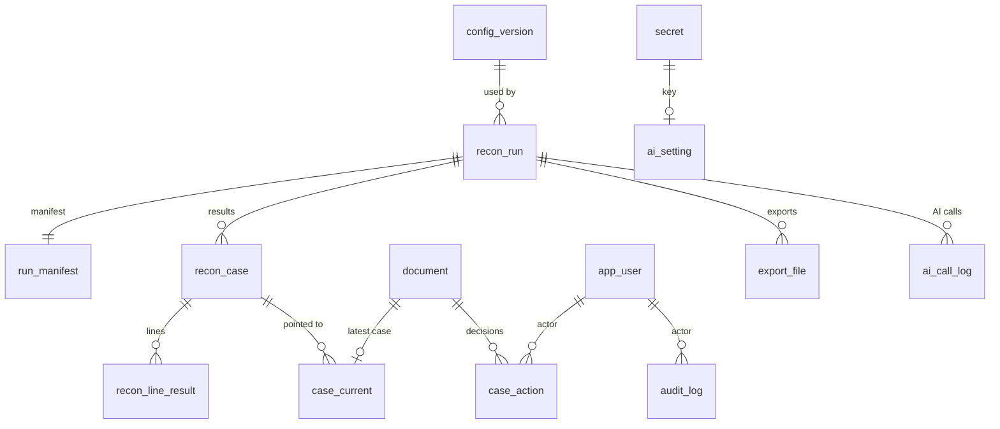

# ReconBench — Backend Schema

**Version** 0.1 (draft) · **Date** 30 Sep 2026 · **Database** PostgreSQL 16+ with `pg_trgm`
**Derived from** PRD v0.1 (§7, §9) · TRD (§3, §5, §6, §7, §9, §11, Appendix A–B) · App Flow v0.1 · UI/UX Design Brief
**Audience** Backend engineers, DBAs, QA, Finance/AP owners

> **Validation status.** The DDL in this file was checked with a script: every table, enum, domain and foreign-key target is declared before it is used, every index and `CHECK` names real columns, enum literals exist, and brackets balance. It has **not** been run against a live PostgreSQL server, because none was available while writing. Run it once, in order, on an empty PostgreSQL 16 database before turning it into Alembic migrations.

---

## 0. How to read this file

| Tag | Meaning |
|---|---|
| **(TRD)** | The table is listed in TRD §6.2. |
| **(added)** | Not listed in TRD §6.2, but another source needs it. The reason is given with the table. |
| **(proposed)** | A design choice made here because the sources are silent or open. Every one is collected in §13 for sign-off. |
| **P0 / P1 / P2** | Phase in which the table is *populated*. All tables are created in P0 so history never needs a backfill (TRD D7, TR-DAT-4). |

Requirement IDs in brackets (`TR-DAT-3`, `ING-6`, `OQ-5`) point back to the PRD, TRD or App Flow.

**Contents**
1. Design rules
2. Schema at a glance (inventory and ER diagrams)
3. Setup: extensions, domains, enums
4. Tables, in dependency order (4.1 Identity · 4.2 Vendors · 4.3 Ingestion · 4.4 Documents · 4.5 Linking and ledger · 4.6 Configuration · 4.7 Reconciliation · 4.8 Review, effective status and audit · 4.9 Export · 4.10 AI · 4.11 Operations)
5. JSONB contracts
6. Canonical field map
7. Views and functions
8. Immutability guards and database roles
9. State machines and invariants
10. Seed data
11. Screen and API to table map
12. Excel sheet to table map
13. Decisions made where the sources are silent, and open items
14. Sizing, partitioning and retention
15. Coverage checklist

---

## 1. Design rules

| Rule | Detail | Source |
|---|---|---|
| Workspace | Every table has `workspace_id` (one fixed value in v1). Unique keys and indexes start with it, so multi-workspace and row-level security arrive without a migration. | TR-DAT-1 |
| Keys | Primary keys are UUIDv7 generated by the application (no database default). No sort or tie-break ever depends on a key; ordering uses business keys. Three narrow exceptions: `audit_log` has a `seq` from a sequence, assigned under a lock, for its hash chain; a few child tables use their parent key plus a natural column; and `vendor_merge_suggestion` orders its two vendor ids only so one pair has one row. | TR-DAT-2 |
| Numbers | Amounts `NUMERIC(18,2)`, rates and quantities `NUMERIC(18,4)`, scores `NUMERIC(5,4)`, tax rates `NUMERIC(5,2)`. No float anywhere. The API sends decimals as strings. | TR-DAT-3, TR-NRM-1 |
| Text stays text | Document numbers, PO numbers, GSTINs and HSN codes are always `TEXT`, so `0142` never becomes `142`. | TRD §2 (row 8) |
| Append-only versions | Documents, links, configuration and runs are immutable rows plus a pointer to the current one. Pointers are the only mutable part. | TR-DAT-4, TR-LNK-1 |
| Derived data | `po_line_ledger`, `ledger_entry`, `link_resolution`, the cache columns on `case_current` and the KPI views can always be rebuilt and are never edited by hand. | TR-DAT-5 |
| Optimistic concurrency | Mutable resources carry `version INTEGER`. It is the ETag; writes need `If-Match`; a stale write returns 409 with the current state. | TR-REV-4, TRD §7.1 |
| Soft delete | Files and documents are withdrawn, not deleted. Only the retention job deletes, and it logs each deletion. | App Flow §6.3, TR-DAT-7 |
| Time | `TIMESTAMPTZ` in UTC for instants, `DATE` for business dates. The engine receives `run_date` as data and never reads a clock. | TR-REC-1 |
| Closed sets vs data | Stable closed sets are PostgreSQL `ENUM` types. Sets Finance edits (reason codes, synonyms, UOM map, slabs) are rows or JSONB. | TRD App B |
| Foreign keys | Reference `id` only. UUIDv7 values are globally unique; workspace consistency is checked in the service layer and by row-level security later. | (proposed) |
| Naming | `snake_case`, singular table names, `*_id` foreign keys, `*_at` timestamps, `*_hash` = lowercase hex SHA-256. | (proposed) |
| Migrations | Alembic, expand-then-contract; backfills run as jobs, never inside a migration transaction. | TR-DAT-6 |

---

## 2. Schema at a glance

### 2.1 Table inventory (41 tables, plus the queue library's own tables)

| # | Table | Kind | Holds | Tag | Phase |
|--:|---|---|---|---|---|
| 1 | `workspace` | primary | The single v1 workspace | TRD | P0 |
| 2 | `app_user` | primary | Users, roles, password hashes | TRD | P0 |
| 3 | `session` | primary | Server-side sessions (token stored as a hash) | TRD | P0 |
| 4 | `rate_limit_event` | log | Login and AI-test attempts, for lockout and rate limits | added | P0 |
| 5 | `vendor` | primary | Canonical vendors; soft `merged_into` pointer | TRD | P0 |
| 6 | `vendor_gstin` | primary | GSTIN registrations per vendor | TRD | P0 |
| 7 | `vendor_merge_suggestion` | primary | Fuzzy vendor pairs awaiting a decision | TRD | P0 |
| 8 | `vendor_alias` | primary | Learned and manual name aliases | TRD | P0 |
| 9 | `batch` | primary | Label and period only; not a silo | TRD | P0 |
| 10 | `source_file` | primary | One upload or ZIP entry | TRD | P0 |
| 11 | `layout_profile` | config | XML profiles, CSV column maps, PDF label memory | TRD | P0 (PDF labels P1) |
| 12 | `document` | identity | One PO, GRN or invoice, plus pointer to current version | TRD | P0 |
| 13 | `document_version` | version | Immutable content of one document version | TRD | P0 |
| 14 | `doc_line` | version child | Lines of one document version | TRD | P0 |
| 15 | `document_text` | child | Page text for reverse lookup, search, AI grounding | TRD | P0 |
| 16 | `field_evidence` | child | Value, confidence, source, page, box, snippet per field | TRD | P0 |
| 17 | `document_warning` | log | Ingestion warnings (`NO_PO_REF`, …) | TRD | P0 |
| 18 | `link` | version | Invoice/GRN → PO, invoice → GRN; immutable versions | TRD | P0 |
| 19 | `link_current` | pointer | Current version of each logical link | added | P0 |
| 20 | `link_resolution` | derived | Ladder outcome, cited refs, top candidates per document | added | P0 |
| 21 | `opening_balance` | primary | Ledger seed from an ERP export | TRD | P1 |
| 22 | `po_line_ledger` | derived | Ordered, received, billed, open per PO line | TRD | P0 |
| 23 | `ledger_entry` | derived | Ledger events behind each PO line (opening, GRN, invoice) | added | P0 |
| 24 | `config_version` | version | Immutable settings snapshots | TRD | P0 |
| 25 | `config_active` | pointer | Which config version is active | added | P0 |
| 26 | `reason_code` | catalogue | Code, level, stage, message, suggested action | added | P0 |
| 27 | `recon_run` | primary | One evaluation run with engine, rules and config identity | TRD | P0 |
| 28 | `run_manifest` | primary | Every input version used by a run, with a hash | added | P0 |
| 29 | `recon_case` | result | Verdict per invoice per run (write-once) | TRD | P0 |
| 30 | `recon_line_result` | result | Result and ledger row per invoice line (write-once) | TRD | P0 |
| 31 | `case_current` | pointer + cache | Latest case per invoice, effective status, staleness | TRD | P0 |
| 32 | `case_action` | event log | Confirm, change, approve, hold, reject, note, release | TRD | P0 |
| 33 | `audit_log` | append-only | Hash-chained audit trail | TRD | P0 (screen P1) |
| 34 | `export_file` | primary | Excel export jobs and their files | TRD | P0 |
| 35 | `secret` | primary | Encrypted AI key material | TRD | P0 |
| 36 | `ai_setting` | primary | AI mode, provider, model, budget, consent | TRD | P0 |
| 37 | `ai_call_log` | log | Hashes and token counts, never document text | TRD | P0 (M3) |
| 38 | `ai_cache` | cache | Validated AI responses, keyed by document hash | added | P0 (M3) |
| 39 | `dirty_scope` | queue | Vendor / PO / invoice scopes waiting for recompute | TRD | P0 |
| 40 | `processing_event` | log | Per-document stage log | TRD | P0 |
| 41 | `idempotency_key` | cache | First result for a repeated `Idempotency-Key`, kept 24 h | added | P0 |

The **job** tables from TRD §6.2 are owned by the queue library (Procrastinate) and created by its own migrations. See §4.11.

### 2.2 Ingestion and documents



### 2.3 Vendors, links and ledger



### 2.4 Reconciliation, review, export and AI



---

## 3. Setup

```sql
CREATE EXTENSION IF NOT EXISTS pg_trgm;          -- trigram pickers (TRD §4, §6.4)

-- Numeric domains (TR-DAT-3) ---------------------------------------------------
CREATE DOMAIN d_amount  AS NUMERIC(18,2);
CREATE DOMAIN d_qty     AS NUMERIC(18,4);        -- quantities and unit rates
CREATE DOMAIN d_score   AS NUMERIC(5,4)  CHECK (VALUE >= 0 AND VALUE <= 1);
CREATE DOMAIN d_taxrate AS NUMERIC(5,2)  CHECK (VALUE >= 0 AND VALUE <= 100);
CREATE DOMAIN d_hash    AS TEXT          CHECK (VALUE ~ '^[0-9a-f]{64}$');   -- hex SHA-256

-- Documents and files ----------------------------------------------------------
CREATE TYPE doc_type          AS ENUM ('po','grn','invoice');
CREATE TYPE upload_zone       AS ENUM ('po','grn','invoice','opening_balance');
CREATE TYPE file_format       AS ENUM ('xml','csv','pdf','zip');
CREATE TYPE file_status       AS ENUM ('staged','queued','parsing','parsed','partial','failed','needs_password','removed');
CREATE TYPE mismatch_state    AS ENUM ('none','suggested','accepted','kept');
CREATE TYPE po_status         AS ENUM ('open','closed','cancelled');
CREATE TYPE line_type         AS ENUM ('goods','charge');
CREATE TYPE field_source      AS ENUM ('rule','ai','manual');
CREATE TYPE extraction_method AS ENUM ('xml_profile','csv_mapping','pdf_text','pdf_ocr','ai_fallback','ai_first','manual','shell');
CREATE TYPE warn_level        AS ENUM ('info','warning','error');

-- Vendors ----------------------------------------------------------------------
CREATE TYPE vendor_rule       AS ENUM ('gstin','pan','name_exact','alias','fuzzy','manual','none');
CREATE TYPE vendor_anchor     AS ENUM ('gstin','pan','name');
CREATE TYPE alias_source      AS ENUM ('merge','manual','learned','seed');
CREATE TYPE suggestion_state  AS ENUM ('pending','accepted','rejected');
CREATE TYPE ai_opinion        AS ENUM ('same','different','unsure');

-- Links ------------------------------------------------------------------------
CREATE TYPE link_type         AS ENUM ('inv_po','grn_po','inv_grn');
CREATE TYPE link_level        AS ENUM ('header','line');
CREATE TYPE link_method       AS ENUM ('labeled','reverse','via_grn','content','manual');   -- ladder steps 0,1,2,3,4
CREATE TYPE link_state        AS ENUM ('auto','suggested','confirmed','rejected');
CREATE TYPE resolution_outcome AS ENUM ('linked','suggested','unlinked');

-- Reconciliation ---------------------------------------------------------------
-- Declared in S7 precedence order: first match wins, and the enum sorts the same way.
CREATE TYPE case_status       AS ENUM ('duplicate','unlinked','needs_review','exception','pending','matched_flags','matched');
CREATE TYPE overlay_type      AS ENUM ('approved','on_hold','rejected');
CREATE TYPE action_type       AS ENUM ('confirm_link','change_link','approve','hold','reject','note','release');
CREATE TYPE reason_level      AS ENUM ('block','review','fail','pending','warn','info');
CREATE TYPE alignment_state   AS ENUM ('aligned','unsure','not_on_po','charge','unlinked');
CREATE TYPE run_status        AS ENUM ('queued','running','succeeded','failed');
CREATE TYPE run_trigger       AS ENUM ('user','auto_pending','manual_recon');

-- Export, AI, access, operations -----------------------------------------------
CREATE TYPE export_status     AS ENUM ('queued','building','ready','failed','expired');
CREATE TYPE ai_mode           AS ENUM ('rules_only','ai_assisted','ai_first');
CREATE TYPE ai_provider       AS ENUM ('claude','openai','gemini');
CREATE TYPE ai_key_storage    AS ENUM ('session','saved');
CREATE TYPE ai_hook           AS ENUM ('h1_extract','h2_item','h3_rerank','h4_vendor','h5_explain');
CREATE TYPE ai_outcome        AS ENUM ('ok','cache_hit','invalid_output','ungrounded','timeout','rate_limited','bad_key','budget_stopped','error');
CREATE TYPE user_role         AS ENUM ('ap_executive','manager','auditor');
CREATE TYPE scope_type        AS ENUM ('vendor','po','invoice');
CREATE TYPE processing_stage  AS ENUM ('received','sniffed','parsed','qa','gated','upserted','vendor_resolved','linked','ledger_updated','evaluated');
CREATE TYPE stage_outcome     AS ENUM ('ok','warn','error','skipped');
```

**Notes**
- `upload_zone` holds the three ING-1 zones plus `opening_balance` for the P1 ERP export (ING-11); the first three match `doc_type` one to one. New document kinds (credit note, service invoice) arrive later with `ALTER TYPE doc_type ADD VALUE` (PRD P2, PRD question 11).
- `case_status` follows the fixed status order in UI/UX Brief §9.1. The default list sort is a different, severity-based order, held in `case_current.severity_rank` (§4.8).
- Reason codes and ingestion warning codes are **not** enums: adding one is a data change, not a schema change (TRD App B).

---

## 4. Tables

Tables appear in dependency order, so the DDL runs top to bottom.

### 4.1 Identity and access

#### `workspace` (TRD)
The single v1 workspace. It exists so every other table can carry `workspace_id` from day one (TR-DAT-1).

```sql
CREATE TABLE workspace (
  id          UUID PRIMARY KEY,
  name        TEXT NOT NULL,
  created_at  TIMESTAMPTZ NOT NULL DEFAULT now()
);
```

#### `app_user` (TRD)
Local accounts with Argon2id hashes (TR-SEC-3). P0 ships one role that holds every capability: create all users as `manager` until the role matrix is switched on in P1 (TR-REV-8, OQ-7).

```sql
CREATE TABLE app_user (
  id             UUID PRIMARY KEY,
  workspace_id   UUID NOT NULL REFERENCES workspace(id),
  email          TEXT NOT NULL,
  display_name   TEXT NOT NULL,
  role           user_role NOT NULL DEFAULT 'manager',
  password_hash  TEXT NOT NULL,                       -- Argon2id
  is_active      BOOLEAN NOT NULL DEFAULT true,
  failed_logins  INTEGER NOT NULL DEFAULT 0,
  locked_until   TIMESTAMPTZ,
  last_login_at  TIMESTAMPTZ,
  created_at     TIMESTAMPTZ NOT NULL DEFAULT now(),
  updated_at     TIMESTAMPTZ NOT NULL DEFAULT now(),
  version        INTEGER NOT NULL DEFAULT 1,
  CONSTRAINT app_user_email_lower CHECK (email = lower(email))
);
CREATE UNIQUE INDEX app_user_email_uq ON app_user (workspace_id, email);
```

#### `session` (TRD)
Server-side sessions. The cookie value is never stored, only its hash. Timeouts (30 min idle, 12 h absolute) are proposed settings (TR-SEC-3).

```sql
CREATE TABLE session (
  id               UUID PRIMARY KEY,
  workspace_id     UUID NOT NULL REFERENCES workspace(id),
  user_id          UUID NOT NULL REFERENCES app_user(id),
  token_hash       d_hash NOT NULL,                   -- SHA-256 of the cookie value
  csrf_hash        d_hash NOT NULL,                   -- SHA-256 of the X-CSRF-Token value
  created_at       TIMESTAMPTZ NOT NULL DEFAULT now(),
  last_seen_at     TIMESTAMPTZ NOT NULL DEFAULT now(),
  idle_expires_at  TIMESTAMPTZ NOT NULL,
  abs_expires_at   TIMESTAMPTZ NOT NULL,
  revoked_at       TIMESTAMPTZ,
  ip               INET,
  user_agent       TEXT
);
CREATE UNIQUE INDEX session_token_uq ON session (token_hash);
CREATE INDEX session_user_ix ON session (user_id) WHERE revoked_at IS NULL;
```

#### `rate_limit_event` (added)
Login and AI-test endpoints are rate limited per user and per address, and login has lockout (TRD §7.1, TR-SEC-3). With no Redis (D4), the counters live in PostgreSQL.

```sql
CREATE TABLE rate_limit_event (
  id            UUID PRIMARY KEY,
  workspace_id  UUID NOT NULL REFERENCES workspace(id),
  kind          TEXT NOT NULL CHECK (kind IN ('login','ai_test')),
  user_id       UUID REFERENCES app_user(id),
  email         TEXT,                                 -- as typed, lower-cased; may match no user
  ip            INET,
  succeeded     BOOLEAN NOT NULL,
  occurred_at   TIMESTAMPTZ NOT NULL DEFAULT now()
);
CREATE INDEX rate_limit_email_ix ON rate_limit_event (workspace_id, kind, email, occurred_at DESC);
CREATE INDEX rate_limit_ip_ix    ON rate_limit_event (workspace_id, kind, ip, occurred_at DESC);
```

### 4.2 Vendors

#### `vendor` (TRD)
Canonical vendors. A merge is soft and reversible: `merged_into` points at the survivor (TR-VEN-4). Keep the chain flat: when A is merged into B, repoint anything that pointed at A to B. `input_seq` is the vendor scope's monotonic sequence used for staleness (TRD §7.3).

```sql
CREATE TABLE vendor (
  id               UUID PRIMARY KEY,
  workspace_id     UUID NOT NULL REFERENCES workspace(id),
  canonical_name   TEXT NOT NULL,
  normalized_name  TEXT NOT NULL,                     -- M/S, PVT, PRIVATE, LTD, LIMITED, LLP and punctuation removed
  pan              TEXT,                              -- GSTIN characters 3–12
  anchor           vendor_anchor NOT NULL,            -- what identifies it: gstin, pan, or name only
  created_by_rule  vendor_rule,                       -- how it first came to exist (proposed)
  merged_into      UUID REFERENCES vendor(id),
  merged_at        TIMESTAMPTZ,
  merged_by        UUID REFERENCES app_user(id),
  input_seq        BIGINT NOT NULL DEFAULT 0,
  created_at       TIMESTAMPTZ NOT NULL DEFAULT now(),
  updated_at       TIMESTAMPTZ NOT NULL DEFAULT now(),
  version          INTEGER NOT NULL DEFAULT 1,
  CONSTRAINT vendor_no_self_merge CHECK (merged_into IS NULL OR merged_into <> id)
);
CREATE INDEX vendor_active_ix ON vendor (workspace_id) WHERE merged_into IS NULL;
CREATE INDEX vendor_pan_ix    ON vendor (workspace_id, pan) WHERE pan IS NOT NULL;
CREATE INDEX vendor_name_trgm ON vendor USING gin (normalized_name gin_trgm_ops);
```

Rules kept in code, not in the database: two different PANs never auto-merge (TR-VEN-2, property test), and only vendors anchored by a GSTIN or PAN can absorb fuzzy matches (TR-VEN-3). The database does not block a manual merge of different PANs, because whether that is allowed is undefined (UI/UX Brief B3).

#### `vendor_gstin` (TRD)
One vendor may hold several GSTIN registrations under the same PAN (PRD §7.3).

```sql
CREATE TABLE vendor_gstin (
  id             UUID PRIMARY KEY,
  workspace_id   UUID NOT NULL REFERENCES workspace(id),
  vendor_id      UUID NOT NULL REFERENCES vendor(id),
  gstin          TEXT NOT NULL,                       -- uppercase, spaces removed
  state_code     TEXT NOT NULL,                       -- characters 1–2
  pan            TEXT NOT NULL,                       -- characters 3–12
  checksum_ok    BOOLEAN NOT NULL,                    -- pattern and checksum passed
  first_seen_at  TIMESTAMPTZ NOT NULL DEFAULT now(),
  UNIQUE (workspace_id, gstin)
);
CREATE INDEX vendor_gstin_vendor_ix ON vendor_gstin (vendor_id);
CREATE INDEX vendor_gstin_pan_ix    ON vendor_gstin (workspace_id, pan);
```

#### `vendor_merge_suggestion` (TRD)
Fuzzy name pairs scoring 0.80 up to 0.92 wait here for a person (TR-VEN-4). A rejected pair stays rejected because the pair is unique. `ai_opinion` is the advisory H4 answer and can never override a PAN conflict (TR-AI-4).

```sql
CREATE TABLE vendor_merge_suggestion (
  id                  UUID PRIMARY KEY,
  workspace_id        UUID NOT NULL REFERENCES workspace(id),
  vendor_a_id         UUID NOT NULL REFERENCES vendor(id),
  vendor_b_id         UUID NOT NULL REFERENCES vendor(id),
  score               d_score NOT NULL,
  state               suggestion_state NOT NULL DEFAULT 'pending',
  ai_opinion          ai_opinion,
  ai_reason           TEXT,
  survivor_vendor_id  UUID REFERENCES vendor(id),     -- set when accepted
  decided_by          UUID REFERENCES app_user(id),
  decided_at          TIMESTAMPTZ,
  created_at          TIMESTAMPTZ NOT NULL DEFAULT now(),
  version             INTEGER NOT NULL DEFAULT 1,
  CONSTRAINT vms_pair_order CHECK (vendor_a_id < vendor_b_id)   -- one row per unordered pair
);
CREATE UNIQUE INDEX vms_pair_uq    ON vendor_merge_suggestion (workspace_id, vendor_a_id, vendor_b_id);
CREATE INDEX        vms_pending_ix ON vendor_merge_suggestion (workspace_id) WHERE state = 'pending';
```

#### `vendor_alias` (TRD)
Learned from merges, plus manual entries. Settings shows where each alias came from, hence `source`, `created_by` and `suggestion_id` (UI/UX Brief §8.8).

```sql
CREATE TABLE vendor_alias (
  id             UUID PRIMARY KEY,
  workspace_id   UUID NOT NULL REFERENCES workspace(id),
  vendor_id      UUID NOT NULL REFERENCES vendor(id),
  alias_raw      TEXT NOT NULL,
  alias_norm     TEXT NOT NULL,
  source         alias_source NOT NULL,
  suggestion_id  UUID REFERENCES vendor_merge_suggestion(id),
  created_by     UUID REFERENCES app_user(id),
  created_at     TIMESTAMPTZ NOT NULL DEFAULT now(),
  UNIQUE (workspace_id, alias_norm)
);
CREATE INDEX vendor_alias_vendor_ix ON vendor_alias (vendor_id);
CREATE INDEX vendor_alias_trgm      ON vendor_alias USING gin (alias_norm gin_trgm_ops);
```

### 4.3 Ingestion

#### `batch` (TRD)
A label and a filter only. A document keeps the batch of its first ingestion, and invoices link to POs and GRNs from any batch (TR-ING-7).

```sql
CREATE TABLE batch (
  id                  UUID PRIMARY KEY,
  workspace_id        UUID NOT NULL REFERENCES workspace(id),
  label               TEXT,                            -- optional at creation
  label_is_suggested  BOOLEAN NOT NULL DEFAULT false,  -- suggested from the month of the most common invoice date
  period_start        DATE,
  period_end          DATE,
  created_by          UUID REFERENCES app_user(id),
  created_at          TIMESTAMPTZ NOT NULL DEFAULT now(),
  updated_at          TIMESTAMPTZ NOT NULL DEFAULT now(),
  version             INTEGER NOT NULL DEFAULT 1,
  CONSTRAINT batch_period_ck CHECK (period_start IS NULL OR period_end IS NULL OR period_end >= period_start)
);
CREATE INDEX batch_recent_ix ON batch (workspace_id, created_at DESC);
```

#### `source_file` (TRD)
One upload or one ZIP entry. Files are unique by SHA-256 (TR-ING-6). Names are display text and never form a path (TR-SEC-9).

```sql
CREATE TABLE source_file (
  id                 UUID PRIMARY KEY,
  workspace_id       UUID NOT NULL REFERENCES workspace(id),
  batch_id           UUID REFERENCES batch(id),
  parent_file_id     UUID REFERENCES source_file(id),   -- ZIP entry → its archive
  sha256             d_hash NOT NULL,
  display_name       TEXT NOT NULL,
  archive_path       TEXT,                              -- path inside the ZIP; display only
  zone               upload_zone NOT NULL,                 -- effective zone; changes if a TYPE_MISMATCH is accepted
  zone_uploaded      upload_zone NOT NULL,                 -- the zone the user dropped it in
  format             file_format NOT NULL,              -- from content sniffing, not the extension
  sniffed_type       doc_type,
  mismatch_state     mismatch_state NOT NULL DEFAULT 'none',
  status             file_status NOT NULL DEFAULT 'staged',
  error_code         TEXT,
  error_message      TEXT,
  attempt_count      INTEGER NOT NULL DEFAULT 0,        -- infrastructure retries, at most 3
  size_bytes         BIGINT NOT NULL,
  page_count         INTEGER,
  object_key         TEXT NOT NULL,                     -- object-store key derived from sha256
  layout_signature   TEXT,
  parser_version     TEXT,
  docs_found         INTEGER NOT NULL DEFAULT 0,
  docs_new           INTEGER NOT NULL DEFAULT 0,
  docs_updated       INTEGER NOT NULL DEFAULT 0,
  docs_skipped       INTEGER NOT NULL DEFAULT 0,
  reupload_skips     INTEGER NOT NULL DEFAULT 0,        -- times identical bytes were uploaded again
  uploaded_by        UUID REFERENCES app_user(id),
  uploaded_at        TIMESTAMPTZ NOT NULL DEFAULT now(),
  queued_at          TIMESTAMPTZ,
  parse_started_at   TIMESTAMPTZ,
  parse_finished_at  TIMESTAMPTZ,
  removed_at         TIMESTAMPTZ,
  removed_by         UUID REFERENCES app_user(id),
  object_purged_at   TIMESTAMPTZ,                       -- set by the retention job
  version            INTEGER NOT NULL DEFAULT 1,
  CONSTRAINT source_file_removed_ck CHECK ((status = 'removed') = (removed_at IS NOT NULL))
);
CREATE UNIQUE INDEX source_file_sha_uq    ON source_file (workspace_id, sha256);
CREATE INDEX        source_file_batch_ix  ON source_file (workspace_id, batch_id, status);
CREATE INDEX        source_file_parent_ix ON source_file (parent_file_id) WHERE parent_file_id IS NOT NULL;
CREATE INDEX        source_file_status_ix ON source_file (workspace_id, status, uploaded_at DESC);
```

Notes
- **Counts for the summary.** `docs_new`, `docs_updated`, `docs_skipped` give the "new / updated / skipped" badge per file (ING-6, UI/UX Brief B7). `reupload_skips` counts identical bytes uploaded again, which the summary reports (UI/UX Brief §8.4).
- **Re-upload after removal (proposed).** Because `sha256` is unique, uploading identical bytes for a removed file reactivates the same row (`status` back to `staged`, `removed_at` cleared) instead of inserting a new one.
- **ZIP parents (proposed).** A ZIP is a row with `format = 'zip'`; its entries point to it through `parent_file_id`. The parent reaches `parsed` when every entry is in a terminal state.
- **CSV needing a column mapping (proposed).** A CSV with unrecognised headers ends `failed` with `error_code = 'CSV_MAPPING_REQUIRED'`. Confirming the mapping writes a `layout_profile` row and retries the file. The sources do not say where this prompt appears (App Flow §9.2, gap 3).

#### `layout_profile` (TRD)
Per layout signature: an XML profile, a CSV column mapping, or PDF label corrections. Profiles are data, not code (TR-PAR-2). Shapes are in §5.6.

```sql
CREATE TABLE layout_profile (
  id            UUID PRIMARY KEY,
  workspace_id  UUID NOT NULL REFERENCES workspace(id),
  signature     TEXT NOT NULL,                        -- hash of the XML tag set / normalised CSV header set / PDF layout
  kind          TEXT NOT NULL CHECK (kind IN ('xml_profile','csv_mapping','pdf_labels')),
  vendor_id     UUID REFERENCES vendor(id),           -- set for per-vendor PDF label memory (P1)
  body          JSONB NOT NULL,
  created_by    UUID REFERENCES app_user(id),
  created_at    TIMESTAMPTZ NOT NULL DEFAULT now(),
  updated_at    TIMESTAMPTZ NOT NULL DEFAULT now(),
  version       INTEGER NOT NULL DEFAULT 1,
  UNIQUE NULLS NOT DISTINCT (workspace_id, signature, kind, vendor_id)
);
```

### 4.4 Documents

Three tables carry the identity/version split from TR-DAT-4: `document` is the stable identity plus a pointer, `document_version` is immutable content, and `doc_line` and the evidence tables hang off a version.

#### `document` (TRD)
Identity of one PO, GRN or invoice. `natural_key` is a hash of type, vendor identity **as read from the document** (GSTIN, else normalised name), canonical document number and date. Using the identity as read, not the resolved vendor, means a later vendor merge cannot create duplicates (TRD §2, row 2). A scanned PDF with no text layer gets a shell document keyed by its file hash (TR-PAR-9).

```sql
CREATE TABLE document (
  id                  UUID PRIMARY KEY,
  workspace_id        UUID NOT NULL REFERENCES workspace(id),
  doc_type            doc_type NOT NULL,
  natural_key         d_hash NOT NULL,
  batch_id            UUID REFERENCES batch(id),        -- batch of first ingestion
  current_version_id  UUID,                              -- pointer; foreign key added below

  vendor_identity     TEXT,                              -- GSTIN, else normalised name, as read

  -- vendor resolution: derived, re-run on merge or alias change (TR-VEN-1)
  vendor_id           UUID REFERENCES vendor(id),        -- NULL = the Unassigned bucket
  vendor_rule         vendor_rule NOT NULL DEFAULT 'none',
  vendor_score        d_score,
  vendor_locked       BOOLEAN NOT NULL DEFAULT false,    -- manual assignment: re-resolution leaves it alone (proposed)
  vendor_resolved_at  TIMESTAMPTZ,

  -- projections of the current version, kept in step with the pointer (proposed)
  doc_no              TEXT,
  canonical_doc_no    TEXT,
  doc_date            DATE,
  grand_total         d_amount,
  needs_verification  BOOLEAN NOT NULL DEFAULT false,

  -- lifecycle
  withdrawn_at        TIMESTAMPTZ,
  withdrawn_by        UUID REFERENCES app_user(id),
  input_seq           BIGINT NOT NULL DEFAULT 0,         -- PO scope sequence; used when doc_type = 'po'
  first_seen_at       TIMESTAMPTZ NOT NULL DEFAULT now(),
  updated_at          TIMESTAMPTZ NOT NULL DEFAULT now(),
  version             INTEGER NOT NULL DEFAULT 1
);
CREATE UNIQUE INDEX document_natural_uq ON document (workspace_id, natural_key);
CREATE INDEX document_vendor_ix ON document (workspace_id, doc_type, vendor_id, doc_date);
CREATE INDEX document_live_ix   ON document (workspace_id, vendor_id, doc_type) WHERE withdrawn_at IS NULL;
CREATE INDEX document_canon_trgm ON document USING gin (canonical_doc_no gin_trgm_ops);
CREATE INDEX document_batch_ix  ON document (batch_id);
```

#### `document_version` (TRD)
Immutable content of one version. A re-ingested document with the same natural key and different content adds a version; identical content is skipped (TR-ING-6). The governing version of a PO is the highest `revision_rank`, then the highest `seq` (§6.3 of the TRD). Every value has a matching `field_evidence` row carrying confidence, source and evidence.

```sql
CREATE TABLE document_version (
  id                            UUID PRIMARY KEY,
  workspace_id                  UUID NOT NULL REFERENCES workspace(id),
  document_id                   UUID NOT NULL REFERENCES document(id),
  seq                           INTEGER NOT NULL,          -- 1, 2, 3 … per document
  revision                      TEXT,                      -- business revision (PO amendments)
  revision_rank                 INTEGER NOT NULL DEFAULT 0,-- parsed ordering of the revision
  content_hash                  d_hash NOT NULL,

  -- header fields (TRD Appendix A)
  doc_no                        TEXT,
  canonical_doc_no              TEXT,
  doc_date                      DATE,
  po_status                     po_status,                 -- PO only; drives PO_NOT_OPEN
  vendor_name                   TEXT,                      -- as printed; a Tally ledger name on POs
  vendor_name_norm              TEXT,
  vendor_gstin                  TEXT,
  vendor_pan                    TEXT,
  vendor_state_code             TEXT,
  buyer_gstin                   TEXT,
  ship_to                       TEXT,
  place_of_supply               TEXT,
  payment_terms_text            TEXT,                      -- as read, e.g. "Net 30"
  payment_terms_days            INTEGER,
  delivery_date                 DATE,
  currency                      CHAR(3) NOT NULL DEFAULT 'INR',
  taxable_total                 d_amount,
  cgst_total                    d_amount,
  sgst_total                    d_amount,
  igst_total                    d_amount,
  round_off                     d_amount,
  grand_total                   d_amount,

  -- linking references (as read, plus canonical forms for lookups)
  po_refs                       TEXT[] NOT NULL DEFAULT '{}',
  canonical_po_refs             TEXT[] NOT NULL DEFAULT '{}',
  grn_refs                      TEXT[] NOT NULL DEFAULT '{}',
  canonical_grn_refs            TEXT[] NOT NULL DEFAULT '{}',
  challan_no                    TEXT,
  canonical_challan_no          TEXT,
  e_way_bill_no                 TEXT,
  irn                           TEXT,                      -- strongest duplicate key
  supplier_invoice_no           TEXT,                      -- GRN: the vendor's invoice / challan number
  canonical_supplier_invoice_no TEXT,

  -- extraction
  extraction_method             extraction_method NOT NULL,
  extraction_conf               d_score,                   -- minimum over critical fields (TR-PAR-6)
  needs_verification            BOOLEAN NOT NULL DEFAULT false,
  verification_reasons          TEXT[] NOT NULL DEFAULT '{}',  -- e.g. NO_TEXT_LAYER, missing:invoice_no, low:grand_total
  extras                        JSONB NOT NULL DEFAULT '{}',   -- unknown tags and columns, never dropped

  -- provenance
  source_file_id                UUID NOT NULL REFERENCES source_file(id),
  locator                       JSONB,                     -- {"xpath":…} | {"rows":[a,b]} | {"pages":[a,b]}
  page_count                    INTEGER,
  parser_version                TEXT NOT NULL,
  layout_signature              TEXT,
  derived_from_version_id       UUID REFERENCES document_version(id),  -- manual correction, P1
  created_by                    UUID REFERENCES app_user(id),          -- NULL when a parser created it
  created_at                    TIMESTAMPTZ NOT NULL DEFAULT now(),
  UNIQUE (document_id, seq)
);
CREATE INDEX document_version_governing_ix ON document_version (document_id, revision_rank DESC, seq DESC);
CREATE INDEX document_version_file_ix      ON document_version (source_file_id);
CREATE INDEX document_version_irn_ix       ON document_version (workspace_id, irn) WHERE irn IS NOT NULL;
CREATE INDEX document_version_po_refs_ix   ON document_version USING gin (canonical_po_refs);

ALTER TABLE document
  ADD CONSTRAINT document_current_version_fk
  FOREIGN KEY (current_version_id) REFERENCES document_version(id)
  DEFERRABLE INITIALLY DEFERRED;
```

Notes
- **Which version is current.** `document.current_version_id` points at the governing version among versions whose `source_file` is not removed. Removing a file therefore moves the pointer back to the latest earlier live version, or withdraws the document when none is left (proposed).
- **PO revision.** `revision` is the text as read; `revision_rank` is its parsed order, so "R10" outranks "R9". Older versions are kept for history (PRD Appendix A, gap 9).
- **Projections.** `document.doc_no`, `canonical_doc_no`, `doc_date`, `grand_total`, `needs_verification` and `vendor_id` support the lists and pickers (TRD §6.4) without joining versions. They are rewritten in the same transaction that moves the pointer.

#### `doc_line` (TRD)
Lines of one document version. Everything is stored as read; the engine derives accepted quantity (accepted, else received minus rejected, else received with a warning) and the net unit rate (amount ÷ quantity, after discount, before tax) (TR-REC-5, TR-REC-8).

```sql
CREATE TABLE doc_line (
  id                   UUID PRIMARY KEY,
  workspace_id         UUID NOT NULL REFERENCES workspace(id),
  document_version_id  UUID NOT NULL REFERENCES document_version(id),
  line_no              INTEGER NOT NULL,
  line_type            line_type NOT NULL DEFAULT 'goods',   -- charge lines skip item and quantity checks
  description          TEXT,
  description_norm     TEXT,                                 -- lower-cased, punctuation stripped
  tokens               TEXT[] NOT NULL DEFAULT '{}',
  spec_tokens          TEXT[] NOT NULL DEFAULT '{}',         -- model no., GB/TB, inch, kW, size, colour: the alignment guard
  item_code            TEXT,
  hsn_sac              TEXT,
  uom                  TEXT,                                 -- canonical unit
  uom_as_read          TEXT,
  quantity             d_qty,
  rate                 d_qty,
  discount             d_amount,
  amount               d_amount,
  tax_rate             d_taxrate,
  cgst_amount          d_amount,
  sgst_amount          d_amount,
  igst_amount          d_amount,
  po_ref               TEXT,                                 -- line-level PO reference, as read
  canonical_po_ref     TEXT,
  po_line_ref          TEXT,                                 -- GRN lines: the PO line they cite
  received_qty         d_qty,
  rejected_qty         d_qty,
  accepted_qty         d_qty,
  extras               JSONB NOT NULL DEFAULT '{}',
  UNIQUE (document_version_id, line_no)
);
```

#### `document_text` (TRD)
Page text for reverse lookup, search and AI grounding (TR-LNK-3, TR-AI-3). The primary key is the parent key plus the page, an intended exception to TR-DAT-2. For XML and CSV records, page 1 holds the flattened record text (proposed). This table is the first candidate for monthly partitioning (TRD §8.3) and is purged by the retention job.

```sql
CREATE TABLE document_text (
  document_version_id  UUID NOT NULL REFERENCES document_version(id),
  page                 INTEGER NOT NULL,
  workspace_id         UUID NOT NULL REFERENCES workspace(id),
  content              TEXT NOT NULL,
  char_count           INTEGER NOT NULL,
  is_ocr               BOOLEAN NOT NULL DEFAULT false,
  created_at           TIMESTAMPTZ NOT NULL DEFAULT now(),
  PRIMARY KEY (document_version_id, page)
);
```

#### `field_evidence` (TRD)
One row per extracted field: value, confidence, source and evidence (page, bounding box, snippet). The box is stored from day one so click-to-highlight (P2) needs no re-parse (TR-PAR-1). It belongs to a header (a version) or to a line, never both. About 0.7 million rows a month (TRD §6.5), so it is the other partitioning candidate. An `ai_call_id` column is added in §4.10.

```sql
CREATE TABLE field_evidence (
  id                   UUID PRIMARY KEY,
  workspace_id         UUID NOT NULL REFERENCES workspace(id),
  document_version_id  UUID REFERENCES document_version(id),
  doc_line_id          UUID REFERENCES doc_line(id),
  field_name           TEXT NOT NULL,                        -- canonical key, e.g. 'invoice_no', 'quantity'
  value_text           TEXT,                                 -- value as text; the typed copy lives on the row
  confidence           d_score NOT NULL,
  source               field_source NOT NULL,
  page                 INTEGER,
  bbox                 JSONB,                                -- {"x0":…,"y0":…,"x1":…,"y1":…,"page_w":…,"page_h":…}
  snippet              TEXT,
  created_at           TIMESTAMPTZ NOT NULL DEFAULT now(),
  CONSTRAINT field_evidence_owner_ck CHECK ((document_version_id IS NOT NULL) <> (doc_line_id IS NOT NULL))
);
CREATE INDEX field_evidence_version_ix ON field_evidence (document_version_id, field_name) WHERE document_version_id IS NOT NULL;
CREATE INDEX field_evidence_line_ix    ON field_evidence (doc_line_id, field_name)         WHERE doc_line_id IS NOT NULL;
```

#### `document_warning` (TRD)
Ingestion warnings. The post-ingestion summary is a query over this table plus document counts, with a jump link per row (TR-ING-8). A warning belongs to a document, or to a file when no document exists (`UNPARSEABLE`, `TYPE_MISMATCH`). `resolved_at` supports the admin view of unresolved warnings (TR-OPS-3).

```sql
CREATE TABLE document_warning (
  id                   UUID PRIMARY KEY,
  workspace_id         UUID NOT NULL REFERENCES workspace(id),
  document_id          UUID REFERENCES document(id),
  document_version_id  UUID REFERENCES document_version(id),
  source_file_id       UUID REFERENCES source_file(id),
  code                 TEXT NOT NULL,                        -- see the code list below
  level                warn_level NOT NULL DEFAULT 'warning',
  message              TEXT NOT NULL,
  detail               JSONB,
  resolved_at          TIMESTAMPTZ,
  resolved_by          UUID REFERENCES app_user(id),
  created_at           TIMESTAMPTZ NOT NULL DEFAULT now(),
  CONSTRAINT document_warning_target_ck CHECK (document_id IS NOT NULL OR source_file_id IS NOT NULL)
);
CREATE INDEX document_warning_doc_ix  ON document_warning (document_id);
CREATE INDEX document_warning_file_ix ON document_warning (source_file_id);
CREATE INDEX document_warning_open_ix ON document_warning (workspace_id, code, created_at DESC) WHERE resolved_at IS NULL;
```

| Warning code | Source | Meaning |
|---|---|---|
| `NO_PO_REF` | TR-ING-8 | No PO reference found on the document |
| `NO_GSTIN` | TR-ING-8 | No GSTIN found |
| `LOW_CONFIDENCE` | TR-ING-8 | A critical field is unreliable |
| `UNPARSEABLE` | TR-ING-8 | The file could not be read |
| `TYPE_MISMATCH` | TR-ING-3 | Content looks like another document type |
| `NO_TEXT_LAYER` | OQ-8, TR-PAR-9 | PDF page has no text; OCR is P1 (proposed code) |
| `UNKNOWN_UOM` | TR-NRM-3 | Unit not in the alias table (proposed code) |
| `ACCEPTED_QTY_ASSUMED` | TR-REC-5 | GRN had no accepted quantity, so received was used (proposed code) |

### 4.5 Linking and ledger

#### `link` (TRD)
Joins an invoice or GRN to a PO, or an invoice to a GRN, at header or line level, and records how (TR-LNK-1). Rows are **never updated**. A change inserts a new row and moves the pointer in `link_current`.

A **logical link** is `(link_type, from_document_id, from_line_no, to_document_id)`. Its versions are numbered by `version_no`. `from_line_no` is NULL for a header link and is the line number for a line-level link (multi-PO invoices, TR-LNK-9). It refers to the line number, not a `doc_line` id, so a link survives a re-ingested document version.

```sql
CREATE TABLE link (
  id                  UUID PRIMARY KEY,
  workspace_id        UUID NOT NULL REFERENCES workspace(id),
  link_type           link_type NOT NULL,
  level               link_level NOT NULL,
  from_document_id    UUID NOT NULL REFERENCES document(id),   -- invoice or GRN
  from_line_no        INTEGER,                                 -- NULL = header level
  to_document_id      UUID NOT NULL REFERENCES document(id),   -- PO, or GRN for inv_grn
  version_no          INTEGER NOT NULL,                        -- 1, 2, 3 … per logical link
  supersedes_link_id  UUID REFERENCES link(id),
  method              link_method NOT NULL,                    -- ladder step 0,1,2,3,4
  confidence          d_score NOT NULL,
  state               link_state NOT NULL,
  ai_suggested        BOOLEAN NOT NULL DEFAULT false,          -- hook H3 chose it; ai_call_id added in §4.10
  evidence_snippet    TEXT,
  evidence_page       INTEGER,
  evidence            JSONB,                                   -- §5.4
  detail_code         TEXT,                                    -- e.g. PO_NOT_IN_POOL
  created_by          UUID REFERENCES app_user(id),            -- NULL when the ladder wrote it
  confirmed_by        UUID REFERENCES app_user(id),
  confirmed_at        TIMESTAMPTZ,
  created_at          TIMESTAMPTZ NOT NULL DEFAULT now(),
  CONSTRAINT link_level_ck     CHECK ((level = 'line') = (from_line_no IS NOT NULL)),
  CONSTRAINT link_not_self_ck  CHECK (from_document_id <> to_document_id),
  CONSTRAINT link_manual_ck    CHECK (method <> 'manual' OR confidence = 1),
  CONSTRAINT link_confirmed_ck CHECK (state <> 'confirmed' OR confirmed_by IS NOT NULL),
  UNIQUE NULLS NOT DISTINCT (workspace_id, link_type, from_document_id, from_line_no, to_document_id, version_no)
);
CREATE INDEX link_to_state_ix ON link (to_document_id, state);
CREATE INDEX link_from_ix     ON link (from_document_id);
```

How the App Flow controls map to rows (proposed where marked):

| Control | Rows written |
|---|---|
| Ladder finds a link | Version 1. `state = auto` when confidence ≥ the auto-accept threshold (default 0.95), else `suggested`. Step 3 and AI re-rank are always `suggested` unless AI auto-accept is on. |
| **Confirm** | New version, same method and confidence, `state = confirmed`, `confirmed_by` set. Keeping method and confidence gives the calibration data (TR-OPS-7). |
| **Unlink** or **Reject** | New version with `state = rejected`. |
| **Change** | Reject the old logical link, and write version 1 of a new logical link with `method = manual`, `confidence = 1`, `state = confirmed`, in one transaction (App Flow §6.4 D). |
| Manual Recon | Manual links as above for the invoice, the PO and each GRN. |

Two rules the database cannot check because they span tables: the document types must fit `link_type` (`inv_po` = invoice → PO, `grn_po` = GRN → PO, `inv_grn` = invoice → GRN), and a `line` link needs a line with that number on the current version. Both are enforced in the service layer and by tests.

#### `link_current` (added)
The pointer required by TR-DAT-4 ("append-only versions with a pointer to the current one"). One row per logical link. Reads of "the links now" go through it.

```sql
CREATE TABLE link_current (
  id                UUID PRIMARY KEY,
  workspace_id      UUID NOT NULL REFERENCES workspace(id),
  link_type         link_type NOT NULL,
  from_document_id  UUID NOT NULL REFERENCES document(id),
  from_line_no      INTEGER,
  to_document_id    UUID NOT NULL REFERENCES document(id),
  current_link_id   UUID NOT NULL REFERENCES link(id),
  updated_at        TIMESTAMPTZ NOT NULL DEFAULT now(),
  UNIQUE NULLS NOT DISTINCT (workspace_id, link_type, from_document_id, from_line_no, to_document_id)
);
CREATE INDEX link_current_to_ix   ON link_current (to_document_id);
CREATE INDEX link_current_from_ix ON link_current (from_document_id);
```

The ETag of a link is `link.version_no` of its current row. `PATCH /links/{id}` runs `SELECT … FROM link_current … FOR UPDATE`, compares `If-Match`, inserts the new version and moves the pointer; a mismatch returns 409 with the current representation (TR-REV-4).

#### `link_resolution` (added, derived)
The outcome of the Anchor Resolution Ladder for one invoice or GRN. It holds what the Mapping screen shows when there is **no** link: the top three candidates with score and reasons, and the "PO not in pool" detail (TR-LNK-10, UI/UX Brief §8.5.2). Rebuilt by the `link_vendor` job.

```sql
CREATE TABLE link_resolution (
  id             UUID PRIMARY KEY,
  workspace_id   UUID NOT NULL REFERENCES workspace(id),
  document_id    UUID NOT NULL REFERENCES document(id),     -- invoice or GRN
  outcome        resolution_outcome NOT NULL,
  resolved_step  SMALLINT CHECK (resolved_step BETWEEN 0 AND 4),
  detail_code    TEXT,                                      -- PO_NOT_IN_POOL, AMBIGUOUS, NO_EVIDENCE
  cited_refs     TEXT[] NOT NULL DEFAULT '{}',              -- PO references read or found, as printed
  candidates     JSONB NOT NULL DEFAULT '[]',               -- top 3 from Step 3, §5.4
  input_hash     d_hash NOT NULL,                           -- idempotency key part: vendor id + input hash
  computed_at    TIMESTAMPTZ NOT NULL DEFAULT now(),
  UNIQUE (workspace_id, document_id)
);
```

#### `opening_balance` (TRD, P1)
Seeds the ledger from an ERP export (PO, line, received to date, billed to date), so the ledger is right when earlier months were never uploaded (ING-11, TR-ING-10). The PO need not be in the pool yet, so rows carry the canonical PO number and `po_document_id` is filled when the PO arrives. The governing row for a PO line is the one with the latest `as_of_date`, then the latest `created_at`, among rows whose file is not removed (proposed).

```sql
CREATE TABLE opening_balance (
  id               UUID PRIMARY KEY,
  workspace_id     UUID NOT NULL REFERENCES workspace(id),
  source_file_id   UUID NOT NULL REFERENCES source_file(id),   -- zone = 'opening_balance'
  row_no           INTEGER NOT NULL,
  vendor_id        UUID REFERENCES vendor(id),
  po_no_raw        TEXT NOT NULL,
  canonical_po_no  TEXT NOT NULL,
  po_line_no       INTEGER NOT NULL,
  po_document_id   UUID REFERENCES document(id),
  received_qty     d_qty NOT NULL DEFAULT 0,
  billed_qty       d_qty NOT NULL DEFAULT 0,
  as_of_date       DATE NOT NULL,
  withdrawn_at     TIMESTAMPTZ,
  created_at       TIMESTAMPTZ NOT NULL DEFAULT now(),
  UNIQUE (source_file_id, row_no)
);
CREATE INDEX opening_balance_po_ix ON opening_balance (workspace_id, canonical_po_no, po_line_no) WHERE withdrawn_at IS NULL;
```

#### `po_line_ledger` (TRD, derived)
Ordered, accepted-received, rejected, billed and open quantity per PO line. Never edited by hand (TR-DAT-5). The `recompute_po` job rebuilds it under an advisory lock on the PO id and writes `input_hash` so a repeated job is a no-op (TRD §3.3). It follows the **governing version** of the PO, so an amendment rebuilds it.

```sql
CREATE TABLE po_line_ledger (
  id                    UUID PRIMARY KEY,
  workspace_id          UUID NOT NULL REFERENCES workspace(id),
  po_document_id        UUID NOT NULL REFERENCES document(id),
  po_version_id         UUID NOT NULL REFERENCES document_version(id),   -- governing version used
  po_line_no            INTEGER NOT NULL,
  po_doc_line_id        UUID NOT NULL REFERENCES doc_line(id),
  uom                   TEXT,
  po_rate               d_qty,
  ordered               d_qty NOT NULL,
  received_accepted     d_qty NOT NULL DEFAULT 0,                        -- includes opening balance
  received_rejected     d_qty NOT NULL DEFAULT 0,
  billed                d_qty NOT NULL DEFAULT 0,                        -- every invoice except Duplicate and Rejected (OQ-1)
  open_qty              NUMERIC(18,4) GENERATED ALWAYS AS (ordered - billed) STORED,   -- negative = over-billed
  grni_qty              NUMERIC(18,4) GENERATED ALWAYS AS (GREATEST(received_accepted - billed, 0)) STORED,
  completeness_warning  BOOLEAN NOT NULL DEFAULT false,                  -- earlier months may be missing (TR-REC-7)
  input_hash            d_hash NOT NULL,
  computed_at           TIMESTAMPTZ NOT NULL DEFAULT now(),
  UNIQUE (workspace_id, po_document_id, po_line_no)
);
CREATE INDEX po_line_ledger_grni_ix ON po_line_ledger (workspace_id, po_document_id) WHERE grni_qty > 0;
```

`open_qty` and `grni_qty` are stored generated columns (plain `NUMERIC(18,4)`, the same scale as `d_qty`) so they cannot drift. GRNI ₹ is `grni_qty × po_rate` (TRD §11.3). How `completeness_warning` is set is open (§13).

#### `ledger_entry` (added, derived)
The events behind each ledger row: the opening balance (a synthetic event, TR-ING-10), each aligned GRN line and each aligned invoice line. It exists for two reasons. First, the GRN-line → PO-line alignment must be stored somewhere, because the ledger sums accepted quantity over GRN lines aligned to the PO line (TR-REC-4). Second, it makes `po_line_ledger` explainable and feeds the chain view (P1) and the PO Status, GRNI and Orphans sheets. Rows are deleted and rebuilt together with their ledger row.

```sql
CREATE TABLE ledger_entry (
  id                  UUID PRIMARY KEY,
  workspace_id        UUID NOT NULL REFERENCES workspace(id),
  po_line_ledger_id   UUID NOT NULL REFERENCES po_line_ledger(id) ON DELETE CASCADE,
  kind                TEXT NOT NULL CHECK (kind IN ('opening','grn','invoice')),
  seq                 INTEGER NOT NULL,                 -- processing order on the PO line
  source_document_id  UUID REFERENCES document(id),
  source_doc_line_id  UUID REFERENCES doc_line(id),
  opening_balance_id  UUID REFERENCES opening_balance(id),
  sort_date           DATE,                             -- invoice date or GRN date
  sort_no             TEXT,                             -- canonical document number
  sort_key            d_hash,                           -- natural key, the last tie-break (TR-REC-2)
  accepted_delta      d_qty NOT NULL DEFAULT 0,
  rejected_delta      d_qty NOT NULL DEFAULT 0,
  billed_delta        d_qty NOT NULL DEFAULT 0,
  consumes            BOOLEAN NOT NULL DEFAULT true,
  excluded_reason     TEXT CHECK (excluded_reason IN ('duplicate','rejected')),
  alignment_score     d_score,
  alignment_state     alignment_state,
  CONSTRAINT ledger_entry_source_ck CHECK (
        (kind = 'opening' AND opening_balance_id IS NOT NULL AND source_doc_line_id IS NULL)
     OR (kind IN ('grn','invoice') AND source_doc_line_id IS NOT NULL AND opening_balance_id IS NULL)),
  CONSTRAINT ledger_entry_consumes_ck CHECK (consumes = (excluded_reason IS NULL)),
  UNIQUE (po_line_ledger_id, seq)
);
CREATE UNIQUE INDEX ledger_entry_line_uq ON ledger_entry (po_line_ledger_id, source_doc_line_id) WHERE source_doc_line_id IS NOT NULL;
CREATE INDEX ledger_entry_doc_ix ON ledger_entry (source_document_id);
```

Rules: `po_line_ledger.received_accepted = Σ accepted_delta`, `received_rejected = Σ rejected_delta`, `billed = Σ billed_delta where consumes`. An invoice entry has `consumes = false` when the invoice is an exact Duplicate or carries a **Rejected** overlay (S4, TR-REC-5). Needs Review and failed invoices still consume (OQ-1). A `reject` or `release` action therefore marks the PO scope dirty, so the ledger is rebuilt (App Flow §7.2).

### 4.6 Configuration

#### `config_version` (TRD)
Immutable settings snapshots (D7). Every change to tolerances, synonyms, the UOM map, buyer entities, the GST slab list, payment terms or weights inserts a new row and moves `config_active`. Shape in §5.1; default content in §10.

```sql
CREATE TABLE config_version (
  id                 UUID PRIMARY KEY,
  workspace_id       UUID NOT NULL REFERENCES workspace(id),
  seq                INTEGER NOT NULL,
  parent_version_id  UUID REFERENCES config_version(id),
  body               JSONB NOT NULL,                  -- {"engine": {...}, "app": {...}}
  engine_hash        d_hash NOT NULL,                 -- SHA-256 of canonical JSON of body.engine; part of rules_hash
  body_hash          d_hash NOT NULL,                 -- SHA-256 of canonical JSON of the whole body
  change_note        TEXT,
  created_by         UUID REFERENCES app_user(id),
  created_at         TIMESTAMPTZ NOT NULL DEFAULT now(),
  UNIQUE (workspace_id, seq)
);
```

#### `config_active` (added)
The "active pointer" of TRD §6.2. `version` is the ETag for `PUT /config`: the write is `UPDATE config_active SET … WHERE workspace_id = $1 AND version = $ifmatch`, and zero rows updated means 409 with what changed (App Flow §6.7).

```sql
CREATE TABLE config_active (
  id                 UUID PRIMARY KEY,
  workspace_id       UUID NOT NULL REFERENCES workspace(id),
  config_version_id  UUID NOT NULL REFERENCES config_version(id),
  activated_by       UUID REFERENCES app_user(id),
  activated_at       TIMESTAMPTZ NOT NULL DEFAULT now(),
  version            INTEGER NOT NULL DEFAULT 1,
  UNIQUE (workspace_id)
);
```

#### `reason_code` (added)
The catalogue served by `GET /reasoncodes` and used by both the screens and the Excel export (TR-API-4, TRD App B). A case's status is a pure function of its reason codes and their levels, so `level`, `stage` and `overridable` are engine inputs and belong in `rules_hash`. `title`, `message` and `suggested_action` are copy and do not. Adding a code is a data change reviewed against the golden set, not a code change.

```sql
CREATE TABLE reason_code (
  id                  UUID PRIMARY KEY,
  workspace_id        UUID NOT NULL REFERENCES workspace(id),
  code                TEXT NOT NULL,
  level               reason_level NOT NULL,
  stage               TEXT NOT NULL CHECK (stage IN ('S1','S2','S3','S4','S5','S6','S7')),
  title               TEXT NOT NULL,                   -- short plain-language chip text (UI/UX Brief §9.5)
  message             TEXT NOT NULL,
  suggested_action    TEXT NOT NULL,
  overridable         BOOLEAN NOT NULL DEFAULT true,
  level_configurable  BOOLEAN NOT NULL DEFAULT false,  -- DATE_ORDER: fail by default, configurable to warn
  is_proposed         BOOLEAN NOT NULL DEFAULT false,  -- OQ-8 additions awaiting approval
  is_active           BOOLEAN NOT NULL DEFAULT true,
  updated_at          TIMESTAMPTZ NOT NULL DEFAULT now(),
  UNIQUE (workspace_id, code),
  CONSTRAINT reason_code_fmt_ck CHECK (code ~ '^[A-Z][A-Z0-9_]+$')
);
```

### 4.7 Reconciliation

#### `recon_run` (TRD)
One evaluation run. It records everything needed to explain and replay it: engine version, rules hash, config version, run date, manifest hash and AI metadata (TR-REC-14, TR-AI-9). `run_date` is an input, used only for Pending ageing, and the engine never reads a clock (TR-REC-1). `version` is bumped as progress changes, so it works as the ETag for the 2-second poll (TRD §7.3).

```sql
CREATE TABLE recon_run (
  id                  UUID PRIMARY KEY,
  workspace_id        UUID NOT NULL REFERENCES workspace(id),
  status              run_status NOT NULL DEFAULT 'queued',
  trigger_kind        run_trigger NOT NULL DEFAULT 'user',
  scope               JSONB NOT NULL,                       -- §5.7
  scope_hash          d_hash NOT NULL,                      -- job idempotency key = run id + scope
  run_date            DATE NOT NULL,
  engine_version      TEXT NOT NULL,
  rules_hash          d_hash NOT NULL,
  config_version_id   UUID NOT NULL REFERENCES config_version(id),
  manifest_hash       d_hash,                               -- set once run_manifest is written
  replay_of_run_id    UUID REFERENCES recon_run(id),        -- P1 replay tooling
  ai_mode             ai_mode NOT NULL DEFAULT 'rules_only',
  ai_provider         ai_provider,
  ai_model            TEXT,
  ai_prompt_versions  JSONB,
  ai_consent          BOOLEAN NOT NULL DEFAULT false,       -- stored with the run (TR-AI-7)
  total_cases         INTEGER NOT NULL DEFAULT 0,
  done_cases          INTEGER NOT NULL DEFAULT 0,
  status_counts       JSONB NOT NULL DEFAULT '{}',          -- live counts by status for the progress bar
  metrics             JSONB NOT NULL DEFAULT '{}',          -- stage durations, straight-through rate, link-method mix, AI cost (TR-OPS-4)
  error_code          TEXT,
  error_message       TEXT,
  job_id              BIGINT,                               -- queue job; no foreign key on purpose (§4.11)
  requested_by        UUID REFERENCES app_user(id),         -- NULL for automatic Pending re-evaluation
  queued_at           TIMESTAMPTZ NOT NULL DEFAULT now(),
  started_at          TIMESTAMPTZ,
  finished_at         TIMESTAMPTZ,
  version             INTEGER NOT NULL DEFAULT 1,
  CONSTRAINT recon_run_ai_consent_ck CHECK (ai_mode = 'rules_only' OR ai_consent),
  CONSTRAINT recon_run_progress_ck   CHECK (done_cases <= total_cases)
);
CREATE INDEX recon_run_recent_ix ON recon_run (workspace_id, queued_at DESC);
CREATE INDEX recon_run_active_ix ON recon_run (workspace_id) WHERE status IN ('queued','running');
```

#### `run_manifest` (added)
Every input version a run used, with a hash: enough to replay it (TR-REC-14, TRD §6.3). It is a table of its own so the large `items` document is not carried on every `recon_run` read. Contents in §5.8.

```sql
CREATE TABLE run_manifest (
  id             UUID PRIMARY KEY,
  workspace_id   UUID NOT NULL REFERENCES workspace(id),
  run_id         UUID NOT NULL UNIQUE REFERENCES recon_run(id),
  manifest_hash  d_hash NOT NULL,
  item_count     INTEGER NOT NULL,
  items          JSONB NOT NULL,
  created_at     TIMESTAMPTZ NOT NULL DEFAULT now()
);
```

#### `recon_case` (TRD)
The verdict for one invoice in one run. **Write-once.** Checks are stored as JSONB on the row, and reason codes are copied into an array with a GIN index for filtering, which avoids millions of tiny rows per run while keeping every check queryable by code (TRD §6.2).

Staleness is computed, not flagged. The case records the `input_seq` of its vendor scope and of every PO scope it used, and is stale when any of them is behind, or when the active config is not the run's config (TRD §7.3, App Flow §7.2). See `v_case_current` in §7.

```sql
CREATE TABLE recon_case (
  id                  UUID PRIMARY KEY,
  workspace_id        UUID NOT NULL REFERENCES workspace(id),
  run_id              UUID NOT NULL REFERENCES recon_run(id),
  invoice_id          UUID NOT NULL REFERENCES document(id),
  invoice_version_id  UUID NOT NULL REFERENCES document_version(id),
  vendor_id           UUID REFERENCES vendor(id),           -- as resolved at run time; NULL if unassigned
  status              case_status NOT NULL,                 -- computed status; overlays live in case_action
  aged                BOOLEAN NOT NULL DEFAULT false,       -- Pending older than the ageing limit; code stays GRN_PENDING
  pending_days        INTEGER,                              -- run_date − invoice date, for the "12 days" label
  duplicate_of_id     UUID REFERENCES document(id),         -- the original, when status = duplicate

  invoice_taxable     d_amount,
  invoice_total       d_amount,
  expected_taxable    d_amount,                             -- Σ billed qty × PO rate + approved charges
  variance            d_amount,
  variance_pct        NUMERIC(9,4),
  payable_taxable     d_amount NOT NULL DEFAULT 0,
  at_risk             d_amount NOT NULL DEFAULT 0,          -- 0 for duplicate and unlinked cases
  at_risk_gst         d_amount NOT NULL DEFAULT 0,          -- shown beside At-risk, not inside it (OQ-4)
  blocked_value       d_amount NOT NULL DEFAULT 0,          -- taxable value of duplicate and unlinked cases (OQ-6)
  payment_due_date    DATE,                                 -- invoice date + PO payment terms

  po_nos              TEXT[] NOT NULL DEFAULT '{}',         -- display copies for the list and the export
  grn_nos             TEXT[] NOT NULL DEFAULT '{}',
  link_summary        JSONB NOT NULL DEFAULT '[]',          -- §5.6
  reason_codes        TEXT[] NOT NULL DEFAULT '{}',
  checks              JSONB NOT NULL DEFAULT '[]',          -- header-level CheckResults, §5.5
  inputs              JSONB NOT NULL,                       -- version ids used, §5.6
  input_fingerprint   d_hash NOT NULL,                      -- stored on overrides for staleness (TR-REV-7)
  vendor_seq          BIGINT,
  po_seqs             JSONB NOT NULL DEFAULT '{}',          -- {"<po_document_id>": input_seq}
  created_at          TIMESTAMPTZ NOT NULL DEFAULT now(),
  UNIQUE (run_id, invoice_id),
  CONSTRAINT recon_case_aged_ck     CHECK (NOT aged OR status = 'exception'),
  CONSTRAINT recon_case_atrisk_ck   CHECK (status NOT IN ('duplicate','unlinked') OR at_risk = 0),
  CONSTRAINT recon_case_blocked_ck  CHECK (status IN ('duplicate','unlinked') OR blocked_value = 0)
);
CREATE INDEX recon_case_run_status_ix ON recon_case (run_id, status);
CREATE INDEX recon_case_reason_gin    ON recon_case USING gin (reason_codes);
CREATE INDEX recon_case_invoice_ix    ON recon_case (invoice_id, created_at DESC);
CREATE INDEX recon_case_vendor_ix     ON recon_case (workspace_id, vendor_id, status);
```

A multi-PO invoice takes the status of its worst line. Read "worst" as the S7 precedence: because `case_status` is declared in precedence order, `recon_case.status = min(recon_line_result.status)` over the invoice's goods lines (proposed reading; §13).

#### `recon_line_result` (TRD)
The result for one invoice line, including the ledger row for the ledger box and the Line Recon sheet. **Write-once.**

```sql
CREATE TABLE recon_line_result (
  id                        UUID PRIMARY KEY,
  workspace_id              UUID NOT NULL REFERENCES workspace(id),
  run_id                    UUID NOT NULL REFERENCES recon_run(id),
  case_id                   UUID NOT NULL REFERENCES recon_case(id),
  invoice_line_id           UUID NOT NULL REFERENCES doc_line(id),
  line_no                   INTEGER NOT NULL,
  line_type                 line_type NOT NULL,
  status                    case_status NOT NULL,             -- this line's own status; the case takes the worst
  -- alignment (S3): never uses quantity or rate
  po_document_id            UUID REFERENCES document(id),
  po_line_no                INTEGER,
  po_doc_line_id            UUID REFERENCES doc_line(id),
  alignment_score           d_score,
  alignment_state           alignment_state NOT NULL,
  ai_item_opinion           ai_opinion,                       -- hook H2, advisory only
  ai_item_reason            TEXT,
  grn_document_ids          UUID[] NOT NULL DEFAULT '{}',
  uom                       TEXT,
  -- ledger row (S4)
  po_qty                    d_qty,
  po_cap                    d_qty,                            -- ordered × (1 + over-tolerance)
  billed_before             d_qty,
  billed_qty                d_qty,
  grn_accepted_cum          d_qty,
  grn_rejected_cum          d_qty,
  eligible_qty              d_qty,
  balance_after             d_qty,                            -- ordered − billed after; negative = over-billed (UI/UX Brief B6)
  shortfall_qty             d_qty,                            -- billed after − GRN cumulative, when positive
  provisional_before_count  INTEGER NOT NULL DEFAULT 0,       -- invoices under review inside "billed before"
  -- price and amount (S5)
  po_rate                   d_qty,
  invoice_net_rate          d_qty,
  rate_var_pct              NUMERIC(9,4),
  payable_rate              d_qty,
  line_taxable              d_amount,
  payable_taxable           d_amount,
  at_risk                   d_amount,
  reason_codes              TEXT[] NOT NULL DEFAULT '{}',
  checks                    JSONB NOT NULL DEFAULT '[]',      -- §5.5
  created_at                TIMESTAMPTZ NOT NULL DEFAULT now(),
  UNIQUE (case_id, line_no)
);
CREATE INDEX recon_line_result_run_ix ON recon_line_result (run_id);
CREATE INDEX recon_line_result_po_ix  ON recon_line_result (po_document_id, po_line_no);
CREATE INDEX recon_line_result_reason_gin ON recon_line_result USING gin (reason_codes);
```

Charge lines skip item and quantity checks: they get `alignment_state = 'charge'` and NULL ledger columns. An unapproved charge shows `EXTRA_CHARGE` with its amount in `checks`.

### 4.8 Review, effective status and audit

Human decisions are events beside the computed result, never edits to it (TR-REV-1). The **effective status** is the computed status overlaid by the latest decision.

#### `case_action` (TRD)
Keyed by invoice, not by run, so a decision survives a re-run. Each row carries the actor, time, reason and a fingerprint of the case inputs (TR-REV-1). `release` clears a hold, approval or rejection; the sources do not define releasing (UI/UX Brief B2), so it is proposed here. Rows are append-only.

```sql
CREATE TABLE case_action (
  id                 UUID PRIMARY KEY,
  workspace_id       UUID NOT NULL REFERENCES workspace(id),
  invoice_id         UUID NOT NULL REFERENCES document(id),
  case_id            UUID REFERENCES recon_case(id),        -- the case the person was looking at
  action             action_type NOT NULL,
  reason             TEXT,
  note               TEXT,
  link_id            UUID REFERENCES link(id),              -- confirm_link / change_link: the link version written
  actor_id           UUID NOT NULL REFERENCES app_user(id),
  actor_role         user_role NOT NULL,                    -- role at the time; roles can change later
  computed_status    case_status,                           -- status when the action was taken
  reason_codes       TEXT[] NOT NULL DEFAULT '{}',          -- snapshot, for calibration (TR-OPS-7)
  input_fingerprint  d_hash,                                -- stored from P0; staleness check is P1 (TR-REV-7)
  bulk_id            UUID,                                  -- groups the items of one bulk action
  occurred_at        TIMESTAMPTZ NOT NULL DEFAULT clock_timestamp(),
  CONSTRAINT case_action_approve_ck CHECK (action <> 'approve' OR length(btrim(coalesce(reason, ''))) > 0),
  CONSTRAINT case_action_note_ck    CHECK (action <> 'note'    OR length(btrim(coalesce(note, ''))) > 0),
  CONSTRAINT case_action_link_ck    CHECK (action NOT IN ('confirm_link','change_link') OR link_id IS NOT NULL),
  CONSTRAINT case_action_print_ck   CHECK (action NOT IN ('approve','hold','reject') OR input_fingerprint IS NOT NULL)
);
CREATE INDEX case_action_invoice_ix ON case_action (invoice_id, occurred_at DESC);
CREATE INDEX case_action_actor_ix   ON case_action (actor_id, occurred_at DESC);
CREATE INDEX case_action_bulk_ix    ON case_action (bulk_id) WHERE bulk_id IS NOT NULL;
```

Approving requires a reason (REV-1, TR-REV-1). Only a Manager may approve an Exception: that is a role check in the service layer (TR-REV-8), and P0 ships one role.

#### `case_current` (TRD)
The pointer from an invoice to its latest case, plus a small cache so the list can filter and sort on the **effective** status without joining actions (TRD §6.4). Every cache column can be rebuilt from `recon_case` and `case_action`. `version` is the ETag of the case resource: it goes up on every new case pointer and on every action (TR-REV-4).

```sql
CREATE TABLE case_current (
  id                UUID PRIMARY KEY,
  workspace_id      UUID NOT NULL REFERENCES workspace(id),
  invoice_id        UUID NOT NULL REFERENCES document(id),
  case_id           UUID NOT NULL REFERENCES recon_case(id),
  run_id            UUID NOT NULL REFERENCES recon_run(id),
  vendor_id         UUID REFERENCES vendor(id),               -- as at the run
  invoice_date      DATE,
  computed_status   case_status NOT NULL,
  overlay           overlay_type,                             -- approved | on_hold | rejected | NULL
  effective_status  TEXT NOT NULL,                            -- overlay if present, else computed status
  severity_rank     SMALLINT NOT NULL,                        -- default list order, from the computed status
  human_touched     BOOLEAN NOT NULL DEFAULT false,           -- any action ever recorded on this invoice
  latest_action_id  UUID REFERENCES case_action(id),
  version           INTEGER NOT NULL DEFAULT 1,
  updated_at        TIMESTAMPTZ NOT NULL DEFAULT now(),
  UNIQUE (workspace_id, invoice_id),
  CONSTRAINT case_current_effective_ck CHECK (effective_status IN
    ('duplicate','unlinked','needs_review','exception','pending','matched_flags','matched','approved','on_hold','rejected'))
);
CREATE INDEX case_current_list_ix   ON case_current (workspace_id, severity_rank, invoice_date, invoice_id);
CREATE INDEX case_current_status_ix ON case_current (workspace_id, effective_status, invoice_date);
CREATE INDEX case_current_vendor_ix ON case_current (workspace_id, vendor_id, effective_status);
CREATE INDEX case_current_run_ix    ON case_current (run_id);
```

Default order (UI/UX Brief §8.6.1, suggested): Exception, Needs Review, Unlinked, Duplicate, Pending, Matched (flags), Matched, then invoice date. The enum order is the S7 precedence, which is different, so the list order is held in `severity_rank`. The trailing `invoice_id` in the list index is only a keyset tie-break, not business ordering.

**Functions and trigger that keep the cache correct**

```sql
CREATE FUNCTION severity_rank(s case_status) RETURNS SMALLINT
LANGUAGE sql IMMUTABLE AS $$
  SELECT CASE s WHEN 'exception'     THEN 1 WHEN 'needs_review' THEN 2 WHEN 'unlinked' THEN 3
                WHEN 'duplicate'     THEN 4 WHEN 'pending'      THEN 5
                WHEN 'matched_flags' THEN 6 WHEN 'matched'      THEN 7 END::SMALLINT
$$;

-- The overlay is decided by the latest approve / hold / reject / release on the invoice.
-- Left VOLATILE on purpose, so the trigger below sees the row it has just inserted.
CREATE FUNCTION case_overlay(p_invoice UUID) RETURNS overlay_type
LANGUAGE sql AS $$
  SELECT CASE a.action WHEN 'approve' THEN 'approved'::overlay_type
                       WHEN 'hold'    THEN 'on_hold'::overlay_type
                       WHEN 'reject'  THEN 'rejected'::overlay_type END      -- release gives NULL
    FROM case_action a
   WHERE a.invoice_id = p_invoice AND a.action IN ('approve','hold','reject','release')
   ORDER BY a.occurred_at DESC
   LIMIT 1
$$;

CREATE FUNCTION case_action_apply() RETURNS trigger LANGUAGE plpgsql AS $$
DECLARE
  v_overlay overlay_type := case_overlay(NEW.invoice_id);
BEGIN
  UPDATE case_current cc
     SET overlay          = v_overlay,
         effective_status = COALESCE(v_overlay::text, cc.computed_status::text),
         human_touched    = true,
         latest_action_id = NEW.id,
         version          = cc.version + 1,
         updated_at       = now()
   WHERE cc.invoice_id = NEW.invoice_id;
  RETURN NULL;
END $$;

CREATE TRIGGER case_action_apply AFTER INSERT ON case_action
  FOR EACH ROW EXECUTE FUNCTION case_action_apply();
```

When a run writes a new case, the worker upserts the pointer in the same transaction as the case rows:

```sql
INSERT INTO case_current AS cc
  (id, workspace_id, invoice_id, case_id, run_id, vendor_id, invoice_date,
   computed_status, overlay, effective_status, severity_rank, human_touched)
SELECT $1, c.workspace_id, c.invoice_id, c.id, c.run_id, c.vendor_id, d.doc_date,
       c.status, o.ov, COALESCE(o.ov::text, c.status::text), severity_rank(c.status),
       EXISTS (SELECT 1 FROM case_action a WHERE a.invoice_id = c.invoice_id)
  FROM recon_case c
  JOIN document d ON d.id = c.invoice_id
 CROSS JOIN LATERAL (SELECT case_overlay(c.invoice_id) AS ov) o
 WHERE c.id = $2
ON CONFLICT (workspace_id, invoice_id) DO UPDATE
   SET case_id = EXCLUDED.case_id,             run_id = EXCLUDED.run_id,
       vendor_id = EXCLUDED.vendor_id,         invoice_date = EXCLUDED.invoice_date,
       computed_status = EXCLUDED.computed_status, overlay = EXCLUDED.overlay,
       effective_status = EXCLUDED.effective_status, severity_rank = EXCLUDED.severity_rank,
       human_touched = EXCLUDED.human_touched,
       version = cc.version + 1, updated_at = now();
```

#### `audit_log` (TRD)
The tamper-evident trail. Append-only, and hash-chained: each row stores the previous row's hash (TR-REV-5, TR-SEC-14). Rows are written from P0 for every case action and every link, vendor, file, config and AI-setting edit; the audit **screen** is P1. `case_action` is the domain event log; `audit_log` is the chained record of the same events plus the ones that are not case events.

The database sets `seq`, `occurred_at`, `prev_hash` and `row_hash` in a `BEFORE INSERT` trigger that holds an advisory lock for the workspace, so the application cannot skip or forge the chain and two writers cannot interleave. The hash input is the fields below joined with `|`, in this order, with NULL written as an empty string and the time as UTC ISO 8601 with microseconds. The verification job (P1) recomputes it the same way and alerts on a break.

```sql
CREATE SEQUENCE audit_log_seq;

CREATE TABLE audit_log (
  id            UUID PRIMARY KEY,
  workspace_id  UUID NOT NULL REFERENCES workspace(id),
  seq           BIGINT NOT NULL,                    -- set by the trigger, under the chain lock
  actor_id      UUID REFERENCES app_user(id),       -- NULL for system jobs such as retention
  actor_role    user_role,
  action        TEXT NOT NULL,                      -- vocabulary below
  target_type   TEXT NOT NULL,                      -- 'case', 'link', 'vendor', 'file', 'config', 'ai_setting', 'export', 'user'
  target_id     UUID,
  before_state  JSONB,
  after_state   JSONB,
  reason        TEXT,
  occurred_at   TIMESTAMPTZ NOT NULL,               -- set by the trigger
  prev_hash     d_hash,                             -- NULL only for a workspace's first row
  row_hash      d_hash NOT NULL,                    -- set by the trigger
  UNIQUE (seq)
);
CREATE INDEX audit_log_chain_ix  ON audit_log (workspace_id, seq DESC);
CREATE INDEX audit_log_target_ix ON audit_log (workspace_id, target_type, target_id, seq DESC);
CREATE INDEX audit_log_actor_ix  ON audit_log (workspace_id, actor_id, seq DESC);

CREATE FUNCTION audit_log_chain() RETURNS trigger LANGUAGE plpgsql AS $$
DECLARE
  v_prev TEXT;
BEGIN
  PERFORM pg_advisory_xact_lock(hashtextextended('reconbench.audit_log.' || NEW.workspace_id::text, 0));
  SELECT a.row_hash INTO v_prev
    FROM audit_log a
   WHERE a.workspace_id = NEW.workspace_id
   ORDER BY a.seq DESC
   LIMIT 1;
  NEW.seq         := nextval('audit_log_seq');
  NEW.occurred_at := clock_timestamp();
  NEW.prev_hash   := v_prev;
  NEW.row_hash    := encode(sha256(convert_to(concat_ws('|',
                       COALESCE(v_prev, ''),
                       NEW.seq::text,
                       NEW.workspace_id::text,
                       COALESCE(NEW.actor_id::text, ''),
                       NEW.action,
                       NEW.target_type,
                       COALESCE(NEW.target_id::text, ''),
                       COALESCE(NEW.before_state::text, ''),
                       COALESCE(NEW.after_state::text, ''),
                       COALESCE(NEW.reason, ''),
                       to_char(NEW.occurred_at AT TIME ZONE 'UTC', 'YYYY-MM-DD"T"HH24:MI:SS.US"Z"')
                     ), 'UTF8')), 'hex');
  RETURN NEW;
END $$;

CREATE TRIGGER audit_log_chain BEFORE INSERT ON audit_log
  FOR EACH ROW EXECUTE FUNCTION audit_log_chain();
```

Proposed `action` vocabulary (a data convention, not an enum): `case.confirm_link`, `case.change_link`, `case.approve`, `case.hold`, `case.reject`, `case.note`, `case.release`, `link.create`, `link.confirm`, `link.reject`, `vendor.merge`, `vendor.suggestion_decide`, `file.remove`, `config.save`, `ai.settings_save`, `ai.key_remove`, `export.create`, `export.download` (P1), `retention.purge`.

### 4.9 Export

#### `export_file` (TRD)
One Excel export. The filter is stored as JSON and re-applied on the server, so "export what I see" cannot drift from the screen (TR-EXP-1). The file lives in the object store behind an authenticated download link and expires after a retention period (a setting).

```sql
CREATE TABLE export_file (
  id                  UUID PRIMARY KEY,
  workspace_id        UUID NOT NULL REFERENCES workspace(id),
  run_id              UUID NOT NULL REFERENCES recon_run(id),   -- anchor run; the job key is run id + filter hash
  included_run_ids    UUID[] NOT NULL DEFAULT '{}',             -- every run the exported cases came from
  filter              JSONB NOT NULL,                           -- §5.9
  filter_hash         d_hash NOT NULL,
  scope               TEXT NOT NULL CHECK (scope IN ('filtered','all')),
  as_of               TIMESTAMPTZ NOT NULL,                     -- when the current case pointers were read
  status              export_status NOT NULL DEFAULT 'queued',
  sheets              TEXT[] NOT NULL DEFAULT '{}',
  case_count          INTEGER,
  object_key          TEXT,
  size_bytes          BIGINT,
  error_code          TEXT,
  error_message       TEXT,
  job_id              BIGINT,
  requested_by        UUID NOT NULL REFERENCES app_user(id),
  created_at          TIMESTAMPTZ NOT NULL DEFAULT now(),
  built_at            TIMESTAMPTZ,
  expires_at          TIMESTAMPTZ,
  last_downloaded_at  TIMESTAMPTZ,
  download_count      INTEGER NOT NULL DEFAULT 0,
  version             INTEGER NOT NULL DEFAULT 1,
  CONSTRAINT export_ready_ck CHECK (status <> 'ready' OR (object_key IS NOT NULL AND expires_at IS NOT NULL))
);
CREATE INDEX export_file_run_ix    ON export_file (run_id, filter_hash);
CREATE INDEX export_file_expiry_ix ON export_file (expires_at) WHERE status = 'ready';
```

There is deliberately no unique key on `(run_id, filter_hash)`: the same filter can be exported again after decisions change the effective status. Double-click safety comes from `idempotency_key` (§4.11).

### 4.10 AI assist

AI is optional, server-side and advisory. Nothing here can change a quantity, total or verdict (TR-AI-4).

#### `secret` (TRD)
Encrypted key material: AES-256-GCM under a master key from the environment or a KMS (TR-AI-6). The API never returns `ciphertext`, only `key_hint`. `key_id` names the master key so a re-encryption job can rotate it (TR-SEC-11). Session-only storage is a record with `expires_at`.

```sql
CREATE TABLE secret (
  id            UUID PRIMARY KEY,
  workspace_id  UUID NOT NULL REFERENCES workspace(id),
  purpose       TEXT NOT NULL CHECK (purpose IN ('ai_api_key')),
  ciphertext    BYTEA NOT NULL,                     -- AES-256-GCM output, auth tag included
  nonce         BYTEA NOT NULL,
  key_id        TEXT NOT NULL,
  key_hint      TEXT,                               -- masked, e.g. '****a3f9'
  expires_at    TIMESTAMPTZ,                        -- set for session-only storage
  created_by    UUID REFERENCES app_user(id),
  created_at    TIMESTAMPTZ NOT NULL DEFAULT now(),
  rotated_at    TIMESTAMPTZ
);
CREATE INDEX secret_expiry_ix ON secret (expires_at) WHERE expires_at IS NOT NULL;
```

#### `ai_setting` (TRD)
The AI Assist card on Home (PRD §7.9, App Flow §6.2). One row per workspace.

```sql
CREATE TABLE ai_setting (
  id                     UUID PRIMARY KEY,
  workspace_id           UUID NOT NULL REFERENCES workspace(id),
  mode                   ai_mode NOT NULL DEFAULT 'rules_only',
  provider               ai_provider,
  model                  TEXT,                          -- a setting, not code (TRD §4)
  budget_cap_usd         NUMERIC(12,4) CHECK (budget_cap_usd IS NULL OR budget_cap_usd >= 0),
  key_storage            ai_key_storage NOT NULL DEFAULT 'session',
  key_secret_id          UUID REFERENCES secret(id),
  consent_given          BOOLEAN NOT NULL DEFAULT false,
  consent_by             UUID REFERENCES app_user(id),
  consent_at             TIMESTAMPTZ,
  consent_text_version   TEXT,                          -- the consent text names the provider
  redaction_enabled      BOOLEAN NOT NULL DEFAULT true, -- bank account, IFSC, phone, email removed before any call
  auto_accept_ai_links   BOOLEAN NOT NULL DEFAULT false,
  auto_accept_threshold  d_score,
  status_code            TEXT NOT NULL DEFAULT 'RULES_ONLY',   -- pill: RULES_ONLY, CONNECTED, or an error code
  last_test_at           TIMESTAMPTZ,
  last_test_ok           BOOLEAN,
  updated_by             UUID REFERENCES app_user(id),
  updated_at             TIMESTAMPTZ NOT NULL DEFAULT now(),
  version                INTEGER NOT NULL DEFAULT 1,
  UNIQUE (workspace_id),
  CONSTRAINT ai_setting_mode_ck CHECK (mode = 'rules_only' OR (consent_given AND provider IS NOT NULL AND model IS NOT NULL)),
  CONSTRAINT ai_setting_auto_ck CHECK (NOT auto_accept_ai_links OR auto_accept_threshold IS NOT NULL)
);
```

`mode_ck` is TR-API-9 in the database: AI-assisted mode cannot be saved without the consent box. The budget unit is not stated in the sources; USD is proposed (§13).

#### `ai_call_log` (TRD)
Hashes and token counts only, never document text (TR-AI-9). `input_hash` is the cache key of the call.

```sql
CREATE TABLE ai_call_log (
  id                   UUID PRIMARY KEY,
  workspace_id         UUID NOT NULL REFERENCES workspace(id),
  run_id               UUID REFERENCES recon_run(id),          -- NULL for hook H1 at parse time
  document_id          UUID REFERENCES document(id),
  document_version_id  UUID REFERENCES document_version(id),
  hook                 ai_hook NOT NULL,
  provider             ai_provider NOT NULL,
  model                TEXT NOT NULL,
  prompt_version       TEXT NOT NULL,
  input_hash           d_hash NOT NULL,
  outcome              ai_outcome NOT NULL,
  error_code           TEXT,
  redacted             BOOLEAN NOT NULL,
  tokens_in            INTEGER,
  tokens_out           INTEGER,
  cost_usd             NUMERIC(12,6),
  latency_ms           INTEGER,
  job_id               BIGINT,
  created_at           TIMESTAMPTZ NOT NULL DEFAULT now()
);
CREATE INDEX ai_call_log_run_ix  ON ai_call_log (run_id) WHERE run_id IS NOT NULL;
CREATE INDEX ai_call_log_doc_ix  ON ai_call_log (document_id);
CREATE INDEX ai_call_log_time_ix ON ai_call_log (workspace_id, created_at DESC);
```

#### `ai_cache` (added)
Validated, grounded responses keyed by document hash, hook, prompt version and model, so a re-run costs nothing (TR-AI-8). Only accepted output is cached. The response can contain short snippets of document text, so this table is purged with the documents by the retention job (§14).

```sql
CREATE TABLE ai_cache (
  id              UUID PRIMARY KEY,
  workspace_id    UUID NOT NULL REFERENCES workspace(id),
  cache_key       d_hash NOT NULL,          -- SHA-256 of document hash + hook + prompt version + model (+ candidate set for H2 to H4)
  hook            ai_hook NOT NULL,
  model           TEXT NOT NULL,
  prompt_version  TEXT NOT NULL,
  document_hash   d_hash,
  response        JSONB NOT NULL,
  hit_count       INTEGER NOT NULL DEFAULT 0,
  created_at      TIMESTAMPTZ NOT NULL DEFAULT now(),
  last_hit_at     TIMESTAMPTZ,
  UNIQUE (workspace_id, cache_key)
);
```

#### Provenance links added after `ai_call_log` exists
Tables created earlier get their AI call reference here, so the DDL above still runs top to bottom.

```sql
ALTER TABLE field_evidence          ADD COLUMN ai_call_id UUID REFERENCES ai_call_log(id);   -- H1 fields
ALTER TABLE link                    ADD COLUMN ai_call_id UUID REFERENCES ai_call_log(id);   -- H3 links
ALTER TABLE vendor_merge_suggestion ADD COLUMN ai_call_id UUID REFERENCES ai_call_log(id);   -- H4 opinions
```

### 4.11 Operations

#### `dirty_scope` (TRD)
The recompute queue. A write marks a scope dirty **in the same transaction**, and workers coalesce dirty scopes into jobs (TRD §3.4). The partial unique index makes repeated marks of one scope collapse into one open row, and the partial index below lets workers find work in constant time (TRD §6.4). `scope_id` is a vendor id, a PO document id or an invoice document id, depending on `scope_kind`.

```sql
CREATE TABLE dirty_scope (
  id               UUID PRIMARY KEY,
  workspace_id     UUID NOT NULL REFERENCES workspace(id),
  scope_kind       scope_type NOT NULL,
  scope_id         UUID NOT NULL,
  reason           TEXT NOT NULL,              -- e.g. 'document_changed', 'vendor_merged', 'link_changed', 'reject'
  mark_count       INTEGER NOT NULL DEFAULT 1,
  first_marked_at  TIMESTAMPTZ NOT NULL DEFAULT now(),
  last_marked_at   TIMESTAMPTZ NOT NULL DEFAULT now(),
  claimed_at       TIMESTAMPTZ,
  processed_at     TIMESTAMPTZ
);
CREATE UNIQUE INDEX dirty_scope_open_uq ON dirty_scope (workspace_id, scope_kind, scope_id) WHERE processed_at IS NULL;
CREATE INDEX        dirty_scope_work_ix ON dirty_scope (workspace_id, first_marked_at)      WHERE processed_at IS NULL;
```

Marking, with coalescing:

```sql
INSERT INTO dirty_scope (id, workspace_id, scope_kind, scope_id, reason)
VALUES ($1, $2, 'po', $3, 'link_changed')
ON CONFLICT (workspace_id, scope_kind, scope_id) WHERE processed_at IS NULL
DO UPDATE SET mark_count = dirty_scope.mark_count + 1, last_marked_at = now();
```

The same transaction also increments `vendor.input_seq` or `document.input_seq` for the scope, which is what makes cases stale (TRD §7.3).

#### `processing_event` (TRD)
The per-document stage log shown on the document detail view (TR-OPS-2), and the source of the error dashboard (TR-OPS-3). Stages before a document exists (`received`, `sniffed`) belong to the file.

```sql
CREATE TABLE processing_event (
  id                   UUID PRIMARY KEY,
  workspace_id         UUID NOT NULL REFERENCES workspace(id),
  source_file_id       UUID REFERENCES source_file(id),
  document_id          UUID REFERENCES document(id),
  document_version_id  UUID REFERENCES document_version(id),
  stage                processing_stage NOT NULL,
  outcome              stage_outcome NOT NULL,
  duration_ms          INTEGER,
  parser_version       TEXT,
  warning_codes        TEXT[] NOT NULL DEFAULT '{}',
  error_code           TEXT,
  job_id               BIGINT,
  detail               JSONB,
  occurred_at          TIMESTAMPTZ NOT NULL DEFAULT now(),
  CONSTRAINT processing_event_target_ck CHECK (source_file_id IS NOT NULL OR document_id IS NOT NULL)
);
CREATE INDEX processing_event_doc_ix  ON processing_event (document_id, occurred_at);
CREATE INDEX processing_event_file_ix ON processing_event (source_file_id, occurred_at);
CREATE INDEX processing_event_err_ix  ON processing_event (workspace_id, occurred_at DESC) WHERE outcome = 'error';
```

#### `idempotency_key` (added)
`Idempotency-Key` on run creation, exports and bulk actions: a repeated key returns the first result for 24 hours (TRD §7.1). Without a table, a double-click would start two runs.

```sql
CREATE TABLE idempotency_key (
  id               UUID PRIMARY KEY,
  workspace_id     UUID NOT NULL REFERENCES workspace(id),
  user_id          UUID NOT NULL REFERENCES app_user(id),
  idem_key         TEXT NOT NULL,
  endpoint         TEXT NOT NULL,               -- method and route template, e.g. 'POST /runs'
  request_hash     d_hash NOT NULL,             -- the same key with a different body is rejected
  response_status  INTEGER,                     -- NULL while the first request is still running
  response_body    JSONB,
  resource_type    TEXT,
  resource_id      UUID,
  created_at       TIMESTAMPTZ NOT NULL DEFAULT now(),
  expires_at       TIMESTAMPTZ NOT NULL,        -- created_at + 24 h
  UNIQUE (workspace_id, user_id, endpoint, idem_key)
);
CREATE INDEX idempotency_key_expiry_ix ON idempotency_key (expires_at);
```

#### Job tables (TRD, owned by the queue library)
The job, retry and periodic-task tables come from the queue library (Procrastinate, provisional until the M2 load test, TRD §4). Install them with the library's own schema command, and do not hand-write them here. `job_id BIGINT` columns in ReconBench tables (`recon_run`, `export_file`, `processing_event`, `ai_call_log`) point at the library's job id **without a foreign key**, so the queue can be swapped behind the `JobQueue` port (D4) without touching this schema. Jobs are enqueued in the same transaction as the rows that need them (TRD §3.5).

| Job | Queue | Idempotency key | Started by |
|---|---|---|---|
| `ingest_file` | ingest | SHA-256 | Upload |
| `parse_file` | parse | file id + parser version | Each source file |
| `resolve_vendors` | mapping | vendor scope + input hash | Files parsed |
| `link_vendor` | mapping | vendor id + input hash | Document or vendor change |
| `recompute_po` | recon | PO id + input hash | Link or document change |
| `evaluate_cases` | recon | run id + scope | User run, or Pending cases after a new GRN |
| `build_export` | export | run id + filter hash | Export request |
| `ai_hook` | ai | document hash + hook + prompt version | Rules unsure and AI on |

---

## 5. JSONB contracts

Every JSONB column has one documented shape. Decimals are strings (no float), ids are UUID strings, dates are ISO 8601, and unknown keys are kept, never dropped. The service layer validates each shape at the boundary. `"<uuid>"` below stands for a UUID string.

### 5.1 `config_version.body`

Two top-level parts. `engine` can change a verdict and is hashed into `rules_hash`. `app` cannot (limits, polling, timeouts) and is excluded, so changing it does not force an engine version bump (proposed, §13). The default content is in §10.2.

| Key | Content |
|---|---|
| `engine.tolerances.limit_mode` | `"or"` (pass when either the % or the absolute limit holds, the looser) or `"both"` (TR-REC-11) |
| `engine.tolerances.<check>` | `{"pct": "0.5", "abs": "1"}` for `qty_vs_grn`, `cum_qty_vs_po`, `unit_rate`, `total_vs_expected`, `arithmetic`, `cum_value_vs_po` |
| `engine.thresholds` | Decimal strings: `extraction_gate`, `link_auto_accept`, `vendor_fuzzy_merge`, `vendor_fuzzy_suggest`, `item_aligned`, `item_review`, `item_single_line_explicit`, `spec_conflict_cap`, `step3_min_score`, `step3_min_lead` |
| `engine.ladder_confidence` | Confidence given to steps 0, 1, 2 and 4: `labeled` (0.99), `reverse` (0.97), `via_grn` (0.95), `manual` (1.00). Step 3 uses its own score (TR-LNK-2 to TR-LNK-6). |
| `engine.weights` | `step3` (six Step 3 weights) and `align` (four item-alignment weights) |
| `engine.policies` | `payable_rate_mode` (`hold` or `pay_at_po_rate`), `date_order_level` (`fail` or `warn`), `pending_ageing_days`, `duplicate.suspect_days`, `duplicate.suspect_edit_distance`, `reverse_lookup.min_canonical_len`, `reverse_lookup.window_runs`, `nonexact_tail_min_digits` |
| `engine.synonyms` | Label synonym groups, one list per canonical field (PRD Appendix B) |
| `engine.uom` | `aliases` (raw → canonical unit) and `conversions` (`[{"item_code": "…", "from": "BOX", "to": "NOS", "factor": "12"}]`) |
| `engine.charge_keywords` | Words that mark a charge line (freight, packing, …), editable (TR-NRM-6) |
| `engine.buyer_entities` | `[{"gstin": "…", "name": "…"}]` |
| `engine.gst_slabs` | Effective-dated: `[{"rate": "5", "from": null, "to": null}]`, chosen by invoice date |
| `engine.payment_terms` | Defaults: `[{"label": "Net 30", "days": 30}]` |
| `engine.overrides` | `vendors` (`[{"vendor_id": "<uuid>", "tolerances": {…}}]`) and `items` (`[{"item_code": "…", "vendor_id": "<uuid> or null", "tolerances": {…}}]`). Resolved item, then vendor, then global (TR-REC-11); a vendor id is followed through `merged_into`. |
| `app.limits` | File size, page and ZIP limits (TR-ING-1, TR-ING-2) |
| `app.ui` | Poll interval, Indian digit grouping in Excel (lakh/crore) |
| `app.retention` | Log, export and document retention days |
| `app.security` | Idle and absolute session timeouts, lockout thresholds |

### 5.2 `layout_profile.body`

XML profile (tag names are illustrative; the real tag set comes from the M0 sample files):

```json
{
  "profile": "tally",
  "record_xpath": "//VOUCHER",
  "fields": { "doc_no": "VOUCHERNUMBER", "doc_date": "DATE", "vendor_name": "PARTYLEDGERNAME",
              "grand_total": "VOUCHERTOTAL", "po_refs": "BASICPURCHASEORDERNO" },
  "line_xpath": "ALLINVENTORYENTRIES.LIST",
  "line_fields": { "description": "STOCKITEMNAME", "quantity": "BILLEDQTY", "rate": "RATE", "amount": "AMOUNT" }
}
```

CSV mapping (one file layout; values are canonical keys):

```json
{
  "delimiter": ",", "encoding": "utf-8", "header_row": 1,
  "one_row_per_line": true, "group_by": ["doc_no"],
  "columns": { "PO No": "doc_no", "Party": "vendor_name", "Qty": "quantity", "Rate": "rate" }
}
```

PDF label memory (P1), per vendor layout:

```json
{ "corrections": [ { "field": "grn_refs", "label": "MRN No", "page": 1,
                     "bbox": { "x0": 72.0, "y0": 540.2, "x1": 210.5, "y1": 552.0, "page_w": 595.0, "page_h": 842.0 } } ] }
```

### 5.3 Evidence and provenance

| Column | Shape |
|---|---|
| `field_evidence.bbox` | `{"x0": 72.0, "y0": 540.2, "x1": 210.5, "y1": 552.0, "page_w": 595.0, "page_h": 842.0}` in PDF points; NULL for XML and CSV |
| `document_version.locator` | One of `{"xpath": "/ENVELOPE/…/VOUCHER[3]"}`, `{"rows": [12, 15]}`, `{"pages": [2, 3]}` |
| `document_version.extras`, `doc_line.extras` | `{"<original tag or column>": "<value as text>"}` |
| `document_warning.detail` | Code-specific, e.g. `{"sniffed_type": "invoice", "zone": "po"}` for `TYPE_MISMATCH` |

### 5.4 Link evidence and candidates

`link.evidence`, for the ladder steps that read or found a reference:

```json
{ "step": 0, "field": "po_refs", "label": "PO No", "printed": "PO No. 0142", "canonical": "0142", "page": 1 }
```

`link_resolution.candidates`, the top three from Step 3 (what the Unlinked pick list shows):

```json
[ { "po_document_id": "<uuid>", "po_no": "PO-0142", "score": "0.9100",
    "parts": { "line_coverage": "1.0000", "qty_feasible": "0.9000", "rate_agree": "0.9500",
               "date_ok": "1.0000", "grn_support": "0.7000", "buyer_match": "1.0000" },
    "reasons": ["All 12 lines matched", "Rates within 0.5%"] } ]
```

### 5.5 `checks` (case and line results)

A list of `CheckResult` objects, one per check that ran (TR-REC-10). A passing check has `code` and `level` null. Every check has a stable id and a version, and adding a check never changes another check's output.

```json
{
  "check_id": "rate_vs_po", "check_version": 1,
  "code": "RATE_HIGH", "level": "fail", "result": "fail",
  "expected": "48000.0000", "actual": "50400.0000",
  "variance": "2400.0000", "variance_pct": "5.0000",
  "tolerance": { "pct": "0.5", "abs": "1", "mode": "or", "source": "global" },
  "evidence": { "invoice_line_no": 3, "po_line_no": 3 }
}
```

`result` is one of `pass`, `info`, `warn`, `pending`, `review`, `fail`, `block`. `tolerance.source` is `item`, `vendor` or `global`.

### 5.6 `recon_case` support columns

```json
// inputs: the exact versions this verdict used (trace to source, TR-REV-5; feeds the fingerprint)
{ "invoice_version_id": "<uuid>", "po_version_ids": ["<uuid>"], "grn_version_ids": ["<uuid>"],
  "link_ids": ["<uuid>"], "peer_invoice_version_ids": ["<uuid>"],
  "opening_balance_ids": [], "excluded_invoice_ids": [] }

// link_summary: what the list and the export show, frozen with the case
[ { "link_id": "<uuid>", "po_document_id": "<uuid>", "po_no": "PO-0142",
    "method": "labeled", "confidence": "0.9900", "state": "auto", "grn_nos": ["GRN-011"] } ]

// po_seqs: input_seq of each PO scope at run time
{ "<po_document_id>": 17 }
```

`peer_invoice_version_ids` are the other invoices on the same PO lines that entered `billed_before`; they are inputs too, because a case's verdict depends on them.

### 5.7 `recon_run` support columns

```json
// scope
{ "kind": "all" }
{ "kind": "vendors",  "vendor_ids": ["<uuid>"] }
{ "kind": "invoices", "invoice_ids": ["<uuid>"] }

// status_counts (live, drives the progress bar)
{ "matched": 340, "matched_flags": 41, "needs_review": 22, "exception": 12, "pending": 9, "unlinked": 5, "duplicate": 2 }

// metrics (TR-OPS-4)
{ "stage_ms": { "s1": 810, "s3": 4200, "s4": 9100 }, "straight_through_pct": "71.20",
  "link_methods": { "labeled": 310, "reverse": 40, "via_grn": 12, "content": 9, "manual": 3 },
  "ai": { "calls": 0, "cost_usd": "0.000000" } }
```

### 5.8 `run_manifest.items`

Arrays are sorted, so the hash is stable. `manifest_hash` is SHA-256 of the canonical JSON (sorted keys, no whitespace) of this object.

```json
{
  "engine_version": "<version>", "rules_hash": "<hex>", "config_version_id": "<uuid>", "run_date": "2026-09-30",
  "documents": [ { "version_id": "<uuid>", "vendor_id": "<uuid or null>" } ],
  "links": ["<uuid>"],
  "opening_balances": ["<uuid>"],
  "rejected_invoices": ["<uuid>"]
}
```

`vendor_id` is recorded beside each document version because vendor resolution is derived and can change later. `rejected_invoices` is there because a Rejected overlay changes ledger consumption but is not a document or link.

### 5.9 `export_file.filter`

Applied server-side to the same query as the screen (TR-EXP-1). `statuses` are **effective** statuses.

```json
{ "scope": "filtered", "vendor_ids": ["<uuid>"], "statuses": ["exception", "needs_review"],
  "invoice_date": { "from": "2026-09-01", "to": "2026-09-30" },
  "reason_codes": ["RATE_HIGH"], "search": "", "sort": { "by": "severity", "dir": "asc" } }
```

---

## 6. Canonical field map

Canonical keys are the vocabulary of the API, of `field_evidence.field_name`, and of layout profiles. This table maps them to columns. It follows TRD Appendix A. The PRD uses a few different key names (`po_number`, `vendor`, `unit_price`); the TRD asks for the *All Fields Reference* sheet to be reconciled in M0, and that sheet was not among the uploaded files. Until then the TRD names are used.

**Header fields** (on `document_version`, except `doc_type`)

| Canonical key | Applies to | Column(s) | Notes |
|---|---|---|---|
| `doc_type` | All | `document.doc_type` | |
| `doc_no` | All | `doc_no`, `canonical_doc_no` | PRD key `po_number` on a PO |
| `doc_date` | All | `doc_date` | |
| `revision` | PO | `revision`, `revision_rank` | Latest revision governs the ledger |
| `status` | PO | `po_status` | open / closed / cancelled; drives `PO_NOT_OPEN` |
| `vendor_name` | All | `vendor_name`, `vendor_name_norm` | PRD key `vendor`. On a Tally PO this is a ledger name, resolved through `vendor_alias` |
| `vendor_gstin` | All | `vendor_gstin`, `vendor_pan`, `vendor_state_code` | PAN and state code are derived |
| `buyer_gstin` | PO, invoice | `buyer_gstin` | |
| `ship_to` | PO | `ship_to` | |
| `payment_terms` | PO | `payment_terms_text`, `payment_terms_days` | Feeds the payment due date |
| `delivery_date` | PO | `delivery_date` | Feeds `LATE_DELIVERY` |
| `po_refs` | Invoice, GRN | `po_refs`, `canonical_po_refs` | Header-level references |
| `grn_refs` | Invoice | `grn_refs`, `canonical_grn_refs` | |
| `challan_no` | Invoice, GRN | `challan_no`, `canonical_challan_no` | |
| `e_way_bill_no` | Invoice | `e_way_bill_no` | |
| `irn` | Invoice | `irn` | Strongest duplicate key |
| `supplier_invoice_no` | GRN | `supplier_invoice_no`, `canonical_supplier_invoice_no` | Lets ladder step 2 link a GRN to an invoice |
| `place_of_supply` | Invoice | `place_of_supply` | |
| `currency` | All | `currency` | ISO 4217; must match across documents |
| `taxable_total` | Invoice, PO | `taxable_total` | |
| `cgst`, `sgst`, `igst` | Invoice, PO | `cgst_total`, `sgst_total`, `igst_total` | |
| `round_off` | Invoice, PO | `round_off` | |
| `grand_total` | Invoice, PO | `grand_total` | |
| `extras` | All | `extras` | Unknown tags and columns, never dropped |

**Line fields** (on `doc_line`)

| Canonical key | Applies to | Column(s) | Notes |
|---|---|---|---|
| `line_no`, `line_type` | All | `line_no`, `line_type` | `charge` lines skip item and quantity checks |
| `description` | All | `description`, `description_norm`, `tokens`, `spec_tokens` | Spec tokens guard item alignment |
| `item_code`, `hsn_sac` | All | `item_code`, `hsn_sac` | New on PO and GRN lines |
| `uom` | All | `uom`, `uom_as_read` | Canonical unit through the alias table |
| `quantity` | All | `quantity` | On a GRN with no accepted quantity it is treated as received (PRD Appendix A, gap 6) |
| `received_qty`, `rejected_qty`, `accepted_qty` | GRN | same names | Accepted, else received − rejected, else received with a warning |
| `rate` | PO, invoice | `rate` | PRD key `unit_price`. The net unit rate is derived, not stored |
| `discount`, `amount` | PO, invoice | `discount`, `amount` | |
| `tax_rate` and tax amounts | PO, invoice | `tax_rate`, `cgst_amount`, `sgst_amount`, `igst_amount` | Checked against the effective-dated slab list |
| `po_ref`, `po_line_ref` | Invoice lines, GRN lines | `po_ref`, `canonical_po_ref`, `po_line_ref` | Line-level references support multi-PO invoices |

Every key above also has a `field_evidence` row per extracted value, with confidence, source (`rule`, `ai`, `manual`) and evidence.

---

## 7. Views and functions

These are the shared definitions the TRD asks for: KPI numbers come from one place, so the Home cards and the Excel Summary sheet agree (TRD §11.3).

```sql
-- One row per invoice: the current case with its effective status and its staleness.
CREATE VIEW v_case_current AS
SELECT cc.id AS case_current_id, cc.workspace_id, cc.invoice_id, cc.case_id, cc.run_id,
       cc.vendor_id, COALESCE(vn.merged_into, vn.id) AS effective_vendor_id,
       cc.invoice_date, cc.computed_status, cc.overlay, cc.effective_status,
       cc.severity_rank, cc.human_touched, cc.latest_action_id, cc.version,
       c.aged, c.pending_days, c.reason_codes, c.po_nos, c.grn_nos,
       c.invoice_taxable, c.invoice_total, c.expected_taxable, c.variance, c.variance_pct,
       c.payable_taxable, c.at_risk, c.at_risk_gst, c.blocked_value, c.payment_due_date,
       ( (vn.id IS NOT NULL AND vn.input_seq > c.vendor_seq)
         OR EXISTS (SELECT 1
                      FROM jsonb_each_text(c.po_seqs) AS s(po_id, seq)
                      JOIN document p ON p.id = s.po_id::uuid
                     WHERE p.input_seq > s.seq::bigint)
         OR r.config_version_id IS DISTINCT FROM ca.config_version_id ) AS is_stale
  FROM case_current cc
  JOIN recon_case c        ON c.id = cc.case_id
  JOIN recon_run r         ON r.id = c.run_id
  LEFT JOIN vendor vn      ON vn.id = c.vendor_id
  LEFT JOIN config_active ca ON ca.workspace_id = cc.workspace_id;

-- Mapping screen: per-vendor counts and link health. The Unassigned bucket is vendor_id NULL.
CREATE VIEW v_vendor_link_health AS
WITH live AS (
  SELECT d.id, d.workspace_id, d.doc_type, COALESCE(v.merged_into, v.id) AS vendor_id
    FROM document d
    LEFT JOIN vendor v ON v.id = d.vendor_id
   WHERE d.withdrawn_at IS NULL
),
src AS (      -- one row per invoice or GRN: does it have a firm or a suggested PO link?
  SELECT lk.from_document_id AS document_id,
         bool_or(lk.state IN ('auto','confirmed')) AS has_firm,
         bool_or(lk.state = 'suggested')           AS has_suggested
    FROM link_current lc
    JOIN link lk ON lk.id = lc.current_link_id
   WHERE lk.link_type IN ('inv_po','grn_po')
   GROUP BY lk.from_document_id
),
po_used AS (  -- POs that at least one invoice or GRN points at
  SELECT DISTINCT lk.to_document_id AS po_id
    FROM link_current lc
    JOIN link lk ON lk.id = lc.current_link_id
   WHERE lk.link_type IN ('inv_po','grn_po') AND lk.state <> 'rejected'
)
SELECT l.workspace_id, l.vendor_id,
       count(*) FILTER (WHERE l.doc_type = 'po')      AS po_count,
       count(*) FILTER (WHERE l.doc_type = 'grn')     AS grn_count,
       count(*) FILTER (WHERE l.doc_type = 'invoice') AS invoice_count,
       count(*) FILTER (WHERE l.doc_type IN ('invoice','grn') AND COALESCE(s.has_firm, false)) AS linked_count,
       count(*) FILTER (WHERE l.doc_type IN ('invoice','grn') AND NOT COALESCE(s.has_firm, false)
                                                              AND COALESCE(s.has_suggested, false)) AS suggested_count,
       count(*) FILTER (WHERE l.doc_type IN ('invoice','grn') AND NOT COALESCE(s.has_firm, false)
                                                              AND NOT COALESCE(s.has_suggested, false)) AS unlinked_count,
       count(*) FILTER (WHERE l.doc_type = 'po' AND u.po_id IS NULL) AS orphan_count
  FROM live l
  LEFT JOIN src s     ON s.document_id = l.id
  LEFT JOIN po_used u ON u.po_id = l.id
 GROUP BY l.workspace_id, l.vendor_id;

-- GRNI now: accepted but not yet billed, at PO rate (TRD §11.3). Not filtered by period.
CREATE VIEW v_grni_now AS
SELECT g.workspace_id, g.po_document_id, g.po_line_no, d.vendor_id,
       g.grni_qty, g.po_rate, round(g.grni_qty * g.po_rate, 2) AS grni_value
  FROM po_line_ledger g
  JOIN document d ON d.id = g.po_document_id
 WHERE d.withdrawn_at IS NULL AND g.grni_qty > 0;

-- Excel Summary sheet and run history: counts and rupee totals per run.
CREATE VIEW v_run_summary AS
SELECT r.id AS run_id, r.workspace_id, r.status, r.finished_at, r.engine_version, r.rules_hash,
       r.config_version_id, r.ai_mode, r.ai_provider, r.ai_model,
       count(c.id)                                              AS invoices,
       count(*) FILTER (WHERE c.status = 'duplicate')           AS duplicate,
       count(*) FILTER (WHERE c.status = 'unlinked')            AS unlinked,
       count(*) FILTER (WHERE c.status = 'needs_review')        AS needs_review,
       count(*) FILTER (WHERE c.status = 'exception')           AS exception,
       count(*) FILTER (WHERE c.status = 'pending')             AS pending,
       count(*) FILTER (WHERE c.status = 'matched_flags')       AS matched_flags,
       count(*) FILTER (WHERE c.status = 'matched')             AS matched,
       COALESCE(sum(c.invoice_taxable), 0)  AS invoiced_taxable,
       COALESCE(sum(c.payable_taxable), 0)  AS payable_taxable,
       COALESCE(sum(c.at_risk), 0)          AS at_risk,
       COALESCE(sum(c.at_risk_gst), 0)      AS at_risk_gst,
       COALESCE(sum(c.blocked_value), 0)    AS blocked_value
  FROM recon_run r
  LEFT JOIN recon_case c ON c.run_id = r.id
 GROUP BY r.id;

-- Home KPI cards for an invoice-date period. Effective status throughout (TRD §11.3).
CREATE FUNCTION kpi_summary(p_workspace UUID, p_from DATE, p_to DATE)
RETURNS TABLE (invoice_count BIGINT, matched_pct NUMERIC, straight_through_pct NUMERIC,
               pending_count BIGINT, exception_count BIGINT, unlinked_count BIGINT,
               at_risk_total NUMERIC, at_risk_gst_total NUMERIC, blocked_total NUMERIC, grni_total NUMERIC)
LANGUAGE sql STABLE AS $$
  WITH c AS (
    SELECT * FROM v_case_current
     WHERE workspace_id = p_workspace AND invoice_date BETWEEN p_from AND p_to
  )
  SELECT count(*),
         round(100.0 * count(*) FILTER (WHERE effective_status IN ('matched','matched_flags')) / NULLIF(count(*), 0), 2),
         round(100.0 * count(*) FILTER (WHERE computed_status = 'matched' AND NOT human_touched) / NULLIF(count(*), 0), 2),
         count(*) FILTER (WHERE effective_status = 'pending'),
         count(*) FILTER (WHERE effective_status = 'exception'),
         count(*) FILTER (WHERE effective_status = 'unlinked'),
         COALESCE(sum(at_risk), 0),
         COALESCE(sum(at_risk_gst), 0),
         COALESCE(sum(blocked_value), 0),
         (SELECT COALESCE(sum(g.grni_value), 0) FROM v_grni_now g WHERE g.workspace_id = p_workspace)
    FROM c
$$;
```

How the pieces line up with the KPI definitions (TRD §11.3):

| KPI | Definition here |
|---|---|
| Invoices | Current cases whose invoice date is in the period |
| Matched % | `matched` + `matched_flags` by **effective** status, as a share of invoices (literal reading, see §13 item 16) |
| Straight-through % | Computed status `matched` and no action ever recorded on the invoice |
| Pending, Exceptions, Unlinked | Current cases by effective status |
| At-risk ₹ | Sum of `at_risk`; it is 0 for Duplicate and Unlinked by construction |
| Blocked value | Sum of `blocked_value`: taxable value of Duplicate and Unlinked cases, shown separately (OQ-6) |
| GRNI ₹ | `grni_qty × po_rate` from the ledger as it stands now |

Staleness in `v_case_current` needs no worker: when a scope's `input_seq` moves, the comparison flips by itself. If the M2 load test shows the `EXISTS` is too slow for the list, cache a boolean on `case_current` and refresh it in the transaction that bumps the sequence.

---

## 8. Immutability guards and database roles

TR-DAT-4 and TR-SEC-13 are enforced twice: by privileges (the application role cannot update or delete these tables) and by a trigger (so a superuser mistake or a migration bug fails loudly).

```sql
CREATE FUNCTION forbid_mutation() RETURNS trigger LANGUAGE plpgsql AS $$
BEGIN
  RAISE EXCEPTION '% on % is not allowed: rows are append-only', TG_OP, TG_TABLE_NAME
    USING ERRCODE = 'restrict_violation';
END $$;

DO $$
DECLARE t TEXT;
BEGIN
  FOREACH t IN ARRAY ARRAY['document_version','doc_line','field_evidence','link','config_version',
                           'recon_case','recon_line_result','run_manifest','case_action','audit_log']
  LOOP
    EXECUTE format('CREATE TRIGGER %I BEFORE UPDATE OR DELETE ON %I FOR EACH ROW EXECUTE FUNCTION forbid_mutation()',
                   t || '_append_only', t);
  END LOOP;
END $$;
```

Not guarded on purpose: `document_text` and `ai_cache` (the retention job deletes them), the derived tables (`po_line_ledger`, `ledger_entry`, `link_resolution`, rebuilt by jobs), and the pointer and cache tables (`document`, `link_current`, `config_active`, `case_current`). `TRUNCATE` skips row triggers, so it is revoked below.

```sql
CREATE ROLE reconbench_migrator  NOLOGIN;   -- owns the objects; used by Alembic only
CREATE ROLE reconbench_app       NOLOGIN;   -- API and workers
CREATE ROLE reconbench_report    NOLOGIN;   -- read-only reporting
CREATE ROLE reconbench_retention NOLOGIN;   -- P1 retention job

GRANT USAGE ON SCHEMA public TO reconbench_app, reconbench_report, reconbench_retention;

-- Application: normal reads and writes ...
GRANT SELECT, INSERT, UPDATE, DELETE ON ALL TABLES IN SCHEMA public TO reconbench_app;
GRANT USAGE, SELECT ON ALL SEQUENCES IN SCHEMA public TO reconbench_app;
-- ... except on the append-only tables (the application role cannot rewrite history).
REVOKE UPDATE, DELETE, TRUNCATE ON document_version, doc_line, field_evidence, link, config_version,
       recon_case, recon_line_result, run_manifest, case_action, audit_log FROM reconbench_app;

-- Reporting: read-only, and never credentials or encrypted keys.
GRANT SELECT ON ALL TABLES IN SCHEMA public TO reconbench_report;
REVOKE ALL ON secret, session, rate_limit_event FROM reconbench_report;
REVOKE SELECT ON app_user FROM reconbench_report;
GRANT SELECT (id, workspace_id, email, display_name, role, is_active, created_at) ON app_user TO reconbench_report;

-- Retention (P1): removes purged content only, and writes an audit row per deletion.
GRANT SELECT, DELETE ON document_text, ai_cache TO reconbench_retention;
GRANT SELECT ON source_file TO reconbench_retention;
GRANT UPDATE (object_purged_at) ON source_file TO reconbench_retention;
GRANT SELECT, INSERT ON audit_log TO reconbench_retention;
GRANT USAGE ON SEQUENCE audit_log_seq TO reconbench_retention;
```

`GRANT … ON ALL TABLES` covers only tables that exist when it runs. Re-run this block at the end of each migration that adds a table (or add `ALTER DEFAULT PRIVILEGES FOR ROLE reconbench_migrator …`), and add any new append-only table to both lists. Login users are created separately and granted these group roles.

**Multi-workspace later (TR-DAT-1).** Because every table has `workspace_id`, row-level security is a later additive change, not a migration of data: `ALTER TABLE … ENABLE ROW LEVEL SECURITY` plus a policy on `workspace_id = current_setting('app.workspace_id')::uuid`. It is not switched on in v1.

---

## 9. State machines and invariants

### 9.1 Allowed transitions

| Column | Transitions | Notes |
|---|---|---|
| `source_file.status` | `staged → queued → parsing → parsed / partial / failed / needs_password`; `failed → queued` (retry); any → `removed`; `removed → staged` | Infrastructure failures retry up to 3 times (`attempt_count`); a parse failure is not retried until the file or the parser changes. Removal is soft and audited. Re-uploading identical bytes reactivates the row (proposed). |
| `link.state` | New rows start as `auto` or `suggested`. `auto → confirmed / rejected`; `suggested → confirmed / rejected`; `confirmed → rejected` (unlink); `rejected → confirmed` (a person re-links the pair) | Every move is a new `link` version, never an update. A current `rejected` link stops the ladder from re-creating it (§13 item 8). |
| `vendor_merge_suggestion.state` | `pending → accepted / rejected` | `rejected` is final for that pair, because the pair is unique. Accepting sets `vendor.merged_into` and writes a `vendor_alias`. |
| `recon_run.status` | `queued → running → succeeded / failed`; `queued → failed` | Progress is `done_cases` of `total_cases`. |
| `export_file.status` | `queued → building → ready → expired`; `queued / building → failed` | `expired` is set by the retention sweep after `expires_at`. |
| Overlay (through `case_action`) | none → `approved` / `on_hold` / `rejected`; any overlay → none by `release`; a later decision replaces an earlier one | `note`, `confirm_link` and `change_link` never change the overlay. |
| `ai_setting.status_code` | `RULES_ONLY ↔ CONNECTED`; either → an error code after a failed test or call | AI falls back to rules-only when the key is missing or expired. |

### 9.2 Status precedence (S7)

First match wins. `case_status` is declared in this order, so `min(status)` over a case's lines is its status.

| S7 rank | Computed status | Level that produces it | `severity_rank` (default list order) |
|--:|---|---|--:|
| 1 | `duplicate` | Block (`DUP_INVOICE`) | 4 |
| 2 | `unlinked` | Block (`NO_PO_LINK`) | 3 |
| 3 | `needs_review` | Review | 2 |
| 4 | `exception` | Fail, or Pending that has aged | 1 |
| 5 | `pending` | Pending (`GRN_PENDING`) | 5 |
| 6 | `matched_flags` | Warn | 6 |
| 7 | `matched` | none, or Info | 7 |

### 9.3 Invariants

| # | Invariant | Enforced by | Source |
|--:|---|---|---|
| 1 | Every table carries `workspace_id`; unique keys and indexes start with it | DDL, code review | TR-DAT-1 |
| 2 | No float anywhere; amounts and quantities are `NUMERIC`, the API sends decimal strings | Column types, domains, JSON contracts | TR-DAT-3 |
| 3 | Document versions, lines, evidence, links, config versions, cases, line results, manifests, actions and audit rows are never updated or deleted | Privileges and `forbid_mutation` trigger (§8) | TR-DAT-4 |
| 4 | `document.current_version_id` points at the governing version among versions whose file is not removed | Service layer, test | TRD §6.3 |
| 5 | One current link per logical link | `UNIQUE` on `link_current` | TR-LNK-1 |
| 6 | Two different PANs never auto-merge | Service layer, property test | TR-VEN-2 |
| 7 | `merged_into` never points at itself, and the chain stays flat | `CHECK` on `vendor` (self-merge), service layer (flat chain) | TR-VEN-4 |
| 8 | One current case per invoice | `UNIQUE (workspace_id, invoice_id)` on `case_current` | TRD §6.4 |
| 9 | Approving needs a reason; overrides carry an input fingerprint | `CHECK` on `case_action` | TR-REV-1, TR-REV-7 |
| 10 | The overlay always equals the latest approve, hold, reject or release | Trigger `case_action_apply`; rebuild with `case_overlay()` | TR-REV-1 |
| 11 | A ledger row equals the sum of its entries; a repeated `recompute_po` with the same `input_hash` changes nothing | Builder, nightly reconciliation test | TR-DAT-5 |
| 12 | Engine output depends only on the manifest: no clock, no sort on ids, no randomness | Engine purity, determinism canary, golden set | TR-REC-1, TR-REC-2 |
| 13 | AI mode other than rules-only needs consent, provider and model | `CHECK` on `ai_setting` and `recon_run` | TR-AI-7, TR-API-9 |
| 14 | AI output never sets a quantity, total or verdict | Service layer, tests | TR-AI-4 |
| 15 | The audit chain is unbroken | `BEFORE INSERT` trigger, verification job (P1) | TR-REV-5 |
| 16 | A write to a mutable resource needs a matching `If-Match`; a mismatch returns 409 with the current state | Service layer | TR-REV-4 |
| 17 | A change, its `input_seq` bump and its `dirty_scope` mark commit in one transaction | Service layer | TRD §3.4 |
| 18 | A case is stale when a scope sequence is behind or the active config differs from the run's | View `v_case_current` | TRD §7.3 |

---

## 10. Seed data

### 10.1 Bootstrap order

Each step is idempotent (`INSERT … ON CONFLICT DO NOTHING`).

1. `workspace`: one row.
2. `config_version` with `seq = 1` and the body in §10.2. The seed script computes `engine_hash` and `body_hash` from canonical JSON (sorted keys, no whitespace). Then insert `config_active` pointing at it.
3. `reason_code`: the 28 rows in §10.3.
4. `app_user`: the first user, role `manager` (P0 has one role with every capability).
5. `ai_setting`: optional; if absent, the API returns the defaults (`rules_only`).

Nothing else is seeded. Vendors, aliases and layout profiles are created by the pipeline and by users.

### 10.2 Default config body

This default body includes the user-confirmed P0 choices (1 Oct 2026): PRD tolerance defaults with `limit_mode=or`, strict `cum_value_vs_po=0`, both payable modes with `pay_at_po_rate` initially active, and PRD GST slabs 5/12/18/28 with null date boundaries. Real business data such as buyer GSTIN(s) is still pending.

```json
{
  "engine": {
    "tolerances": {
      "limit_mode": "or",
      "qty_vs_grn":        { "pct": "0",   "abs": "0" },
      "cum_qty_vs_po":     { "pct": "0",   "abs": "0" },
      "unit_rate":         { "pct": "0.5", "abs": "1" },
      "total_vs_expected": { "pct": "1",   "abs": "10" },
      "arithmetic":        { "pct": "0",   "abs": "1" },
      "cum_value_vs_po":   { "pct": "0",   "abs": "0" }
    },
    "thresholds": {
      "extraction_gate": "0.70",
      "link_auto_accept": "0.95",
      "vendor_fuzzy_merge": "0.92",
      "vendor_fuzzy_suggest": "0.80",
      "item_aligned": "0.80",
      "item_review": "0.60",
      "item_single_line_explicit": "0.50",
      "spec_conflict_cap": "0.60",
      "step3_min_score": "0.80",
      "step3_min_lead": "0.15"
    },
    "ladder_confidence": { "labeled": "0.99", "reverse": "0.97", "via_grn": "0.95", "manual": "1.00" },
    "weights": {
      "step3": { "line_coverage": "0.40", "qty_feasible": "0.20", "rate_agree": "0.15",
                 "date_ok": "0.10", "grn_support": "0.10", "buyer_match": "0.05" },
      "align": { "desc": "0.55", "code": "0.20", "hsn": "0.15", "uom": "0.10" }
    },
    "policies": {
      "payable_rate_mode": "pay_at_po_rate",
      "date_order_level": "fail",
      "pending_ageing_days": 30,
      "duplicate": { "suspect_days": 3, "suspect_edit_distance": 2 },
      "reverse_lookup": { "min_canonical_len": 5, "window_runs": 6 },
      "nonexact_tail_min_digits": 5
    },
    "synonyms": {
      "po_refs": ["PO No", "PO No.", "P.O. No", "PO #", "PO Ref", "PO Reference", "Purchase Order", "Purchase Order No",
                  "Purchase Order Number", "Purchase Order Ref", "Order No", "Order Number", "Order Ref",
                  "Buyer's Order No", "Customer PO", "Cust PO No", "Your Order No", "Your PO", "Your Ref",
                  "Ref No", "Reference No", "Work Order", "WO No", "Contract No", "Indent No", "Against PO",
                  "As per PO", "Ref. PO", "Purchasing Document", "PO Num", "Source Document", "Base Document", "Reference Doc"],
      "grn_refs": ["GRN No", "MRN No", "MRR No", "Receipt No", "Delivery Challan", "DC No", "Challan No",
                   "Delivery Note", "Delivery Note No", "Dispatch Doc No", "Gate Entry No", "LR No", "Docket No", "E-way Bill No"],
      "supplier_invoice_no": ["Invoice No", "Supplier Invoice No", "Vendor Invoice No", "Bill No", "Party Bill No",
                              "Challan No", "DC No", "Delivery Note No"],
      "invoice_no": ["Invoice No", "Inv No", "Tax Invoice No", "Bill No", "Invoice #", "Voucher No"],
      "vendor_name": ["Vendor", "Supplier", "Seller", "Sold By", "Billed By", "Party", "Party Name", "M/s"],
      "buyer": ["Bill To", "Billed To", "Buyer", "Invoice To", "Sold To", "Consignee", "Ship To", "Customer"],
      "quantity": ["Qty", "Quantity", "Nos", "Pcs", "Units", "Billed Qty", "Shipped Qty", "Recd Qty",
                   "Accepted Qty", "Passed Qty", "OK Qty", "Rejected Qty", "Rej Qty", "Shortage Qty", "Damaged Qty"],
      "rate_amount": ["Rate", "Unit Price", "Price/Unit", "Basic Rate", "Unit Rate", "Amount", "Taxable Value", "Basic Amount", "Line Total"],
      "totals": ["Grand Total", "Invoice Total", "Total Amount", "Net Payable", "Amount Payable", "Amount Chargeable"],
      "dates": ["Invoice Date", "Date of Issue", "Bill Date", "Dated", "GRN Date", "Receipt Date", "Inward Date", "MRN Date"],
      "tax": ["CGST", "SGST", "UTGST", "IGST", "Central Tax", "State Tax", "Integrated Tax", "HSN", "SAC", "IRN", "Ack No"]
    },
    "uom": {
      "aliases": { "PCS": "NOS", "EA": "NOS", "UNIT": "NOS", "KGS": "KG", "M": "MTR" },
      "conversions": []
    },
    "charge_keywords": ["freight", "packing", "insurance", "handling", "round off", "round-off", "discount"],
    "buyer_entities": [],
    "gst_slabs": [
      { "rate": "5",  "from": null, "to": null },
      { "rate": "12", "from": null, "to": null },
      { "rate": "18", "from": null, "to": null },
      { "rate": "28", "from": null, "to": null }
    ],
    "payment_terms": [ { "label": "Net 30", "days": 30 }, { "label": "Net 60", "days": 60 } ],
    "overrides": { "vendors": [], "items": [] }
  },
  "app": {
    "limits": { "max_file_mb": 25, "max_pages": 100, "zip_max_entries": 5000, "zip_max_uncompressed_gb": 2, "zip_max_ratio": 100 },
    "ui": { "poll_seconds": 2, "lakh_crore_in_excel": false },
    "retention": { "log_days": 30, "export_days": null, "document_days": null },
    "security": { "session_idle_minutes": 30, "session_absolute_hours": 12 }
  }
}
```

Notes on the values:
- The synonym lists are the PRD Appendix B starter set, with the slash alternatives written out. They are meant to be extended from real documents in M0.
- Both `payable_rate_mode` choices (`hold`, `pay_at_po_rate`) are supported; the selected initial default is `pay_at_po_rate`.
- `cum_value_vs_po` is strict at 0% / INR 0, as selected from the Implementation Plan default.
- The selected P0 slab seed is the PRD list 5 / 12 / 18 / 28, all with null `from` / `to` dates. Keep effective-date support, but do not add extra rates or boundaries unless explicitly supplied and approved.
- `buyer_entities` remains empty until the actual Benchmark buyer GSTIN value(s) are supplied. The number of buyer GSTINs remains a business input; do not infer it from sample files.
- `app.limits` are the TRD's protective limits, all settings: 25 MB and 100 pages per file (TR-ING-1); 5,000 ZIP entries, 2 GB uncompressed and a 100:1 compression ratio (TR-ING-2).
- The session timeouts are the TRD's proposed 30 minutes and 12 hours, and the 30-day log retention is the TRD default. `export_days` and `document_days` stay `null` until Finance and Ops decide (OQ-9).
- The sources make Indian digit grouping in Excel a setting without a default, so `lakh_crore_in_excel` is seeded off.

### 10.3 Reason-code catalogue (28 rows)

All rows are seeded with `overridable = true`: PRD §7.5 allows an overlay on any status, and Finance may lock codes such as `DUP_INVOICE` in M0. `DATE_ORDER` has `level_configurable = true`. The last three in the Review group (`DUP_SUSPECTED`, `ITEM_UNSURE`, `NO_TEXT_LAYER`) have `is_proposed = true` (OQ-8). Levels and stages follow TRD Appendix B and PRD §7.5. **The wording is draft copy**: the UI/UX Brief's reason-code copy deck (Appendix A) is not in the uploaded file.

| Code | Level | Stage | Title (chip) | Message | Suggested action |
|---|---|---|---|---|---|
| `DUP_INVOICE` | block | S1 | Duplicate invoice | Same vendor, invoice number and financial year (or the same IRN) as an earlier invoice. | Keep the original and do not pay this one. |
| `NO_PO_LINK` | block | S2 | No PO found | No PO could be linked to this invoice. | Pick the PO yourself, or upload the missing PO. |
| `LINK_INFERRED` | review | S2 | PO link needs confirming | The PO was worked out from the invoice content, not read from it. | Check the suggested PO, then confirm or change it. |
| `LOW_CONFIDENCE_DATA` | review | S1 | Some fields are unreliable | A critical field was missing or read with low confidence. | Check the highlighted fields against the source document. |
| `DUP_SUSPECTED` | review | S1 | Possible duplicate | Looks like another invoice from the same vendor: similar number, same amount, nearby date. | Compare the two, then approve this one or reject it. |
| `ITEM_UNSURE` | review | S3 | Item match uncertain | A line matches a PO line only weakly. | Confirm which PO line this is. |
| `NO_TEXT_LAYER` | review | S1 | Scanned document | The PDF has no readable text, so values could not be extracted. | Upload a text-based copy of the document. |
| `VENDOR_MISMATCH` | fail | S6 | Vendor differs from PO | The GSTIN or PAN does not match the PO's vendor. | Check whether the invoice belongs to another vendor. |
| `PO_NOT_OPEN` | fail | S1 | PO is not open | The PO is closed or cancelled. | Ask procurement to reopen the PO, or reject the invoice. |
| `ITEM_NOT_ON_PO` | fail | S3 | Item not on PO | A line does not match any line on the PO. | Ask whether the item was ordered; reject the line if not. |
| `QTY_OVER_PO` | fail | S4 | Billed more than ordered | Total billed quantity across invoices is more than was ordered. | Pay up to the ordered quantity and ask the vendor for a credit note. |
| `QTY_OVER_GRN` | fail | S4 | Billed more than received | The billed quantity is more than was received and accepted. | Hold the excess until goods are accepted, or ask for a credit note. |
| `RATE_HIGH` | fail | S5 | Rate above PO | The invoice rate is higher than the PO rate, beyond tolerance. | Ask the vendor to reissue at the PO rate, or get the price change approved. |
| `TOTAL_MISMATCH` | fail | S5 | Total differs from expected | The invoice taxable value differs from billed quantity × PO rate, beyond tolerance. | Check charges and rounding, and ask the vendor to correct it. |
| `MATH_ERROR` | fail | S5 | Arithmetic does not add up | Quantity × rate, the line totals or the grand total do not add up. | Ask the vendor to correct the invoice. |
| `PO_VALUE_EXCEEDED` | fail | S5 | PO value exceeded | Total invoiced value on this PO is above the PO value plus tolerance. | Check earlier invoices on this PO; get a PO amendment if needed. |
| `CURRENCY_DIFF` | fail | S6 | Currency differs | The currency is not the same across the invoice, PO and GRN. | Check the currency; multi-currency is not supported yet. |
| `UOM_MISMATCH` | fail | S6 | Unit differs | The unit of measure differs from the PO and cannot be converted. | Add a unit conversion in Settings, or ask the vendor to correct it. |
| `DATE_ORDER` | fail | S6 | Date out of order | The invoice or GRN is dated before the PO. | Check the dates and ask the vendor to correct them if wrong. |
| `GRN_PENDING` | pending | S4 | Waiting for goods receipt | Billed quantity is not yet covered by accepted GRN quantity. | Wait for the GRN; the case re-checks itself when it is uploaded. |
| `RATE_LOW` | warn | S5 | Rate below PO | The invoice rate is lower than the PO rate, beyond tolerance. | No action needed; note it for pricing review. |
| `TAX_RATE_DIFF` | warn | S6 | Tax rate differs | The tax rate differs from the PO or is not in the slab list for that date. | Check the tax rate with the vendor. |
| `TAX_TYPE_MISMATCH` | warn | S6 | Wrong tax type | CGST and SGST versus IGST does not fit the supplier and place-of-supply states. | Check the place of supply and the tax split. |
| `HSN_DIFF` | warn | S6 | HSN differs | The HSN is missing or differs from the PO's. | Confirm the HSN code. |
| `GSTIN_INVALID` | warn | S6 | GSTIN looks wrong | A GSTIN fails the format or checksum test. | Check the GSTIN on the source document. |
| `EXTRA_CHARGE` | warn | S5 | Charge not on PO | A charge line such as freight or packing is not on the PO. | Confirm the charge was agreed, then approve or reject it. |
| `GRN_OVER_PO` | warn | S4 | Received more than ordered | Received quantity is above the ordered quantity; the excess is not billable. | Check with stores and the vendor. |
| `LATE_DELIVERY` | info | S6 | Late delivery | The goods were received after the PO delivery date. | For information only. |

---

## 11. Screen and API to table map

Endpoints are from TRD §7.2. Writes to `audit_log` happen for every case, link, vendor, file, config and AI-setting change (§4.8) and are not repeated in each row.

| Screen | Endpoint | Reads | Writes |
|---|---|---|---|
| Login | `POST /auth/login`, `POST /auth/logout`, `GET /auth/me` | `app_user`, `session`, `rate_limit_event` | `session`, `rate_limit_event`, `app_user` (failed logins, lockout, last login) |
| Ingestion | `POST /batches`, `GET /batches`, `PATCH /batches/{id}` | `batch` | `batch` |
| Ingestion | `POST /files` | `source_file` (SHA-256 check) | `source_file` (staged), object store |
| Ingestion | `POST /batches/{id}/process` | `source_file` | `source_file` (queued), job queue |
| Ingestion | `GET /files` | `source_file`, `document_warning` | none |
| Ingestion | `POST /files/{id}/retry`, `DELETE /files/{id}` | `source_file`, `document_version` | `source_file`, `document` (pointer or withdrawn), `dirty_scope`, `input_seq` on vendor and PO |
| Ingestion | `GET /files/{id}/content`, `GET /files/{id}/errors` | `source_file`, `processing_event`, `document_warning` | none |
| Ingestion | `GET /batches/{id}/summary` | `source_file`, `document`, `document_version`, `document_warning`, `vendor` | none |
| Ingestion | `GET /documents`, `/documents/{id}`, `/documents/{id}/raw` | `document`, `document_version`, `doc_line`, `field_evidence`, `document_text`, `processing_event`, `document_warning` | none |
| Ingestion (workers) | `ingest_file`, `parse_file`, `resolve_vendors` | all of the above | `document`, `document_version`, `doc_line`, `field_evidence`, `document_text`, `document_warning`, `processing_event`, `layout_profile`, `vendor*`, `dirty_scope` |
| Mapping | `GET /vendors`, `/vendors/{id}`, `/vendors/{id}/documents` | `v_vendor_link_health`, `vendor`, `vendor_gstin`, `vendor_alias`, `document`, `link_current`, `link_resolution`, `case_current` | none |
| Mapping | `POST /vendors/{id}/merge` | `vendor` | `vendor` (`merged_into`, `input_seq`), `vendor_alias`, `dirty_scope` |
| Mapping | `GET /vendor-merge-suggestions`, `POST /vendor-merge-suggestions/{id}/decision` | `vendor_merge_suggestion`, `vendor` | `vendor_merge_suggestion`, `vendor_alias`, `vendor`, `dirty_scope` |
| Mapping | `GET /links` | `link_current`, `link`, `link_resolution` | none |
| Mapping | `POST /links`, `PATCH /links/{id}`, `POST /links/bulk-confirm` | `link_current`, `link` | `link`, `link_current`, `dirty_scope`, `input_seq`, `idempotency_key` (bulk) |
| Mapping (workers) | `link_vendor`, `recompute_po` | `document*`, `doc_line`, `document_text`, `link*`, `opening_balance` | `link`, `link_current`, `link_resolution`, `po_line_ledger`, `ledger_entry` |
| Reconciliation | `POST /runs` | `config_active`, `dirty_scope` | `recon_run`, `idempotency_key`, job queue |
| Reconciliation | `GET /runs/{id}` | `recon_run` | none |
| Reconciliation (worker) | `evaluate_cases` | every input, `config_version`, `reason_code`, `ai_setting`, `ai_cache` | `run_manifest`, `recon_case`, `recon_line_result`, `case_current`, `recon_run` (progress), `ai_call_log`, `ai_cache` |
| Reconciliation | `GET /cases` | `v_case_current` | none |
| Reconciliation | `GET /cases/{id}` | `v_case_current`, `recon_case`, `recon_line_result`, `document_version`, `doc_line`, `field_evidence`, `po_line_ledger`, `ledger_entry`, `case_action`, `link_current` | none |
| Reconciliation | `POST /cases/{id}/actions`, `POST /cases/bulk-actions` | `case_current` (`If-Match`) | `case_action`, `case_current` (trigger), `link` and `link_current` (confirm or change), `dirty_scope` (reject, release), `idempotency_key` (bulk) |
| Reconciliation | `POST /manual-recon` | `document`, `link_current` | `link`, `link_current`, `recon_run` (`manual_recon`), then as `evaluate_cases` |
| Home | `GET /kpis` | `kpi_summary()` over `v_case_current`, `v_grni_now` | none |
| Export | `POST /exports`, `GET /exports/{id}`, `GET /exports/{id}/download` | `export_file`, `v_case_current`, `recon_*`, `v_run_summary` | `export_file`, `idempotency_key`, object store |
| Settings | `GET /config`, `PUT /config` | `config_active`, `config_version` | `config_version`, `config_active` |
| Settings | `GET /reasoncodes` | `reason_code` | none |
| Home (AI Assist) | `GET/PUT /ai/settings`, `POST /ai/test`, `DELETE /ai/key`, `GET /ai/usage` | `ai_setting`, `ai_call_log` (`secret` is never returned) | `ai_setting`, `secret`, `rate_limit_event` |
| Admin | `GET /admin/errors`, `GET /healthz`, `GET /readyz` | `processing_event`, `source_file`, `document_warning`, queue tables | none |

No endpoint is listed for vendor-alias management or user administration. The tables support both (`vendor_alias.source`, `app_user`); the endpoints are left to the API design (§13 item 25).

---

## 12. Excel sheet to table map

The workbook is built from stored results, never recomputed (TR-EXP-1). Variance and total columns are live Excel formulas (PRD §7.8).

| Sheet | Phase | Built from |
|---|:-:|---|
| Summary | P0 | `v_run_summary` for the anchor run, plus `recon_run` (engine version, AI mode) and `config_version` (tolerances used); `export_file.included_run_ids` when cases come from several runs |
| Invoice Recon | P0 | `v_case_current` joined to `recon_case` (`link_summary`, `po_nos`, `grn_nos`, amounts, `reason_codes`) and `document_version` (vendor, GSTIN, invoice number and date); override info from `case_action` |
| Line Recon | P0 | `recon_line_result` joined to `doc_line` (item, UOM) and `recon_case` |
| Exceptions | P0 | `v_case_current` where the effective status is Exception, Pending, Needs Review or Unlinked, with `reason_code.message` and `suggested_action` |
| Vendor Summary | P0 | `v_vendor_link_health` for counts, plus `v_case_current` grouped by `effective_vendor_id` for status counts, invoiced and at-risk |
| PO Status | P1 | `po_line_ledger` |
| GRNI | P1 | `v_grni_now`; age from the GRN entries in `ledger_entry.sort_date` |
| Orphans | P1 | `v_vendor_link_health` counts; rows from `link_current` and `link_resolution` |
| Audit | P1 | `audit_log` and `case_action` for overrides and manual link changes |

---

## 13. Decisions made where the sources are silent, and open items

This list tracks schema choices that are still open. User-confirmed P0 config defaults are recorded in §10.2 and its notes; missing business data remains explicitly pending.

| # | Topic | What the schema assumes | Where |
|--:|---|---|---|
| 1 | Opening-balance upload | `upload_zone` has a fourth value, `opening_balance`. The upload entry point is not defined in the sources; a file lands as a `source_file`, and its rows in `opening_balance`. | §3, §4.5 |
| 2 | Re-upload after removal | Same bytes reactivate the removed `source_file` row, because SHA-256 is unique. | §4.3 |
| 3 | ZIPs and unmapped CSVs | A ZIP is a parent row; entries point to it. A CSV with unknown headers ends `failed` with `CSV_MAPPING_REQUIRED`, and confirming a mapping writes a `layout_profile` and retries (App Flow gap 3). | §4.3 |
| 4 | Current version and projections | `document` carries copies of number, date, total, verification flag and vendor for lists. Removing a file moves the pointer back to the latest live version, or withdraws the document. | §4.4 |
| 5 | First-time vendors (App Flow gap 1) | A valid GSTIN with no match creates a GSTIN-anchored vendor. A name-only document with no match stays Unassigned until a person assigns it, and `vendor_locked` protects that choice. | §4.4 |
| 6 | Merge semantics | Merges are soft and reversible: `merged_into` stays flat, documents keep their original `vendor_id`, and readers resolve through `merged_into`. A merge bumps `input_seq` on both vendors. The database does not block a manual merge of different PANs (UI/UX Brief B3 is open). | §4.2 |
| 7 | Alias source `learned` | Written by the resolver when a GSTIN match carries a different printed name. | §4.2 |
| 8 | Unlink sticks | A current `rejected` link stops the ladder from re-creating that logical link until a person changes it. Without this, the next run would undo an Unlink. | §4.5 |
| 9 | Link identity | A logical link is `(type, from document, from line number, to document)`. Change = reject the old link and write a manual one, in one transaction. Line links use the line number, not a `doc_line` id. | §4.5 |
| 10 | Added tables | `link_current`, `link_resolution`, `ledger_entry`, `config_active`, `reason_code`, `run_manifest`, `rate_limit_event`, `ai_cache` and `idempotency_key` are not in TRD §6.2. Each is needed by a rule or screen named where it is defined. | §2.1 |
| 11 | Duplicates in the ledger | Duplicate detection is a pure function of the documents, used both in gate S1 and when the ledger is rebuilt, so both agree. `ledger_entry.consumes` records the result; a Rejected overlay also stops consumption. | §4.5 |
| 12 | Ledger completeness rule | The sources show a warning when earlier months are missing but do not say how that is detected. The schema stores `po_line_ledger.completeness_warning`. **Open.** A workable default: set it when the PO date is earlier than the earliest GRN or invoice in the pool and no opening balance exists for the line. | §4.5 |
| 13 | Worst line | "Takes its worst line" is read as the S7 precedence: `recon_case.status = min(line status)`. | §4.7 |
| 14 | Config hash scope | `rules_hash` covers the check registry and `body.engine` only; `body.app` (limits, polling, timeouts) is excluded so it does not force an engine version bump. The TRD describes the hash as covering "config"; confirm whether this engine-only scope is intended. The selected defaults are documented in §10.2. | §5.1 |
| 15 | Releasing a decision | A `release` action clears a hold, approval or rejection (UI/UX Brief B2 is open). The overlay is the latest of approve, hold, reject, release. The stale-override check (TR-REV-7) is P1; the fingerprint is stored from P0. | §4.8 |
| 16 | Overlays in KPIs and lists | **Needs a decision.** Matched % is read literally: `matched` plus `matched_flags` by effective status, so an approved case leaves it (bulk-approving Matched (flags) lowers Matched %). Lists filter on effective status but sort by the computed status's `severity_rank`. Where an approved, held or rejected case belongs in "Needs attention" is undefined. | §7, §4.8 |
| 17 | Staleness | Computed in `v_case_current` from sequences and config, with no stored flag. A cache column is the fallback if the M2 load test needs it. | §7 |
| 18 | Exports and runs | An export has an anchor run, `included_run_ids` and `as_of`, because the Reconciliation table can show cases from several runs. There is no unique key on run and filter; double-clicks are caught by `idempotency_key`. | §4.9 |
| 19 | GRNI period | GRNI ₹ is "as the ledger stands now" and is not filtered by the KPI period. | §7 |
| 20 | AI budget | `budget_cap_usd` assumes USD; the sources do not name the unit. AI auto-accept (TR-AI-4 allows an opt-in threshold) is `auto_accept_ai_links` plus `auto_accept_threshold`. | §4.10 |
| 21 | Audit chain | Built in a `BEFORE INSERT` trigger under an advisory lock, with `seq` from a sequence. The `action` names are a convention, not an enum. | §4.8 |
| 22 | Retention scope | The retention sweep removes raw files, `document_text` and `ai_cache`, and logs each deletion in `audit_log`. `field_evidence` snippets stay until the statutory periods are known (OQ-9). | §14 |
| 23 | Job tables | Owned by the queue library; ReconBench columns hold `job_id` with no foreign key, so the queue can be swapped. | §4.11 |
| 24 | Reason-code copy | The UI/UX Brief file ends at §14, so Appendix A (copy deck) was not available. Titles, messages and actions in §10.3 are drafts. | §10.3 |
| 25 | API gaps | The docs disagree on `/reasoncodes` and `/reason-codes` (App Flow gap 8). No endpoints are listed for vendor aliases or users. | §11 |
| 26 | Field names | Canonical keys follow the TRD. The *All Fields Reference* sheet was not uploaded; reconcile it in M0 (PRD uses `po_number`, `vendor`, `unit_price`). | §6 |

**Open questions from the sources that touch the schema**

| Question | Schema effect |
|---|---|
| OQ-1: do failed invoices consume PO balance? | Default is yes (Needs Review and failed invoices consume). Switching it changes which `ledger_entry` rows set `consumes = false`; no DDL. |
| OQ-4: GST on the at-risk amount | `recon_case.at_risk_gst` is stored beside `at_risk`, not inside it. |
| OQ-6: do Duplicate and Unlinked value count as at-risk? | Kept out of `at_risk`; shown as `blocked_value`. |
| OQ-7: one role in P0 | `app_user.role` and `case_action.actor_role` exist now; the role matrix is service-layer and switched on in P1. |
| OQ-8: new codes | The three proposed codes are `reason_code` rows with `is_proposed = true`. |
| OQ-9: legal retention periods | `app.retention` values are `null` until decided; see §14. |
| PRD question 11: credit notes and non-PO invoices | `doc_type` extends with `ALTER TYPE … ADD VALUE`. `document_version.currency` exists; there are no FX tables (multi-currency is P2). |

---

## 14. Sizing, partitioning and retention

### 14.1 Growth

Assumption from TRD §6.5: about 10,000 documents a month, about 10 lines each, PDFs of about 200 KB and 3 pages or fewer. PRD question 6 will confirm these.

| Table | Grows with | Rough size per month | Note |
|---|---|---|---|
| `document`, `document_version` | Documents | About 10,000 each, more with revisions | |
| `doc_line` | Lines | About 100,000 | |
| `field_evidence` | Extracted fields | About 0.7 million | First partitioning candidate |
| `document_text` | Pages | At most about 30,000 | Purged by retention; second candidate |
| `processing_event` | Documents × 10 stages | About 100,000 | |
| `link`, `link_current`, `link_resolution` | Invoices and GRNs | About one to two per invoice or GRN | Small |
| `recon_case`, `recon_line_result` | Invoices (lines) × runs | Cases in scope × number of runs | A scoped re-run writes only the cases in scope |
| `case_action`, `audit_log` | Human actions | Small | Never purged |
| Object store | Raw files | About 2 GB | Purged by retention |

A year stays under 10 million rows, so v1 needs no partitioning (TRD §6.5).

### 14.2 Partitioning path

Nothing in P0 blocks it. Partition `field_evidence` and `document_text` by month on `created_at` when the load test asks for it (TRD §8.3). A partitioned table's primary key must include the partition column, so the change is an expand-then-contract migration: create the partitioned table with key `(id, created_at)`, backfill in a job, then swap. Archive old runs the same way.

### 14.3 Sweeps

| Sweep | Table | Rule |
|---|---|---|
| Idempotency | `idempotency_key` | Delete rows past `expires_at` (24 hours) |
| Sessions | `session` | Delete rows past both expiry times, or revoked more than 7 days ago (proposed) |
| Rate limits | `rate_limit_event` | Delete rows older than the lockout window plus a margin (proposed) |
| Secrets | `secret` | Delete rows past `expires_at`; clear `ai_setting.key_secret_id` and set the status to key expired |
| Exports | `export_file` | Mark `expired` and delete the object after `expires_at` |
| Dirty scopes | `dirty_scope` | Delete processed rows after a short delay (proposed) |
| Retention (P1) | `source_file`, `document_text`, `ai_cache` | After the retention period: delete the raw file (set `object_purged_at`), delete page text and cached AI responses. Keep documents, lines, evidence, cases, runs and audit rows. Log each deletion in `audit_log` with `action = 'retention.purge'` (TR-DAT-7). |

---

## 15. Coverage checklist

### 15.1 TRD §6.2 table list

| TRD §6.2 | This document |
|---|---|
| `workspace`, user, `session` | `workspace`, `app_user` (renamed because `user` is a reserved word in PostgreSQL), `session`; `rate_limit_event` added |
| `vendor`, `vendor_gstin`, `vendor_alias` | §4.2 |
| `vendor_merge_suggestion` | §4.2 |
| `batch`, `source_file` | §4.3 |
| `layout_profile` | §4.3 |
| `document`, `document_version`, `doc_line` | §4.4 |
| `document_text`, `field_evidence`, `document_warning` | §4.4 |
| `link` | §4.5; `link_current` and `link_resolution` added |
| `opening_balance`, `po_line_ledger` | §4.5; `ledger_entry` added |
| `config_version` (with active pointer) | §4.6 `config_version` and `config_active` |
| `recon_run` | §4.7; `run_manifest` added |
| `recon_case`, `recon_line_result` | §4.7 |
| `case_current` | §4.8 |
| `case_action`, `audit_log` | §4.8 |
| `dirty_scope`, `processing_event`, job tables | §4.11 |
| `export_file` | §4.9 |
| `ai_setting`, `ai_call_log`, `secret` | §4.10; `ai_cache` added |

### 15.2 Data rules

| Rule | Where |
|---|---|
| TR-DAT-1 `workspace_id` on every table | §1; every DDL block |
| TR-DAT-2 application-generated UUIDv7 keys, no ordering on keys | §1 |
| TR-DAT-3 `NUMERIC`, no float | §1, §3 domains |
| TR-DAT-4 immutable versions plus pointers | §4.4, §4.5, §4.6, §8 |
| TR-DAT-5 derived data can be rebuilt | §4.5, §7 |
| TR-DAT-6 expand-then-contract migrations | §1, §14.2 |
| TR-DAT-7 retention job, P1 | §14.3 |

### 15.3 PRD §9 entities

| PRD entity | Table |
|---|---|
| batch, source_file | `batch`, `source_file` |
| document, doc_line, field_evidence | `document`, `document_version`, `doc_line`, `field_evidence` |
| vendor, vendor_alias | `vendor`, `vendor_gstin`, `vendor_alias` |
| link | `link`, `link_current` |
| po_line_ledger | `po_line_ledger`, `ledger_entry` |
| recon_case | `recon_case`, `case_current` |
| recon_check | The `checks` JSONB on `recon_case` and `recon_line_result`, plus the `reason_codes` arrays (TRD §6.2) |
| audit_log | `audit_log`, `case_action` |
| config_snapshot | `config_version` referenced by `recon_run`, with AI settings copied onto the run |

### 15.4 Not in this schema

Reserved for later phases and needing no table now: OCR (`extraction_method` already has `pdf_ocr`), credit notes and non-PO invoices, multi-currency conversion, approval workflow beyond `case_action`, single sign-on, e-mail ingestion and ERP export (the `DocumentSource` and `ErpSink` ports are interfaces only in v1).
