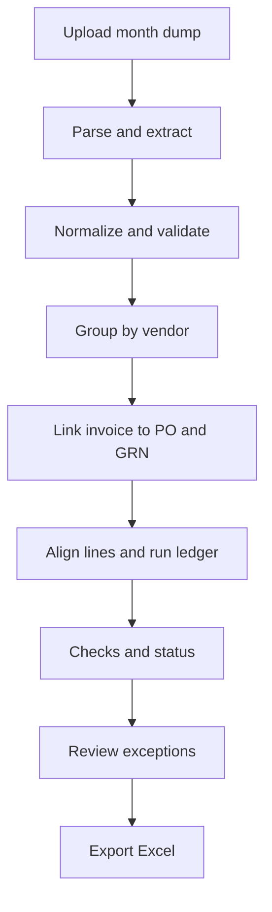
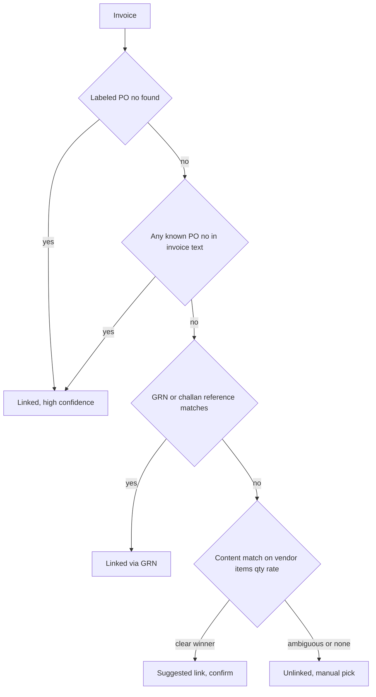

# ReconBench — Product Requirements Document

**Version** 0.1 (draft) · **Date** 29 Sep 2026 · **Buyer entity** Benchmark
**Audience** Product, Engineering, Finance/AP
**Built from** your idea brief + the *Document Field Dictionary* (3 sheets)

---

## 0. TL;DR

ReconBench ingests a month's dump of **POs, GRNs and Invoices** (XML / CSV / PDF), groups everything **vendor-wise**, links every **invoice** to its PO and GRN(s), runs a **partial-delivery-aware 3-way match**, and exports the result to **Excel**.

Six decisions shape the whole product:

1. **Invoice is the spine.** One case = one invoice. PO and GRN are evidence looked up *for* that invoice (this is how AP actually pays).
2. **PO number is helpful, not mandatory.** A 5-step *Anchor Resolution Ladder* (§7.4) links an invoice even when the PO number is unlabeled or missing.
3. **Quantities run on a ledger per PO line** (ordered → received → billed, across invoices and months). This is what makes "100 ordered, 90 now + 10 later" work.
4. **Rules decide, AI assists.** All maths and pass/fail are deterministic. AI (optional, your own API key on Home) only helps with extraction, fuzzy item matching, PO suggestions and explanations.
5. **Precision over recall.** When unsure, the case goes to *Needs Review*. A silent wrong "Matched" is the worst failure.
6. **Every verdict is explainable:** reason codes + evidence (page / snippet) + config snapshot.

> **Heads-up from the dictionary review (Appendix A):** the check "Invoice Total must match PO Total" would wrongly fail every partial invoice. This PRD replaces it with *expected amount = billed qty × PO rate* plus a cumulative PO-value check.

---

## 1. Problem & opportunity

**Today (manual):** AP pulls POs/GRNs from ERP/Tally, opens each invoice PDF, and compares item, quantity, rate and total in Excel — vendor by vendor, PO by PO.

**Why it hurts**
- Slow and repetitive: hundreds of invoices, month-end crunch.
- Error-prone: over-billing, price hikes, billing for rejected or undelivered goods slip through.
- Partial deliveries: one PO → many GRNs → many invoices over weeks.
- Invoices/GRNs often don't state the PO number cleanly, so people "just know" the mapping.
- No clean audit trail; no month-end view of goods received but not invoiced (GRNI).

**Example (your laptop case):** Benchmark orders 100 laptops from Acer. Acer ships 90 (GRN-1 + Invoice-1); 10 follow later (GRN-2 + Invoice-2). AP must confirm each invoice's item, quantity, rate and tax are right, goods were really received, and *cumulative* billing never exceeds what was ordered or received.

**Opportunity:** turn this into "upload → review exceptions → export".

---

## 2. Goals, non-goals, success metrics

**Goals**
- G1 Bulk-ingest a full month at once; no per-document data entry.
- G2 Auto-map documents to vendors; link invoice ↔ PO ↔ GRN with visible confidence.
- G3 Correct 3-way match incl. partial/split deliveries and rejections.
- G4 Humans touch only exceptions; the rest is straight-through.
- G5 Excel export Finance can audit line by line.

**Non-goals (v1)**
- Not an ERP or payment system (no payment run, no vendor portal).
- No credit notes, returns, multi-currency conversion, service (2-way) invoices — designed for, built later.
- No GSTR-2B / ITC reconciliation.

**Success metrics (proposed; calibrate in pilot)**

| Metric | Target |
|---|---|
| Straight-through rate (Matched, no human touch) | ≥ 70% pilot, ≥ 85% steady |
| False "Matched" (real qty/rate/vendor error passed) | 0 on golden set, ≤ 0.5% in audit sampling |
| Link precision / auto-link recall | ≥ 99% / ≥ 90% |
| Critical-field extraction accuracy (text PDFs) | ≥ 97% |
| Manual recon time saved | ≥ 80% vs baseline |
| Speed (rules-only) | 1,000 invoices ingest + recon ≤ 15 min |

---

## 3. Users

| Role | Uses ReconBench to |
|---|---|
| AP Executive (daily) | Upload dump, fix mapping, clear exceptions, export |
| AP Manager / Finance Controller | Set tolerances, approve overrides, read summary |
| Auditor (read-only) | Trace any verdict to source documents and config |

---

## 4. Scope

| Priority | In scope |
|---|---|
| **P0 (MVP)** | 3-zone ingestion (PO/GRN: XML·CSV·PDF, Invoice: PDF, ZIP); parsing & normalization; vendor grouping; Mapping tables + preview; invoice-centric linking (ladder steps 0–4); quantity ledger with partial deliveries; all hard checks; statuses & reason codes; manual recon; Excel export (core sheets); Home with AI-key card |
| **P1** | OCR for scans; inline field correction; chain view; GRNI / PO-status reports; opening-balance import; vendor layout memory; audit log; roles |
| **P2** | Credit notes / returns; multi-currency; service (2-way) & non-PO invoices; Tally/ERP push-back; GSTR-2B ITC recon; email ingestion; approval workflow; period close; click-to-highlight evidence |

**Assumptions:** buyer is Benchmark (India, GST, INR); PO/GRN XML looks Tally-style; most invoice PDFs have a text layer; one invoice = one PDF; single workspace in v1.

---

## 5. Key concepts

- **Document pool** — every ingested PO/GRN/invoice persists. A *batch* ("Sep 2026") is only a label/filter, not a silo.
- **Case** — one invoice plus the PO and GRN evidence linked to it; the unit of verdict and payment.
- **Link** — connection of invoice/GRN to PO (or invoice to GRN) with method, confidence, evidence.
- **PO-line ledger** — per PO line: ordered, received (accepted), billed, open. Recomputed, never hand-edited.
- **Straight-through** — Matched with no human action.
- **At-risk ₹ (leakage)** — billed value that is not payable (excess qty, rate hike, rejected goods).

---

## 6. End-to-end flow



**Sidebar mapping:** Ingestion = A–C · Mapping = D–E · Reconciliation = F–I · Home = overview, AI key, KPIs.

**Mapping vs Reconciliation:** *Mapping answers "who belongs to whom"* (vendor + document links). *Reconciliation answers "are the numbers right"*. A change in Mapping marks affected Reconciliation cases stale.

---

## 7. Functional requirements

### 7.1 Ingestion

| ID | Requirement | Pri |
|---|---|---|
| ING-1 | Ingestion page has three drop zones: **PO**, **GRN**, **Invoice**. Multi-file drag-drop, folder and **ZIP** upload | P0 |
| ING-2 | Formats: PO & GRN → XML, CSV, PDF. Invoice → PDF. Anything else rejected with a clear reason | P0 |
| ING-3 | Warn when content looks like another type (e.g. a PO dropped in the Invoice zone) | P0 |
| ING-4 | One XML/CSV may hold hundreds of docs across many vendors → split into individual documents (by voucher / PO no. / GRN no.). One PDF = one document | P0 |
| ING-5 | Async processing: per-file status (Queued → Parsing → Parsed n docs / Partial / Failed + reason), progress bar, retry, error-log download. One bad file never blocks the rest | P0 |
| ING-6 | Idempotent: file SHA-256 dedupe + document upsert key (type + vendor + doc no. + date). Re-uploading a month shows *new / updated / skipped*, never duplicates | P0 |
| ING-7 | **Persistent document pool.** Batch label auto-suggested from dominant invoice date, editable. Invoices may match POs/GRNs ingested in earlier months | P0 |
| ING-8 | Post-ingestion summary: counts by type/format/vendor + warnings (no PO ref, no GSTIN, low confidence, unparseable) with jump-to-document | P0 |
| ING-9 | Password-protected PDF prompt; size/page limits (default 25 MB / 100 pages) | P1 |
| ING-10 | Auto-detect doc type for mixed dumps; split multi-invoice PDFs | P1 |
| ING-11 | **Opening-balance import** (CSV from ERP: PO, line, received-to-date, billed-to-date) so the ledger is right when earlier months were never uploaded | P1 |

### 7.2 Parsing, extraction & normalization

Everything becomes one **canonical schema** (Appendix A, based on your *All Fields Reference* sheet). Each field carries `value`, `confidence`, `source` (rule / AI / manual) and `evidence` (page + snippet).

**By format**
- **XML (P0)** — profile-based. *Tally-style* profile is default (your dictionary already lists tags like `BASICPURCHASEORDERNO`, `PARTYLEDGERNAME`, `VOUCHERTOTAL`). *Generic* profile auto-detects by tag-name synonyms; custom XPath maps can be saved per layout. Unknown tags kept in `extras`, never dropped.
- **CSV (P0)** — sniff delimiter/encoding (UTF-8, BOM, Windows-1252); header row = first row matching ≥ 3 known synonyms; map columns via synonyms; one-time *mapping confirmation* remembered per layout signature; support one-row-per-line files (group by doc no.).
- **PDF, text layer (P0)** — layout-aware: label→value by proximity (right of / below), header blocks (Seller / Bill-to / Ship-to), line-item table detection (header row with ≥ 3 of desc/qty/rate/amount/HSN), multi-line descriptions, multi-page tables with repeated headers, totals block.
- **PDF, scanned (P1)** — OCR, then same pipeline with lower base confidence.

**Normalization**
- **Numbers:** Indian grouping (12,34,567.50), ₹ / Rs / INR, negatives in brackets or trailing minus. **Decimal arithmetic only**, never floats.
- **Dates:** dd/mm/yyyy default (India), ISO, "12-Sep-26"; ambiguous ones resolved by file-level majority.
- **UOM:** NOS/PCS/EA/UNIT→NOS, KG/KGS→KG, MTR/M→MTR …; optional conversion table (BOX→NOS ×n). Unknown UOM → flag.
- **GSTIN:** uppercase, strip spaces, validate pattern + checksum; derive **state code** (digits 1–2) and **PAN** (chars 3–12).
- **Vendor name:** drop M/S, PVT, PRIVATE, LTD, LIMITED, LLP, punctuation.
- **Item text:** lowercase, strip punctuation, tokenise; extract **spec tokens** (model no., GB/TB, inch, kW, size, colour).
- **Line types:** goods vs **charge lines** (freight, packing, insurance, handling, round-off, discount) by keyword; charge lines skip item/qty checks.

**Self-consistency (extraction QA):** line qty × rate − discount ≈ amount (±₹1); Σ lines ≈ taxable; taxable + tax + round-off ≈ total (±₹1). On failure retry alternative column readings; if still failing, lower confidence and flag. *Maths that adds up is the strongest sign that extraction was right.*

**Critical-fields gate:** invoice no., date, vendor (name or GSTIN), ≥ 1 line with qty and (rate or amount), grand total. Missing or confidence < 0.7 → document marked *Needs verification* → its case becomes **Needs Review**. The engine never computes a silent pass/fail on shaky numbers.

### 7.3 Vendor grouping (Mapping, part 1)

Goal: "this vendor → these POs, GRNs and invoices".

Resolution order per document:
1. GSTIN exact match
2. Same **PAN** (from GSTIN) → same vendor, multiple GSTIN registrations
3. Normalized-name exact match
4. Learned alias table (e.g. Tally ledger name "ACER INDIA" ↔ legal "Acer India Pvt. Ltd.")
5. Fuzzy name ≥ 0.92 **and** no conflicting PAN/GSTIN
6. Otherwise → **Unassigned** bucket

Rules
- Different PANs **never** auto-merge, however similar the names.
- Fuzzy 0.80–0.92 → *merge suggestion*; user merges (P0) or splits (P1); decision saved as alias so next month it just works.
- Mapping table shows per vendor: #PO, #GRN, #Invoice and link health (linked / unlinked / orphan).

### 7.4 Linking — the Anchor Resolution Ladder (Mapping, part 2)

Your dictionary shows the current engine fails ("No matching invoice found") when the PO label isn't recognised. ReconBench removes that single point of failure. Linking is **invoice-centric**: for each invoice find its PO(s), then its GRN(s), using evidence from most certain to weakest.



| Step | Method | Confidence |
|---|---|---|
| 0 | **Labeled ref** — PO no. read from a labeled field (header or line level). Labels from Appendix B, e.g. "Buyer's Order No.", "Your Ref" | 0.99 |
| 1 | **Reverse lookup** — we already know every PO number in the pool, so search the invoice's *whole text* (narration, remarks, item lines) for any of them. No label needed | 0.97 |
| 2 | **Via GRN / challan** — a GRN records this invoice or challan no., or the invoice cites a GRN/DC no. → GRN → its PO | 0.95 |
| 3 | **Content inference** among this vendor's *open* POs (rules; AI can re-rank) | ≤ 0.90 |
| 4 | **Manual** — user picks PO and GRN(s) (your "Manual Recon") | 1.00 |

Confidence below 0.95 (default) → **Needs Review** with one-click confirm. Every link stores method, confidence and evidence snippet.

**PO-number canonicalisation:** split on non-alphanumerics, strip leading zeros from numeric segments, uppercase, rejoin. `PO/26-27/0142`, `PO-26-27-142`, `po 26 27 142` → `PO2627142`. Match order: exact canonical → prefix-stripped (drop PO / ORDER / PUR) → numeric-tail match (≥ 5 digits, unique within the vendor). Non-exact matches are allowed only within the **same vendor**.

**Reverse-lookup guards:** hit must be bounded by non-alphanumerics; canonical length ≥ 5 (shorter needs a PO-like label nearby); ignore hits that equal the invoice's own number, GSTIN, IRN, e-way bill no., HSN or an amount.

**Step 3 scoring** (candidates = vendor's POs with open balance and PO date ≤ invoice date):

`score = 0.40·line_coverage + 0.20·qty_feasible + 0.15·rate_agree + 0.10·date_ok + 0.10·grn_support + 0.05·buyer_match`

- *line_coverage* — share of invoice value whose lines align to a PO line (similarity ≥ 0.80, see §7.5).
- *qty_feasible* — billed qty ≤ PO open qty. *grn_support* — uninvoiced accepted GRN qty covers billed qty.
- Suggest only if best ≥ 0.80 **and** lead over runner-up ≥ 0.15; otherwise show top-3 for manual pick.
- Rate is a soft ranking signal only — a price hike must surface as *price variance*, not as "wrong PO".

**GRN linking** uses the same ladder: GRN's PO label → reverse lookup → GRN records invoice/challan → content inference → manual.

**Multi-PO invoices:** links live at *line* level. A line without its own PO ref inherits the header PO if there is exactly one; otherwise it is inferred among the invoice's candidate POs.

**Cross-period:** if an invoice cites a PO that isn't in the pool, show *"PO not in pool — upload the earlier PO file"* instead of a generic failure.

---

### 7.5 Reconciliation engine

Pipeline per invoice. It is **deterministic**: same inputs → same outputs, regardless of ingestion order.

S1 Gate → S2 Links (from Mapping) → S3 Line alignment → S4 Quantity ledger → S5 Price & amount → S6 Tax & compliance → S7 Status, payable, reason codes

#### S1 Gate
- Critical fields present? (else Needs Review) · Vendor resolved? · PO open (not cancelled/closed)?
- **Duplicate invoice:** same vendor (PAN) + canonical invoice no. + financial year, or same IRN. Fuzzy duplicate = same vendor + same amount + date ±3 days + similar no. Duplicates never consume PO balance.

#### S3 Line alignment (invoice line → PO line; GRN line → PO line)

Alignment answers "which PO line is this?" and must **not** depend on the values we audit (qty, rate). Otherwise a price hike would look like "item not on PO".

`sim = 0.55·desc + 0.20·code + 0.15·hsn + 0.10·uom`

- *desc* — blend of token-set and token-sort fuzzy ratios, **capped at 0.60 if spec tokens conflict** (16GB vs 8GB, A515-58 vs A315-58). Plain fuzzy text would call those the same item.
- *code* — 1.0 on exact item / vendor part no. when both sides carry one; ignored otherwise. *hsn* — full match 1.0, first-4-digits 0.7.
- Best global assignment per invoice–PO pair (Hungarian). Qty and rate only break ties.
- ≥ 0.80 aligned · 0.60–0.80 Needs Review · < 0.60 **ITEM_NOT_ON_PO**. If both PO and invoice have a single line and the link is explicit, threshold relaxes to 0.50.
- Many invoice lines → one PO line is allowed (aggregate). PO lines never billed are simply "open".

#### S4 Quantity ledger (heart of the 3-way match; handles 90 + 10)

Each PO line has a ledger: `ordered`, GRN-accepted events, invoiced events. Invoices on a line are processed **in order of (invoice date, invoice no.)**. For invoice *k* with billed qty *B*:

```
A (GRN accepted)  = accepted_qty, else received − rejected, else received (+warning)
billed_before     = Σ eligible invoices before k on this PO line
billed_after      = billed_before + B
PO_cap            = ordered × (1 + over-tolerance)
GRN_cum           = Σ A over GRNs linked to this PO line

Check 1   billed_after ≤ PO_cap    else QTY_OVER_PO
Check 2   billed_after ≤ GRN_cum   else GRN_PENDING or QTY_OVER_GRN
eligible_qty = max(0, min(B, PO_cap − billed_before, GRN_cum − billed_before))
```

**Why cumulative, not per document:** vendors split shipments and invoices differently (GRNs 60 + 30, one invoice for 90). Cumulative passes; comparing document to document would falsely fail.

**Shortfall rule (billed > received):** if the cumulative billed quantity exceeds the PO cap, classify it as **QTY_OVER_PO** and **QTY_OVER_GRN** (P0 decision: follow Appendix C1 / TR-REC-6, selected 1 Oct 2026). Otherwise, if linked GRNs exist and the shortfall ≤ their rejected qty, classify it as **QTY_OVER_GRN** (billed rejected goods). All other shortfalls are **GRN_PENDING**, which re-evaluates automatically when the GRN is ingested and **ages into an exception** after 30 days (invoice date → run date, configurable).

Other ledger rules
- Provisional (Needs Review) invoices still consume balance — conservative, fewer false passes.
- Duplicates and Rejected invoices consume nothing.
- GRN received > ordered → `GRN_OVER_PO` warning; the excess is not billable.
- Adding or changing any document recomputes **only the affected PO-line ledgers**.
- If earlier months aren't in the pool, show a *ledger completeness* warning (fix: ING-11).

#### S5 Price & amount
- **Rate:** compare invoice *net* unit rate (line amount ÷ qty, after discount, before tax) with PO rate. Within tolerance = pass. Above = **RATE_HIGH** (fail). Below = RATE_LOW (warn, favourable).
- **Maths:** qty × rate − discount = line amount; Σ lines = taxable; taxable + tax + round-off = total (±₹1).
- **Total check (redefined for partial billing):** invoice taxable value vs **expected = Σ (billed qty × PO rate)** + PO-approved charges, tolerance ±1% or ±₹10. *Not* against the PO grand total.
- **Cumulative PO value:** Σ invoiced taxable on the PO ≤ PO total × (1 + tol), else `PO_VALUE_EXCEEDED`.
- **Charge lines** (freight, packing…) not on the PO → `EXTRA_CHARGE` warning with amount.

#### S6 Tax & compliance
- Invoice tax rate vs PO tax rate (warn). Computed tax = taxable × rate (±₹1). Rate must be in the configurable slab list — seed P0 with 5/12/18/28 per the user-confirmed PRD choice (1 Oct 2026). Keep the list configurable; do not preload extra rates or date boundaries from the TRD departure note.
- **Tax type:** supplier state (GSTIN digits 1–2) = buyer / place-of-supply state → CGST + SGST; else IGST. Mismatch → `TAX_TYPE_MISMATCH`.
- HSN present, and equals PO HSN if the PO carries one. GSTIN format + checksum.
- **Vendor:** GSTIN (or PAN) equals PO vendor; name similarity ≥ 0.92 else warn. Buyer GSTIN ∈ configured entity list.
- **Dates:** invoice date ≥ PO date (`DATE_ORDER`, default **fail** per your dictionary, configurable to warn); GRN date ≥ PO date; GRN date ≤ PO delivery date (`LATE_DELIVERY`, info).
- Currency equal across documents; UOM equal or convertible.
- Payment due date = invoice date + PO payment terms (Net 30/60); shown in export.

#### S7 Status, payable amount, leakage

Precedence — first match wins:

| # | Status | When |
|---|---|---|
| 1 | Duplicate | duplicate of another invoice |
| 2 | Unlinked | no PO resolved |
| 3 | Needs Review | link < 0.95, line similarity 0.60–0.80, or critical data low-confidence |
| 4 | Exception | any hard check failed |
| 5 | Pending | only issue is GRN_PENDING |
| 6 | Matched (flags) | only soft warnings |
| 7 | Matched | all pass, variances inside tolerance |

Users can overlay **Approved (override)**, **On hold** or **Rejected** on any status.

```
payable_rate    = min(invoice net rate, PO rate)     # both modes supported; default pay_at_po_rate, or hold until vendor correction
payable_taxable = Σ eligible_qty × payable_rate  (+ approved charges)
at_risk ₹       = invoice taxable − payable_taxable  # excess qty + rate hike + rejected goods
```

`at_risk` is the **potential leakage** KPI shown on Home and in Excel.

#### Tolerances (P0 defaults selected for build; per-vendor / per-item overrides allowed)

| Check | Default |
|---|---|
| Invoice qty vs GRN accepted | 0 (strict) |
| Cumulative qty vs PO ordered | 0% over (bulk items up to 5% via override) |
| Unit rate vs PO | ±0.5% or ±₹1 |
| Invoice total vs expected | ±1% or ±₹10 (from your guide) |
| Arithmetic / rounding | ±₹1 |
| Cumulative PO value vs PO total | 0% / ₹0 (strict; Plan default) |
| Item alignment | ≥ 0.80 auto · 0.60–0.80 review |
| Vendor name fuzzy | ≥ 0.92 |
| Link auto-accept | ≥ 0.95 |
| Pending → exception ageing | 30 days |

"or" = pass if within the % or the INR limit (whichever is looser); switchable to "both". Initial `limit_mode` is `or`; `both` remains selectable.

#### Reason codes (each has a plain-language message and suggested action)

| Code | Level | Meaning |
|---|---|---|
| DUP_INVOICE | Block | Vendor + invoice no. (or IRN) already present |
| NO_PO_LINK | Block | No PO resolved |
| LINK_INFERRED | Review | PO chosen by content — confirm |
| LOW_CONFIDENCE_DATA | Review | Critical field unreliable |
| VENDOR_MISMATCH | Fail | GSTIN/PAN differs from PO vendor |
| PO_NOT_OPEN | Fail | PO cancelled or closed |
| ITEM_NOT_ON_PO | Fail | Billed item has no PO line |
| QTY_OVER_PO | Fail | Cumulative billed > PO (+tol) |
| QTY_OVER_GRN | Fail | Billed > accepted (rejections explain gap) |
| RATE_HIGH | Fail | Rate above PO beyond tolerance |
| TOTAL_MISMATCH | Fail | Invoice vs expected beyond tolerance |
| MATH_ERROR | Fail | Lines / tax / total don't add up |
| PO_VALUE_EXCEEDED | Fail | Cumulative invoiced value > PO value |
| CURRENCY_DIFF, UOM_MISMATCH | Fail | Currency or unit differs |
| DATE_ORDER | Fail* | Invoice before PO (*configurable) |
| GRN_PENDING | Pending | Billed > received so far |
| RATE_LOW | Warn | Rate below PO |
| TAX_RATE_DIFF, TAX_TYPE_MISMATCH, HSN_DIFF | Warn | Tax inconsistencies |
| GSTIN_INVALID | Warn | Format / checksum fails |
| EXTRA_CHARGE | Warn | Freight / packing not on PO |
| GRN_OVER_PO | Warn | Received more than ordered |
| LATE_DELIVERY | Info | GRN after PO delivery date |

---

### 7.6 Review & overrides

| ID | Requirement | Pri |
|---|---|---|
| REV-1 | Per case: confirm link, change PO/GRN (searchable picker), approve with mandatory reason, hold, reject, add note | P0 |
| REV-2 | **Manual Recon:** pick any invoice + PO + GRN(s) from the pool; the same engine runs | P0 |
| REV-3 | Bulk actions: confirm all links ≥ 0.95; approve selected *Matched (flags)* | P0 |
| REV-4 | Immutable audit log (who, when, before/after, reason) | P1 |
| REV-5 | Inline correction of an extracted field → re-link and re-run affected cases; corrected label/position remembered for that vendor's layout | P1 |
| REV-6 | An override becomes "stale — re-review" if its inputs later change | P1 |
| REV-7 | Role gate: only Manager can approve Exceptions | P1 |

### 7.7 Preview

- PDF → in-app viewer (page nav, zoom). XML/CSV record → readable document card (header + line table) with *View raw* toggle.
- Reachable from Ingestion (per file), Mapping (any document row) and Reconciliation (side-by-side Invoice | PO | GRN). **P0**
- Shows extraction confidence per field; low-confidence fields highlighted. **P0**
- Click a value to highlight its source location in the PDF. **P2**

### 7.8 Excel export

One click from Reconciliation (respects current filters, or exports all).

| Sheet | Contents | Pri |
|---|---|---|
| Summary | Batch, run time, counts by status, ₹ invoiced / payable / at-risk, engine version, tolerances used, AI on/off | P0 |
| Invoice Recon | One row per invoice: vendor, GSTIN, invoice no./date, PO(s), GRN(s), link method + confidence, taxable / tax / total, expected @ PO rate, variance ₹ / %, payable, at-risk, status, reason codes, override info, payment due date | P0 |
| Line Recon | One row per invoice line: item, PO no./line, GRN(s), UOM, PO qty, billed before, this qty, GRN accepted (cum), balance after, PO rate, invoice rate, rate var %, qty/rate check, result | P0 |
| Exceptions | Only Exception / Pending / Needs Review / Unlinked, with reason text + suggested action | P0 |
| Vendor Summary | Per vendor: #PO / #GRN / #Invoice, status counts, ₹ invoiced, ₹ at-risk | P0 |
| PO Status | Per PO line: ordered, received, billed, open | P1 |
| GRNI | Received-not-invoiced lines: qty, value @ PO rate, age (month-end accrual view) | P1 |
| Orphans | POs / GRNs / invoices left unlinked | P1 |
| Audit | Overrides and manual link changes | P1 |

Formatting: frozen header, filters, ₹ number format, status colour-coding. Variance and total columns are **live Excel formulas** so Finance can audit them.

### 7.9 AI assist (optional, bring-your-own-key)

The **Home page** has an *AI Assist* card: mode, provider, API key, model, budget cap, Test button.

| Mode | Behaviour |
|---|---|
| Rules only (default) | No key needed; fully functional |
| AI-assisted | AI used only at the hooks below, and only when rules are unsure |
| AI-first extraction | AI reads every PDF; rules still validate the output |

**Hooks**

| Hook | Where | Output |
|---|---|---|
| H1 | PDF extraction fallback (critical-field failure or confidence < 0.7) | JSON in canonical schema + source snippet per field |
| H2 | Item similarity in the 0.60–0.80 band | same / different / unsure + reason |
| H3 | Step-3 PO inference re-rank (top-5 candidates) | chosen PO or abstain |
| H4 | Vendor merge suggestions | same / different |
| H5 | Plain-language exception explanation + draft vendor email (P2) | text |

**Guardrails (non-negotiable)**
1. AI never computes totals, quantities or pass/fail. Code does.
2. Output must match a strict JSON schema; anything else is discarded.
3. **Grounding check:** every extracted value must come with a snippet that literally exists in the document text; PO numbers returned must exist in the PO pool. Otherwise the field is dropped.
4. AI cannot override a spec-token conflict (16GB vs 8GB) or a vendor/PAN conflict.
5. AI-suggested links are tagged *AI-suggested* and default to Needs Review unless the user enables auto-accept above a threshold.
6. Any AI failure (bad key, rate limit, timeout) falls back to rules. The run never blocks.

**Key handling & privacy**
- Key entered on Home; masked after saving; never returned to the browser, never logged, never in exports. Storage: *session only* (default) or *saved encrypted*. "Remove key" button.
- Calls go through the backend. Consent checkbox: "document text will be sent to <provider>". Redact bank account / IFSC / phone / email before sending (default on).
- Cost control: per-run budget cap, live token/cost estimate, cache by document hash + prompt version (re-runs cost nothing).
- Run metadata stores provider / model / prompt version for audit.

---

## 8. UX (simple, desktop-first)

Left sidebar, always visible: **Home · Ingestion · Mapping · Reconciliation**, with a small ⚙ Settings at the bottom. A top bar holds the batch/period selector.

**Home**
- KPI cards for the selected period: Invoices · Matched % · Pending · Exceptions · Unlinked · At-risk ₹ · GRNI ₹.
- 4-step tracker Ingest → Map → Reconcile → Export, with a "Next step" button.
- **AI Assist card:** mode, provider, API key (masked), model, budget, Test, status pill.
- Recent batches / activity.

**Ingestion**
- Three drop zones (PO / GRN / Invoice) + Process button.
- File table: name · type · format · size · status · docs found · warnings · actions (preview, retry, remove).
- Summary panel after processing → "Go to Mapping".

**Mapping**
- Vendor table: Vendor · GSTIN(s) · #PO · #GRN · #Invoice · link-health bar · Open. Search; filter "has issues"; *Unassigned* bucket pinned on top; merge-suggestions banner.
- Vendor detail: tabs **PO / GRN / Invoice**. Each row shows key fields (no., date, amount, link) + **Preview** icon.
- Optional **chain view:** `PO-0142 [100] → GRN-011 [90], GRN-047 [10] → INV-2201 [90], INV-2260 [10]` (P1).
- Link controls: confirm / change / unlink; bulk "confirm all ≥ 0.95".
- CTA: Run reconciliation (this vendor or all).

**Reconciliation**
- Toolbar: vendor · status · date filters · Run / Re-run · **Export Excel**. Stale banner if Mapping changed.
- Invoice table, one row per invoice: Invoice · Date · Vendor · PO(s) · GRN(s) · Invoice amt · Expected · Variance · Status chip · Issue chips.
- Row → detail panel:
  1. header checks
  2. line grid Invoice | PO | GRN with per-cell pass/fail
  3. **ledger box** — "PO ordered 100 · billed before 90 · this invoice 10 · GRN accepted 100 · balance 0"
  4. evidence + preview
  5. actions (confirm link, change link, approve / hold / reject, note)

**Settings:** tolerances, label synonyms, UOM map, buyer entities/GSTINs, vendor aliases, payment-terms defaults, users/roles.

---

## 9. Data model (logical)

| Entity | Key fields |
|---|---|
| batch | id, label, period, created_at |
| source_file | id, batch, type, format, sha256, status, error |
| document | id, type (PO/GRN/INV), doc_no, doc_date, vendor_id, gstin, currency, totals, status, extraction_conf, file_id, version |
| doc_line | id, document_id, line_no, line_type (goods/charge), desc, item_code, hsn, uom, qty, rate, discount, amount, tax fields, po_ref, received / rejected / accepted qty |
| field_evidence | doc/line id, field, value, confidence, source, page, snippet |
| vendor, vendor_alias | id, canonical name, PAN, GSTINs, aliases |
| link | from (invoice/GRN) → to (PO/GRN), level (header/line), method, confidence, evidence, confirmed_by |
| po_line_ledger | po line id, ordered, received, billed, open (derived, recomputable) |
| recon_case | invoice id, status, payable, at_risk, reason codes, run id |
| recon_check | case id, line id, check, result, expected, actual, variance, tolerance |
| audit_log | actor, action, target, before, after, reason, timestamp |
| config_snapshot | tolerances, synonyms, engine version, AI settings — stored per run |

---

## 10. Non-functional requirements

- **Performance (rules-only):** text PDF ≤ 3 s per ≤ 5 pages; 1,000 XML/CSV docs ≤ 30 s; recon of 5,000 invoices ≤ 60 s; virtualised UI tables; all heavy work in background jobs.
- **Scale v1:** ~10,000 documents/month; design for 10× via queue + workers.
- **Correctness:** decimal arithmetic; deterministic ordering; idempotent ingest and recon; engine built as a UI-independent library with fixtures.
- **Explainability & audit:** every verdict = reason codes + evidence + config snapshot + engine version; reproducible on demand.
- **Security:** TLS, encryption at rest, role-based access, API keys encrypted and never logged, configurable retention, on-prem / VPC deployment option.
- **Privacy:** AI calls opt-in, redaction on by default, provider data-use terms shown next to the key field.
- **Compatibility:** latest Chrome / Edge; 1366 px minimum width.
- **Observability:** per-document processing log, error dashboard, run metrics.

---

## 11. Testing & acceptance

**Golden dataset (build first):** 6–8 vendors, ~40 POs, ~60 GRNs, ~80 invoices (mix of XML / CSV / text PDF / scanned PDF) with hand-labelled truth (links, statuses, reason codes). The engine must hit the §2 metrics on it before pilot; every release re-runs it.

**Scenario matrix — each row is an acceptance test**

| # | Scenario | Expected |
|---|---|---|
| 1 | Exact 1 PO / 1 GRN / 1 invoice | Matched |
| 2 | 100 ordered; 90 + 10 delivered and billed | Both Matched; PO fully billed |
| 3 | GRNs 60 + 30, one invoice for 90 | Matched (cumulative rule) |
| 4 | Second invoice pushes cumulative to 105 | Exception QTY_OVER_PO; at-risk = 5 × rate |
| 5 | Invoice 10, GRN-2 not uploaded | Pending; turns Matched after GRN upload |
| 6 | GRN 8 accepted / 2 rejected, invoice 10 | Exception QTY_OVER_GRN; payable 8 |
| 7 | Rate +2% over PO / rate +0.3% | Exception RATE_HIGH / Matched |
| 8 | 16GB billed vs 8GB on PO | ITEM_NOT_ON_PO (spec guard) |
| 9 | PO no. only in narration / only on GRN / nowhere | Linked by Step 1 / Step 2 / Step 3 suggestion |
| 10 | `PO/26-27/0142` vs `PO-26-27-142` | Linked |
| 11 | Same invoice uploaded twice (re-scan) | Duplicate; consumes no balance |
| 12 | Ledger name vs legal name | Same vendor |
| 13 | Invoice cites another vendor's PO | VENDOR_MISMATCH |
| 14 | One invoice, two POs | Line-level links; case status = worst line |
| 15 | IGST charged on intra-state supply | TAX_TYPE_MISMATCH |
| 16 | Freight line not on PO | Matched (flags), EXTRA_CHARGE |
| 17 | Sep invoice vs Aug PO/GRN in pool / PO not in pool | Correct ledger / Unlinked with "PO not in pool" |
| 18 | Ingest Oct before Sep | Identical final results |
| 19 | Blurry scan, unreadable qty | Needs Review, never a silent pass |
| 20 | Same data with AI on / off | Same maths and verdicts; AI adds suggestions only |

---

## 12. Roadmap — build the hard part first

| Phase | Scope | Exit criteria |
|---|---|---|
| M0 Discovery | Collect samples (Tally XML, CSV, ~20 invoice PDFs across ≥ 5 vendors, GRN PDFs); Finance signs off tolerances and policies; build golden set | Golden set + signed rules |
| M1 Engine | Headless engine on **XML/CSV only**: normalization, vendor grouping, ladder, ledger, checks, statuses | Scenarios 1–18 pass |
| M2 PDF & ingestion | Text-PDF extraction, ingestion UI, ZIP, async jobs, preview | Critical-field accuracy ≥ 97% on golden PDFs |
| M3 App | Home, Mapping, Reconciliation, overrides, Excel export, AI hooks | End-to-end demo on one full month |
| M4 Pilot | 1–2 real months run in parallel with manual work; tune thresholds | §2 metrics met; sign-off |
| v1.1 | OCR, inline correction, chain view, GRNI / PO reports, opening balances, audit log | — |
| v2 | Credit notes / returns, service 2-way, Tally/ERP push-back, GSTR-2B, email ingestion, approvals, period close | — |

---

## 13. Risks & mitigations

| Risk | Mitigation |
|---|---|
| PDF layout variety breaks extraction | Maths-consistency QA; confidence gating → Needs Review; AI fallback; per-vendor layout memory; golden set from real vendors |
| Wrong auto-link → wrong payment | Precision-first thresholds; Step 3 needs confirmation by default; evidence shown; audit log |
| Fuzzy match treats different SKUs as same | Spec-token guard; AI cannot override |
| Earlier months missing → ledger overstates open balance | Persistent pool; completeness warning; opening-balance import |
| Business rules (tolerance defaults and payable policy) | PRD defaults selected for build; settings remain configurable; confirm only business facts not supplied (such as buyer GSTINs) |
| Tally XML variants | Profiles + custom XPath + samples early |
| AI hallucination / data leakage | Guardrails, grounding, redaction, opt-in |
| Users distrust a "black box" | Reason codes, evidence, ledger box, reproducible runs |
| Scanned / blurry documents | OCR + gating; ask vendor for a better copy |

---

## 14. Open questions and recorded decisions

1. Is the PO/GRN XML a **Tally export**? Please share 2–3 sample XMLs and CSVs.
2. Share 15–20 real invoice PDFs (≥ 5 vendors, include ugly / scanned ones) and a few GRN PDFs.
3. Does the GRN usually carry the vendor's **invoice / challan number**? Is the GRN usually earlier or later than the invoice?
4. **Resolved (1 Oct 2026):** use the §7.5 P0 tolerance defaults, including `limit_mode=or` and the Plan's strict `cum_value_vs_po=0`; keep `both` limit mode selectable. Support both payable policies (`hold` and `pay_at_po_rate`), initially defaulting to `pay_at_po_rate`.
5. **Pending business data:** P0 follows the PRD scope (Benchmark, one workspace). Actual buyer GSTIN value(s), and whether more than one buyer GSTIN is needed, remain unconfirmed. Keep `buyer_entities` configurable and empty until the real value(s) are supplied; do not infer them from sample files.
6. Monthly volumes (POs / GRNs / invoices) and max PDF pages?
7. Do invoices carry e-invoice IRN / QR? (best duplicate key)
8. Users, roles, approval needs; is login required in v1?
9. Deployment: cloud or on-prem/local? May documents go to an AI provider?
10. Which AI providers first (Claude / OpenAI / Gemini)?
11. Credit notes, service invoices, non-PO invoices — needed in v1?

---

## Appendix A — Field dictionary review

**What we adopt:** the *All Fields Reference* sheet is the v1 canonical schema (keys like `po_number`, `vendor`, `quantity`, `unit_price`, `accepted_qty`).

**Gaps found and proposed fixes**

| # | Gap | Fix |
|---|---|---|
| 1 | "Invoice total vs PO total" fails on partial invoices | Expected = Σ billed qty × PO rate; cumulative PO-value check (§7.5) |
| 2 | Only PO number links documents; no other link fields | Invoice: add `grn_refs`, `challan_no`, `e_way_bill_no`, `irn`. GRN: add `supplier_invoice_no`, `challan_no`, `po_line_ref` |
| 3 | PO lacks fields the checks need | PO: add `vendor_gstin`, `buyer_gstin`, `hsn_sac`, `item_code`, `payment_terms`, `status`, `revision`, `ship_to` |
| 4 | GRN lacks item identifiers | GRN line: add `item_code`, `hsn` |
| 5 | Invoice lacks currency, line type, place of supply | Add `currency`, `line_type` (goods/charge), `place_of_supply` |
| 6 | Label "qty" under GRN *accepted* qty is ambiguous | Only `qty` present → treat as received, accepted = received, warn |
| 7 | Tally-style PO vendor is a ledger name, not the legal name | Vendor alias table (§7.3) |
| 8 | Column F "Probable terms — LEADS FILL HERE" is empty | Starter set in Appendix B; expand from real documents in M0 |
| 9 | PO revisions / amendments not modelled | Add `revision`; latest version governs the ledger, older kept for history |

---

## Appendix B — Starter synonyms for Column F

*Additions beyond the labels already in your sheet. Expand with real documents.*

**PO number, on Invoice / GRN:** PO No · PO No. · P.O. No · PO # · PO Ref / Reference · Purchase Order (No / Number / Ref) · Order No / Number / Ref · Buyer's Order No (& Date) · Customer PO / Cust PO No · Your Order No / Your PO / Your Ref · Ref No / Reference No · Work Order / WO No · Contract No · Indent No · Against PO / As per PO / Ref. PO · Purchasing Document (SAP) · PO Num (Oracle) · Source Document / Base Document / Reference Doc (GRN)

**GRN / delivery reference, on Invoice:** GRN No · MRN / MRR No · Receipt No · Delivery Challan / DC No · Challan No · Delivery Note (No) · Dispatch Doc No · Gate Entry No · LR / Docket No · E-way Bill No

**Invoice / challan reference, on GRN:** Invoice No · Supplier / Vendor Invoice No · Bill No / Party Bill No · Challan No / DC No · Delivery Note No

**Invoice number:** Invoice No · Inv No · Tax Invoice No · Bill No · Invoice # · Voucher No

**Vendor:** Vendor · Supplier · Seller · Sold By · Billed By · Party / Party Name · M/s

**Buyer:** Bill To / Billed To · Buyer · Invoice To · Sold To · Consignee (Ship To) · Customer

**Quantity:** Qty · Quantity · Nos · Pcs · Units · Billed Qty · Shipped Qty · Recd Qty · Accepted / Passed / OK Qty · Rejected / Rej Qty · Shortage Qty · Damaged Qty

**Rate / amount:** Rate · Unit Price · Price/Unit · Basic Rate · Unit Rate · Amount · Taxable Value · Basic Amount · Line Total

**Totals:** Grand Total · Invoice Total · Total Amount · Net Payable · Amount Payable · Amount Chargeable

**Dates:** Invoice Date · Date of Issue · Bill Date · Dated · GRN Date · Receipt Date · Inward Date · MRN Date

**Tax:** CGST · SGST / UTGST · IGST · Central Tax · State Tax · Integrated Tax · HSN / SAC · IRN · Ack No

---

## Appendix C — Worked examples

### C1. Partial delivery (your laptop case)

PO **BM-PO-0142** · Acer India Pvt Ltd · Acer Aspire 5 (i5 / 16GB / 512GB) · HSN 8471 · **qty 100 @ ₹48,000** · GST 18%

| Document | Date | Detail |
|---|---|---|
| GRN-2609-011 | 12 Sep | accepted 90 |
| INV ACR/26-27/2201 | 14 Sep | 90 × 48,000 = ₹43,20,000 + GST ₹7,77,600 = ₹50,97,600 |
| GRN-2609-047 | 26 Sep | accepted 10 |
| INV ACR/26-27/2260 | 28 Sep | 10 × 48,000 = ₹4,80,000 + GST ₹86,400 = ₹5,66,400 |

Invoice-centric run, oldest invoice first:

| Invoice | PO qty | Billed before | This inv | GRN accepted (cum) | Result |
|---|---|---|---|---|---|
| 2201 | 100 | 0 | 90 | 90 | 90 ≤ 100 ✔, 90 ≤ 90 ✔ → **Matched** |
| 2260 | 100 | 90 | 10 | 100 | 100 ≤ 100 ✔, 100 ≤ 100 ✔ → **Matched** |

Variants on invoice 2260:

| Change | Outcome |
|---|---|
| Bills 15 | cum 105 > 100 → **Exception** QTY_OVER_PO + QTY_OVER_GRN; eligible 10; at-risk 5 × 48,000 = ₹2,40,000 (+ GST) |
| GRN-047 not uploaded | cum GRN 90 < 100 → **Pending** GRN_PENDING; flips to Matched when GRN-047 arrives; ages to Exception after 30 days |
| GRN-047: 8 accepted, 2 rejected | cum 98 < 100 and gap = rejected → **Exception** QTY_OVER_GRN; payable 8; at-risk 2 × 48,000 = ₹96,000 (+ GST) → ask vendor for a credit note |
| Rate ₹49,000 | +2.08% → **Exception** RATE_HIGH; at-risk 10 × 1,000 = ₹10,000 (+ GST) |

### C2. PO number missing on invoice 2260

1. **Step 0** — no labeled PO field.
2. **Step 1** — reverse lookup: none of the pool's PO numbers (`BM-PO-0142` → `BMPO142`, …) appears anywhere in the text.
3. **Step 2** — GRN-047 records "Challan/Invoice: ACR/26-27/2260" → GRN → PO BM-PO-0142. **Linked via GRN, confidence 0.95.**
4. If the GRN is silent too, **Step 3** — the only open Acer PO is BM-PO-0142 (open qty 10): lines align, qty feasible, rate equal, uninvoiced GRN qty 10 → score ≈ 0.94, no runner-up → **suggested link, Needs Review** (one-click confirm).

### C3. One invoice, two POs

Vendor bills 10 monitors (PO-A) and 5 docks (PO-B) on one invoice. Each line links to its own PO (label on the line, else inference among the invoice's candidate POs) and runs its own ledger. Case status = worst line status; the Line Recon sheet shows both POs.

---

## Appendix D — Suggested stack (non-binding)

- **Engine:** Python; keep matching as a pure library, testable headlessly with the golden set.
- **Parsing:** lxml (XML), pandas (CSV), pdfplumber / PyMuPDF (PDF), Tesseract or PaddleOCR (scans, P1), RapidFuzz (fuzzy).
- **API & jobs:** FastAPI + a job queue (RQ / Celery / Arq). **DB:** PostgreSQL (SQLite for a local MVP).
- **Frontend:** React + Tailwind, TanStack Table, pdf.js viewer.
- **Excel:** openpyxl / XlsxWriter (with live formulas).
- **AI:** thin provider adapter (Claude / OpenAI / Gemini) behind the guardrails in §7.9.
