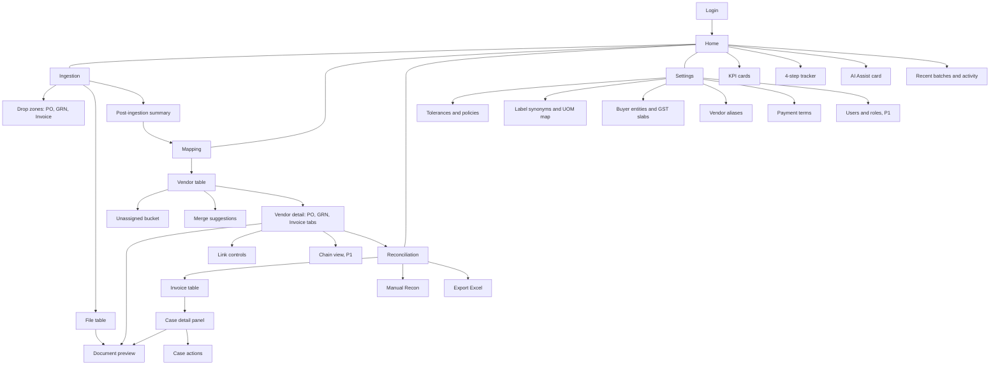
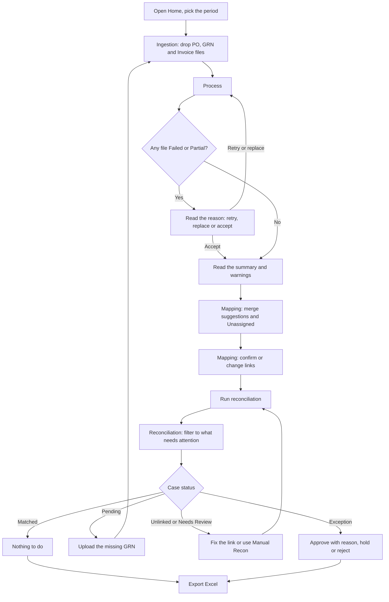

# ReconBench — UI/UX Design Brief

**Version** 0.1 (draft) · **Date** 30 Sep 2026 · **Buyer entity** Benchmark
**Audience** Product designers, UX researchers, front-end engineers, Product, Finance/AP
**Derived from** ReconBench PRD v0.1 (29 Sep 2026) · ReconBench TRD (29 Sep 2026) · ReconBench App Flow v0.1 (30 Sep 2026)
**Status** Ready for design kickoff. Anything tagged *(proposed)* or *(suggested)* still needs a decision; open items are collected in §15.

**Reading order for a designer in a hurry:** §1 (summary) → §4 (principles) → §8.6 (Reconciliation and the case panel) → §9 (status language) → §11 (visual foundations). Everything else is reference.

---

## Contents

0. How to read this brief
1. Design summary
2. Product context: what the UI has to express
3. Users and jobs to be done
4. Design principles
5. Constraints that shape the design
6. Information architecture
7. Key journeys
8. Screen specifications
9. The status, confidence and reason-code language
10. Cross-cutting UX patterns
11. Visual design foundations
12. Component inventory
13. Content and microcopy guide
14. Accessibility requirements
15. Open design questions and gaps
16. Deliverables, sequencing and design acceptance
17. Risks
- Appendix A — Reason-code copy deck (draft)
- Appendix B — Sample content for mockups
- Appendix C — KPI tooltip copy (draft)
- Appendix D — Traceability to source documents

---

## 0. How to read this brief

**What this is.** A design brief for the ReconBench web app. It says what each screen must help the user do, what it must show, how it must behave and what it must never do. It turns the PRD (what and why), the TRD (constraints) and the App Flow (screens and hand-offs) into design direction.

**What this is not.** It does not repeat the matching rules (PRD §7.5), the data schema (TRD §6) or the API list (App Flow Appendix A). It points to them.

**Conventions** (the same as the App Flow, so the documents line up)
- **P0** = MVP · **P1** = v1.1 · **P2** = later. Anything untagged is P0.
- Source tags in square brackets, such as `[PRD §7.6]`, `[TRD TR-API-3]` and `[Flow §6.5]`, point to the requirement behind a statement.
- *(proposed)* = the TRD or App Flow proposes it and it still needs a decision.
- *(suggested)* = **added by this brief** to complete the design. It is not in the PRD, TRD or App Flow. Please confirm or replace it.
- Wireframes are low-fidelity structure sketches, not visual design. Every number in them is sample data.
- **Case** = one invoice plus the PO and GRN evidence linked to it.

**If documents disagree.** The PRD wins on product behaviour, the TRD on technical limits, and the App Flow on screen hand-offs. Please flag any mismatch (§15).

---

## 1. Design summary

**One line.** Upload a month of POs, GRNs and invoices → confirm who belongs to whom → review only the exceptions → export to Excel.

**What we are designing.** A desktop web app for accounts-payable teams: a left-sidebar shell with four working areas — **Home**, **Ingestion**, **Mapping** and **Reconciliation** — plus **Settings**, **Login** and a shared **Document Preview**. `[Flow §2.1]`

**Design north star: "Trust at a glance, proof on demand."**
A user should see within seconds *what needs their attention*, and be able to prove *why* any verdict was reached — quantities, evidence, tolerances, engine version — without leaving the case. The worst failure of this product is a silent wrong "Matched" `[PRD §0]`, so the interface must never look more certain than the data behind it.

**The six hard design problems** (spend the most design effort here)

| # | Problem | Why it is hard | Where it lives |
|---|---|---|---|
| 1 | Make the **cumulative quantity story** obvious ("100 ordered, 90 now + 10 later") | Users think document to document; the engine judges a cumulative ledger per PO line | Ledger box, §8.6.3 |
| 2 | Compare **Invoice / PO / GRN** side by side at **1366 px** | Three documents, many columns, one narrow screen | Case panel, §8.6.2 |
| 3 | Express **uncertainty honestly**: confidence, suggested links, AI versus rules | Precision over recall: shaky data must read as "needs your eyes", never as a clean pass or fail | §9, §8.5, §8.7 |
| 4 | Keep **10,000-row work fast and triageable**, exceptions first | Month-end crunch; hundreds to thousands of invoices | Reconciliation list, §8.6.1 |
| 5 | Make **asynchronous and stale states legible** | Jobs run in the background, Mapping changes make cases stale, late GRNs flip Pending cases by themselves | §10.1, §10.2 |
| 6 | Show **computed status versus human decision** without muddying the audit trail | Effective status = computed status overlaid by the latest action | §9.2 |

**How we will know it works** (PRD targets; UX-specific targets are proposed in §16.3)
- Straight-through rate ≥ 70% in pilot, ≥ 85% at steady state. `[PRD §2]`
- Manual reconciliation time saved ≥ 80% against the baseline. `[PRD §2]`
- Zero false "Matched" on the golden set. `[PRD §2]`
- 1,000 invoices ingested and reconciled in ≤ 15 minutes with rules only. The UI must not add waiting of its own. `[PRD §2, TRD TR-NFR-4]`

---

## 2. Product context: what the UI has to express

**The problem today.** AP staff pull POs and GRNs from the ERP or Tally, open every invoice PDF, and compare item, quantity, rate and total in Excel, vendor by vendor. It is slow and error-prone, partial deliveries make it harder, and it leaves no clean audit trail. `[PRD §1]`

**Six product decisions and what each means for the interface** `[PRD §0]`

| Product decision | What the UI must do |
|---|---|
| **1. The invoice is the spine.** One case = one invoice; PO and GRN are evidence. | The Reconciliation list has one row per invoice. PO and GRN appear inside the case, never as competing lists. |
| **2. PO number is helpful, not mandatory.** A five-step ladder links documents. | Always show *how* a link was made (method) and *how sure* we are (confidence). Give a fast way to confirm, change or pick manually. |
| **3. Quantities run on a ledger per PO line.** | A ledger box in every case that tells the ordered → received → billed → open story in one glance. |
| **4. Rules decide, AI assists.** | AI is optional and off by default. Mark anything AI-sourced. Never present AI as the reason for a pass or fail. |
| **5. Precision over recall.** | "Needs Review" is a first-class, well-designed state. Low-confidence fields are visibly highlighted. No silent passes. |
| **6. Every verdict is explainable.** | Reason codes with a plain-language message and suggested action, plus evidence (page and snippet), config snapshot and engine version. |

**Two questions, two areas. Keep them apart.** *Mapping* answers "**who belongs to whom**" (vendor and document links). *Reconciliation* answers "**are the numbers right**". Mapping must never show pass or fail on numbers. A change in Mapping makes affected Reconciliation cases stale. `[PRD §6, Flow §6.4]`

**Where the work happens** `[Flow §2.1]`

| Screen | Question it answers | Main output |
|---|---|---|
| Home | Where are we this period? | KPIs, next step, AI Assist setup |
| Ingestion | Did all my files get read? | Parsed documents and warnings |
| Mapping | Who belongs to whom? | Vendors and invoice ↔ PO ↔ GRN links |
| Reconciliation | Are the numbers right? | Case verdicts, overrides, Excel workbook |
| Settings | What are the rules? | Tolerances, synonyms, UOM map, entities, aliases, payment terms |

---

## 3. Users and jobs to be done

| Role | How often | Jobs to be done | What hurts today | What the UI must give them |
|---|---|---|---|---|
| **AP Executive** | Daily, peak at month-end | Upload the dump → fix mapping → clear exceptions → export | Hundreds of PDFs to open; partial deliveries; PO numbers missing or unlabeled; Excel copy-paste | Bulk actions, one-click confirm, a clear "next step", fast triage, keyboard speed |
| **AP Manager / Finance Controller** | Weekly to daily | Set tolerances and AI mode; approve overrides, including Exceptions; read the summary | No month-end view of leakage or goods received but not invoiced (GRNI) | Trustworthy KPIs (At-risk ₹, GRNI ₹), defensible approvals with a reason, settings whose impact is visible |
| **Auditor** (read-only) | Periodic | Trace any verdict to source documents, evidence and config; export | No clean audit trail | Deep links, evidence on every value, config snapshot and engine version, a read-only experience that explains why controls are disabled |

`[PRD §3, Flow §3]`

**Access model.** P0 ships **one login role that holds every capability**. Every action already passes a role check and records the actor, so P1 only switches the matrix below on. **Design the role-aware states now** so P1 needs no redesign. `[Flow §3, TRD TR-REV-8]`

| Capability | AP Executive | Manager | Auditor |
|---|:---:|:---:|:---:|
| Upload and process files | ✔ | ✔ | — |
| Confirm or change links, merge vendors | ✔ | ✔ | — |
| Run reconciliation | ✔ | ✔ | — |
| Approve Matched (flags), hold, reject, add notes | ✔ | ✔ | — |
| Approve Exceptions | — | ✔ | — |
| Change tolerances and settings | — | ✔ | — |
| Manage AI key and mode | — | ✔ | — |
| Manage users | — | ✔ | — |
| Export to Excel | ✔ | ✔ | ✔ |
| View documents, evidence and audit trail | ✔ | ✔ | ✔ |

A control the role lacks is shown **disabled with a short reason** *(suggested)*. The server is the authority and answers 403. `[Flow §3]`

**What these users already know** *(suggested, from the domain in the PRD)*: PO, GRN, GSTIN, PAN, HSN, IRN, CGST / SGST / IGST, lakh and crore, Net 30 / 60. They work in Excel all day, are comfortable with dense tables, and will judge the product on whether the exported workbook matches the screen. Use their vocabulary and avoid engine jargon (§13).

---

## 4. Design principles

| # | Principle | In practice |
|---|---|---|
| 1 | **Exceptions first.** Humans touch only exceptions `[PRD G4]`. | Default views and shortcuts lead to what needs attention. Matched cases stay quiet: visible, never demanding. |
| 2 | **Trust at a glance, proof on demand.** | Every status has a plain-language "why" one click away. Every value has evidence (page and snippet). |
| 3 | **Never look more certain than the data.** | Show confidence, suggested versus confirmed links, and "Needs verification". Highlight low-confidence fields. A shaky number never renders as a clean pass or fail. |
| 4 | **The invoice is the spine.** | One row per invoice. PO and GRN are evidence inside the case. |
| 5 | **Show the story in numbers.** | Ledger box: ordered → billed before → this invoice → GRN accepted → balance. The same words everywhere, including Excel. |
| 6 | **The server computes; the screen formats.** `[TRD TR-API-3]` | No business arithmetic in the client. Money is an opaque decimal string; the UI only formats (Indian grouping, ₹). |
| 7 | **Long work is visible, durable and non-blocking.** | Progress survives a reload; users can leave the page; one bad file never blocks the rest. |
| 8 | **Decisions are recorded, not overwritten.** `[TRD TR-REV-1]` | Approve, hold, reject and notes sit beside the computed result, with who, when and why. |
| 9 | **Make change and staleness obvious.** | Always say what is stale, why, and what re-running will do. Say what updates by itself (ledgers, Pending cases) and what needs Re-run. |
| 10 | **Dense but calm.** | Built for daily use at 1366 px by finance professionals: compact tables, tabular numerals, restrained colour, keyboard-friendly. |
| 11 | **Status is never colour alone.** `[TRD TR-NFR-12]` | Every status, level and health indicator carries a text label and an icon. |
| 12 | **One vocabulary across screen and Excel.** `[PRD §7.8, TRD TR-API-4]` | Statuses, reason messages and KPI definitions come from the same source as the workbook. |

---

## 5. Constraints that shape the design

### 5.1 Platform and technology

| Area | Constraint | Source |
|---|---|---|
| Browsers | Latest Chrome and Edge only | TRD TR-NFR-11 |
| Screen | **Desktop-first, minimum width 1366 px. No mobile layout in v1.** | PRD §8, §10; TRD TR-NFR-11 |
| Language and locale | English UI; INR with Indian digit grouping (12,34,567.50); dates as dd/mm/yyyy | TRD TR-NFR-13 |
| Front-end stack | React SPA (Vite), Tailwind, TanStack Table / Virtual / Query, React Router, react-hook-form with zod | TRD §4 |
| PDF viewing | pdf.js with scripting disabled; loads only the page in view | TRD TR-PRV-1, TR-API-5 |
| Hosting | Cloud, VPC or on-prem. Fonts, icons and images should be **bundled, not fetched from public CDNs** *(suggested; follows from the on-prem option)* | TRD §3.6, §10 |
| Deep links | Stable links for a **document, a vendor and a case**, so an audit trail can be shared | TRD TR-API-1 |

### 5.2 Behaviour rules that change what we can design

| Rule | Source | What it means for design |
|---|---|---|
| **The UI computes no business result.** Statuses, variances, payable, at-risk, ledger boxes and messages come from the API. Money fields are an opaque decimal-string type. | TR-API-3 | No client-side sums, for example no "selected invoices total ₹…" unless the API supplies it. Components take server values and only format them. |
| **Keyset pagination; total count only on request.** | TRD §7.1 | No page numbers and no default "1–50 of 8,432". Use continuous scroll and an optional "Show count" *(suggested)*. |
| **Server-side filter and sort.** | TR-API-2 | Changing a filter or sort re-queries. Design a fast, non-jarring loading state; do not promise instant local sorting. |
| **Virtualised tables: 10,000 rows scroll smoothly at 1366 px.** | TR-API-2 | Fixed, predictable row heights; no heavy per-row widgets; no inline row expansion. Detail opens in a panel. |
| **Progress by polling every 2 s (ETag); survives reload; never cancelled by leaving the page.** Server-sent events are P1. | TR-API-8, TRD §7.3 | Progress UI must be re-joinable from anywhere (Home, Ingestion, Reconciliation). |
| **A stale write returns 409 with the current state.** | TR-API-6 | A conflict dialog that shows what changed and offers a reload. |
| **Idempotency keys on runs, exports and bulk actions.** | TRD §7.1 | Double-click safe. Buttons show an in-flight state; a repeated click returns the first result. |
| **401 = no session; 403 = role lacks the capability.** | TRD §7.1 | Return to Login (keep the deep link *(suggested)*); disabled controls with reasons. |
| **Reason messages and suggested actions come from one catalogue** shared with Excel. | TR-API-4 | Author the copy once (Appendix A). Never hard-code reason text in components. |
| **Effective status = computed status overlaid by the latest human action.** | TR-REV-1 | Show both when they differ (§9.2). |
| **Confidence thresholds:** extraction gate 0.70; link auto-accept 0.95; item alignment ≥ 0.80 auto, 0.60–0.80 review. | PRD §7.2, §7.4, §7.5 | Visual buckets follow these numbers. They are settings, so read them from config rather than hard-coding them. |
| **A batch is only a label; the document pool is persistent.** | ING-7 | The period selector filters by **invoice date**. Do not present batches as folders or silos. |
| **Performance:** list p95 ≤ 300 ms; case detail p95 ≤ 500 ms *(proposed)*. | TR-NFR-5 | Case detail loads in one call. Show skeletons when a load exceeds about 200 ms *(suggested)*. |
| **Accessibility baseline:** keyboard for tables and dialogs, visible focus, no colour-only status *(proposed)*. | TR-NFR-12 | See §14. |
| **Excel parity:** the export re-applies the same filter on the server. | TR-EXP-1 | "Export what I see" must mean exactly that. Make the scope explicit in the UI. |

### 5.3 Out of scope for v1 design
No mobile or tablet layouts; no multi-workspace switching; no credit notes, returns, multi-currency, service (2-way) or non-PO invoices; no email ingestion, ERP push-back, approval workflow or SSO. Leave room for them (§6.4) but do not design them now. `[PRD §2, §4; TRD §1]`

---

## 6. Information architecture

### 6.1 Navigation
- **Left sidebar, always visible:** Home · Ingestion · Mapping · Reconciliation, with a small ⚙ **Settings** at the bottom. `[PRD §8]`
- **Top bar:** the **period selector**, which filters by invoice date. *(Suggested additions: user menu with sign-out, a background-activity indicator, help.)*
- **The sidebar can collapse to icons** *(suggested)*. This wins back horizontal space at 1366 px (§11.4).
- **Settings** is visible to Managers only once roles are enforced (P1). `[Flow §6.7]`

### 6.2 Sitemap



`[Flow §4]`

### 6.3 Screen inventory

| Screen or surface | Priority | Entry points | Design note |
|---|---|---|---|
| Login | P0 | App open; a shared deep link without a session | Local accounts; SSO is P2 |
| Home | P0 | After login; sidebar | KPIs, tracker, AI Assist |
| Ingestion | P0 | Sidebar; Home tracker step 1 | Drop zones, file table, summary |
| Mapping: vendor table | P0 | Ingestion summary → Go to Mapping; sidebar; tracker step 2 | Unassigned pinned; merge banner |
| Mapping: vendor detail | P0 | A vendor row | PO / GRN / Invoice tabs; link controls |
| Mapping: chain view | **P1** | Vendor detail | Design now, build later |
| Reconciliation: invoice list | P0 | Mapping's Run button; sidebar; tracker step 3 | One row per invoice |
| Reconciliation: case detail panel | P0 | An invoice row; a deep link | The centrepiece (§8.6.2) |
| Manual Recon | P0 | Toolbar; an Unlinked or Needs Review case *(suggested)* | Same engine, no second code path |
| Export flow | P0 | Toolbar | Scope choice, progress, download |
| Document preview (shared) | P0 | Ingestion, Mapping, Reconciliation | PDF viewer and document card |
| Settings | P0 | ⚙ in the sidebar | Tolerances, synonyms, UOM, entities, aliases, payment terms |
| Users and roles | P1 | Settings | Role matrix |
| Audit log screen | P1 | *(suggested: Settings, and a link from each case)* | Rows are written from P0; the screen is P1 |
| GRNI, PO Status and Orphans reports | P1 | *(suggested: Reconciliation or Home)* | Excel sheets come first |
| Inline field correction | P1 | Document preview | Re-links and re-runs affected cases |
| Opening-balance import | P1 | Ingestion | CSV from the ERP |

### 6.4 Design for P0, leave room for P1 and P2
- **P1 hooks to leave in the layout:** a chain-view toggle on vendor detail; inline correction in preview; the NeedsPassword file state; an audit-trail link on cases; role-driven disabled states; an opening-balance import entry on Ingestion; a "stale — re-review" marker on overrides; GRNI and PO Status reports.
- **P2 hooks:** click a value to highlight its source in the PDF; AI explanations and vendor email drafts (H5); approvals; period close; email ingestion.

### 6.5 The four-step tracker is the app's spine
Home shows **Ingest → Map → Reconcile → Export** with a **Next step** button. Each screen ends with the call to action that leads to the next step.

| From | Primary call to action | To |
|---|---|---|
| Home | Next step | The next incomplete step |
| Ingestion summary | Go to Mapping | Mapping |
| Mapping | Run reconciliation (this vendor or all) | Reconciliation, showing run progress |
| Reconciliation | Export Excel | The export flow |
| Reconciliation (a Pending case) | Upload the missing GRN | Ingestion |

**Gap F4.** The source documents do not define what "complete" means for each step, so **Next step** cannot yet know where to go. *(Suggested rule, needs a Product decision.)* Ingest = files processed and none Queued or Parsing. Map = no Unassigned documents, no open merge suggestions, and no Suggested links awaiting a decision. Reconcile = a run exists and is not stale. Export = an export exists for the latest run.

---

## 7. Key journeys

### 7.1 Month-end, happy path



`[Flow §5.1]`

**Design intent by stage** *(suggested)*
- **Ingestion: confidence and momentum.** The user sees progress quickly and never wonders whether a file was read.
- **Mapping: low anxiety.** Most links are auto-accepted. Attention goes only to suggestions and Unassigned.
- **Reconciliation: control.** A short, prioritised list, a clear reason for each item, and fast decisions.
- **Export: closure.** The workbook matches the screen, and the user knows which run and filters it reflects.

### 7.2 Top tasks and target interaction cost *(suggested targets)*

| Task | Target | How the design gets there |
|---|---|---|
| Confirm every high-confidence link | 1 click, then a result summary | "Confirm all ≥ 0.95" per vendor or for all, with a per-link result |
| Find out **why** an invoice isn't Matched | Open the row; the answer is at the top of the panel | A "Why this status" block lists reason messages and suggested actions above the detail |
| Fix an Unlinked invoice | 3 interactions or fewer | Top-3 candidates shown; searchable picker; Manual Recon as the fallback |
| Approve an exception with a reason | 4 interactions or fewer | Approve → reason → confirm; the reason is mandatory |
| Clear a stack of cases | No return trips to the list | Next and previous case inside the panel; keyboard navigation |
| Attach a missing GRN and see a Pending case flip | Upload → Process → the case turns Matched by itself | A clear "this case updates automatically" message on Pending cases |
| Export what I see | 2 clicks | Export ▾ → "Current filters" or "All"; the scope is shown in the confirmation |
| Trace a verdict for an audit | A deep link opens the case with its evidence | Case deep link; evidence and config snapshot inside the panel |

### 7.3 Scenario journeys to design and prototype
Use the laptop case (Appendix B) as the running example. The four variants of invoice 2260 — bills 15; GRN-047 missing; 8 accepted and 2 rejected; rate ₹49,000 — must each work in the case panel and ledger box. Also prototype: **PO number missing** (link via GRN, then via content inference), **late GRN**, **one invoice against two POs**, **duplicate**, and **blurry scan**. `[Flow §8]`

---

## 8. Screen specifications

Each screen lists its purpose, a layout sketch, key elements, interactions, states and design notes. Rules for the matching logic itself stay in the PRD.

### 8.1 App shell

**Purpose:** persistent orientation, plus a home for the period, background activity and identity.

```text
ReconBench  | Period (by invoice date): [ Sep 2026 v ]        (Activity)  [ User v ]
------------+--------------------------------------------------------------------
Home        |
Ingestion   |
Mapping     |                              PAGE CONTENT
Reconcile   |
            |
Settings    |
```

| Element | Behaviour |
|---|---|
| Sidebar | Home · Ingestion · Mapping · Reconciliation, ⚙ Settings at the bottom. Active item is clearly marked. Collapses to icons *(suggested)*. `[PRD §8]` |
| Period selector | Filters KPIs by **invoice date**. A batch is only a label `[TRD TR-ING-7]`. Say "by invoice date" in the control so nobody mistakes a period for a folder. |
| Activity indicator *(suggested)* | Shows running jobs (parsing, runs, exports). Opens a small list with progress and a link back to the screen that started each one. Jobs continue if the user leaves or the session ends `[TRD TR-API-8]`. |
| User menu *(suggested)* | Name and role (from `GET /auth/me`), sign out. |

**Open point B1:** does the period selector scope only Home, or also Mapping and Reconciliation? Suggested default: Home KPIs and the default date filter on Reconciliation. Mapping shows the whole pool, because links cross periods (§15).

### 8.2 Login `[Flow §6.1]`

**Purpose:** sign in. Nothing else.

| Element | Notes |
|---|---|
| Email, password, **Sign in** | Password managers must work here (the AI key field is the one that blocks autofill, not this). |
| Rate limit and lockout | Show a calm message and, if the API supplies it, when to retry. |
| Session expiry | After 30 min idle or 12 h *(proposed, configurable)*, the next request returns to Login. Say so plainly and add that running jobs continue. Keep the deep link and return to it after sign-in *(suggested)*. |
| Errors | Generic wording for wrong email or password *(suggested)*. |

### 8.3 Home `[Flow §6.2, PRD §8]`

**Purpose:** orient the user, show the period's KPIs, point to the next step, and hold the AI Assist setup.

```text
Home                                                  Period: [ Sep 2026 v ]

+------------+------------+------------+------------+------------+------------+------------+
| Invoices   | Matched %  | Pending    | Exceptions | Unlinked   | At-risk ₹  | GRNI ₹     |
| 212        | 78 %       | 9          | 14         | 6          | 4,20,000   | 9,60,000   |
|            |            |            |            |            | +GST 75,600|            |
+------------+------------+------------+------------+------------+------------+------------+

Ingest ---------- Map ---------- Reconcile ---------- Export       [ Next step: Reconcile > ]
(done)            (done)         (not run yet)         (--)

AI Assist                                                            [ Rules only ]
  Mode      (o) Rules only   ( ) AI-assisted   ( ) AI-first extraction
  Rules only is fully functional and needs no key.

Recent batches and activity
  Sep 2026 batch  · 96 files · last run 30/09 · 212 invoices          [ Open ]
```

**KPI cards** (definitions in Appendix C; counted on the server from the same views as the Excel Summary sheet, so screen and workbook agree `[Flow §6.2]`)

| Card | Shows | Design notes |
|---|---|---|
| Invoices | Invoices in the period that have a current case | Run-based: empty until the first run |
| Matched % | Matched plus Matched (flags), as a share of invoices, by **effective status** *(proposed)* | Tooltip explains that straight-through counts only cases with no human action |
| Pending | Cases waiting on a GRN | |
| Exceptions | Cases where a hard check failed | |
| Unlinked | Invoices with no PO resolved | |
| At-risk ₹ | Billed value that is not payable: excess quantity, rate hikes, rejected goods | Show **GST beside it, not inside it** *(proposed, OQ-4)*. Show **duplicate and unlinked value separately** as "blocked" *(proposed, OQ-6)*: a secondary line or tooltip, not part of the headline number |
| GRNI ₹ | Goods received but not yet invoiced, at PO rate, as the ledger stands now | The month-end accrual by date is the P1 GRNI report |

- **Click-through:** each card opens Reconciliation pre-filtered to that status *(suggested; Flow lists it as recommended, not required, F6)*.
- **No trend charts in v1.** None are in the sources. Leave room in the card layout.
- Format money with Indian grouping. No client-side arithmetic.

**Four-step tracker.** Ingest → Map → Reconcile → Export with a **Next step** button that opens the following screen. Each step shows a short state label (for example "done", "3 need attention", "not run yet") *(suggested)*. The rule for "complete" is open (F4, §6.5).

**AI Assist card** `[PRD §7.9, TRD TR-AI-6 to TR-AI-9, TR-API-9]`

```text
AI Assist                                                            [ Rules only ]
  Mode      (o) Rules only   ( ) AI-assisted   ( ) AI-first extraction
  Provider  [ Claude v ]   Model [ ........ v ]   Budget cap per run [ ...... ]
  API key   [ ************ ]  (write-only)   Storage: (o) Session only  ( ) Saved encrypted
  [x] I agree that document text will be sent to the provider   (data-use terms)
  Estimated cost this run: ...                        [ Test ]  [ Save ]  [ Remove key ]
```

| Field | Design behaviour |
|---|---|
| Mode | Rules only (default), AI-assisted, AI-first extraction. One line under each says what it does. Rules only reads as "fully functional", not as "AI switched off / missing". |
| Progressive disclosure *(suggested)* | Provider, key, model, budget and consent appear only after an AI mode is chosen. |
| Provider | Claude, OpenAI or Gemini. The provider's data-use terms sit **beside the key field**. |
| API key | Write-only. Masked after saving. Never returned to the browser, never logged, never in an export. Excluded from autofill. Never kept in browser storage. Storage choice: session only (default) or saved encrypted. **Remove key** returns the mode to Rules only. |
| Model, budget cap | Per-run budget cap with a live token and cost estimate. Calls stop at the cap. |
| Consent | Required for both AI modes. **Save is blocked without it**, with the reason shown next to the button. |
| Redaction | Bank account, IFSC, phone and email are removed before any call. On by default. Say so in one line. |
| Test | Rate limited. Result goes to the status pill. |
| Status pill | Rules only · Connected · Error with a code *(suggested values)*. |
| Roles | Manager only once roles are enforced (P1). |

**Recent batches and activity.** Jump back to a batch or a recent run.

**States:** *No data yet* → cards show "—" with a short helper ("Run reconciliation to see this") *(suggested)* and the tracker points to the first incomplete step. *Loading* → skeleton cards *(suggested)*. *API error* → card-level retry *(suggested)*.

### 8.4 Ingestion `[Flow §6.3, PRD §7.1]`

**Purpose:** bring a month's documents in, parse them, and show what was found.

```text
Ingestion                                        Batch label (optional): [ Sep 2026 ]

+------------------+   +------------------+   +------------------+
| PO               |   | GRN              |   | Invoice          |
| Drop files,      |   | Drop files,      |   | Drop PDFs,       |
| folders or ZIP   |   | folders or ZIP   |   | folders or ZIP   |
| XML · CSV · PDF  |   | XML · CSV · PDF  |   | PDF              |
| [ Browse ]       |   | [ Browse ]       |   | [ Browse ]       |
+------------------+   +------------------+   +------------------+
                                                             [ Process ]
Progress   [#########-------]  41 of 96 files

Name          Type     Format  Size    Status    Docs  Warnings         Actions
acer_po.xml   PO       XML     1.2 MB  Parsed    312   -                Preview
inv_2260.pdf  Invoice  PDF     210 KB  Partial   0     LOW_CONFIDENCE   Preview Retry Remove

Summary (after processing): counts by type, format, vendor · warnings with jump links
                                                         [ Go to Mapping > ]
```

**Drop zones**
- Three zones: **PO**, **GRN**, **Invoice**. Multi-file drag and drop, folder and ZIP. Show accepted formats in each zone. PO and GRN accept XML, CSV and PDF; Invoice accepts PDF. `[PRD ING-1, ING-2]`
- Always offer a **Browse** button as well as drag and drop *(suggested; needed for keyboard users)*.
- Rejections appear at upload with a clear reason: unsupported format, over 25 MB or 100 pages, unsafe ZIP (bad paths, more than 5,000 entries, over 2 GB uncompressed, extreme compression, nested archive). `[Flow §6.3, §7.4]`
- Identical bytes uploaded again are **skipped** silently and counted in the summary.
- **TYPE_MISMATCH:** if content looks like another type (a PO in the Invoice zone), the row gets a chip with the suggested type. The chosen zone stands until the user accepts, with two clear actions: *Move to {type}* and *Keep in {zone}*. `[PRD ING-3]`
- **Batch label:** optional field. The label is suggested from the month of the most common invoice date once invoices are read, and stays editable *(UI placement suggested, F2)*.

**File table** (virtualised; one bad file never blocks the rest)

| Column | Notes |
|---|---|
| Name · Type · Format · Size | Type is PO, GRN or Invoice; format is XML, CSV or PDF |
| Status | Staged → Queued → Parsing → Parsed / Partial / Failed. NeedsPassword is P1 |
| Docs found | Documents extracted from the file (one XML or CSV can hold hundreds) |
| Warnings | Chips: NO_PO_REF, NO_GSTIN, LOW_CONFIDENCE, UNPARSEABLE, TYPE_MISMATCH |
| Actions | **Preview**, **Retry** (Failed, Partial), **Remove**, **Download error log** (Failed, Partial) |

- **ZIP files:** each entry becomes its own row with a parent link. Group them under the ZIP with expand and collapse *(suggested)*.
- **Progress:** a row moves through statuses as the app polls every 2 s. A batch progress bar sits above the table. Progress survives a reload and is never cancelled by leaving the page.
- **Re-upload results:** the summary shows *new / updated / skipped*. Show the same as a per-row badge after processing *(suggested, B7)*.
- **Partial** is a normal outcome, not an error. The user may continue to Mapping with what parsed.

**Warnings and what the user does next** `[Flow §6.3]`

| Warning | Meaning | Typical next move |
|---|---|---|
| NO_PO_REF | No PO reference found on the document | None yet. Mapping tries other evidence |
| NO_GSTIN | No GSTIN found | Vendor resolves by name or alias; check it in Mapping |
| LOW_CONFIDENCE | A critical field is unreliable | Preview the document; ask the vendor for a better copy; inline correction is P1 |
| UNPARSEABLE | The file could not be read | Retry, replace the file, or read the error log |
| TYPE_MISMATCH | Content looks like another document type | Accept the suggested type or keep the zone |

**CSV column-mapping confirmation.** For a CSV with unrecognised headers, the user confirms the column mapping once; it is remembered per layout signature. Placement is not defined in the sources. *(Suggested: a dialog opened from the file row, with detected headers on the left, canonical fields on the right, and "Remember for this layout" on by default. F3.)*

**Post-ingestion summary** `[PRD ING-8]`. Counts by type, format and vendor, plus every warning with a **jump link** to the document. The main button is **Go to Mapping**. *(Suggested placement: a summary card above the file table once processing finishes, collapsible.)*

**Remove.** Confirm first: the file's documents are withdrawn (soft, audited) and linked cases become stale.

**States**

| State | What the user sees |
|---|---|
| Empty | Three empty drop zones and no table |
| Processing | Row statuses moving, batch progress bar |
| Partial success | Summary with warnings; **Go to Mapping** still available |
| All failed | Rows Failed with reasons; retry and error-log actions foregrounded |
| Upload storage unavailable | The upload answers 503. Say the upload failed and can be retried later |

### 8.5 Mapping `[Flow §6.4, PRD §7.3, §7.4]`

**Purpose:** answer "who belongs to whom". Group documents by vendor and link every invoice and GRN to its PO. Mapping never judges numbers.

#### 8.5.1 Vendor table

```text
Mapping                       [ Search vendor ]  [ Has issues ]      [ Run reconciliation: all ]

(!) 3 merge suggestions - review >

Vendor                  GSTIN(s)          #PO  #GRN  #Inv  Link health                    
Unassigned  (pinned)    -                   2     1     4  [##------]  1 linked, 3 unlinked   Open
Acer India Pvt Ltd      27AAAAA0000A1Z5    12    18    21  [########]  19 linked, 1 sugg., 1 unlinked  Open
```

| Element | Behaviour |
|---|---|
| Columns | Vendor · GSTIN(s) · #PO · #GRN · #Invoice · link-health bar · Open |
| **Unassigned bucket** | Pinned at the top and visually distinct. Shows the count of documents that could not be resolved |
| **Merge-suggestions banner** | "n merge suggestions" opens the compare view (below) |
| Search and filter | Search by vendor; a "Has issues" filter |
| **Link-health bar** | Segments for linked, unlinked and orphan. Every segment has a count on hover **and** a text summary beside the bar. Never colour alone; add a pattern or a divider between segments |
| Run reconciliation | Main button, for all vendors (the vendor detail has the per-vendor button) |

**Merge suggestions** `[PRD §7.3, Flow §6.4 B]`. Fuzzy name pairs scoring 0.80 to 0.92.
- **Compare view:** the two names, GSTIN(s), PAN and the score side by side. If AI is on, show hook H4's opinion (same or different) as an advisory line; it can never override a PAN conflict.
- **Accept (merge)** writes an alias so next month it just works. **Reject** saves the decision.
- **Confirm the merge** with plain consequences: "Documents with either name will map to one vendor from now on. You can't split them again from the app yet." Splitting a merged vendor is P1 `[TRD TR-VEN-5]`, so make the merge feel deliberate.
- Two different PANs never auto-merge. Whether a user may merge them by hand is undefined (B3).
- After a decision: counts and link health refresh; affected cases go stale.

**Gap F1.** The sources do not say how a first-time vendor is created, or how a user moves a document out of Unassigned. *(Suggested: a per-document "Assign to vendor…" action with a searchable vendor picker, available in the Unassigned bucket. Needs a backend decision.)*

#### 8.5.2 Vendor detail

```text
< Mapping / Acer India Pvt Ltd      [ Confirm all >= 0.95 ]  [ Run reconciliation: this vendor ]

[ PO (12) ]  [ GRN (18) ]  [ Invoice (21) ]

Invoice          Date        Amount           PO           Link                         Actions
ACR/26-27/2201   14/09/2026  ₹50,97,600.00    BM-PO-0142   Auto · Labeled ref · 0.99    Preview  Confirm  Change  Unlink
ACR/26-27/2260   28/09/2026  ₹5,66,400.00     BM-PO-0142   Suggested · By content · 0.94 Preview  Confirm  Change  Unlink
```

- **Tabs:** PO · GRN · Invoice. Each row shows number, date, amount, link state, method and confidence, and a **Preview** icon.
- **Link cell:** a state chip (Auto / Suggested / Confirmed / Unlinked), the method in plain words, and the confidence to two decimals. A popover shows the **evidence snippet** and where it was found. An **AI-suggested** tag appears when hook H3 chose the link. `[PRD §7.4, §7.9]`
- **Link controls:** *Confirm*, *Change* (opens a searchable picker over the vendor's POs and GRNs from the whole pool), *Unlink*, and bulk **Confirm all ≥ 0.95** for one vendor or all. `[Flow §6.4 D]`
- **Bulk confirm result:** list a result per link. One failure never rolls back the rest, so show successes and failures separately. `[TRD TR-REV-3]`
- **Unlinked rows** show the **top three candidate POs** with score and short reasons (lines align, quantity feasible, rate equal, uninvoiced GRN quantity), and a manual pick. `[PRD §7.4 Step 3]`
- **PO not in pool:** show "PO not in pool — upload the earlier PO file" with a shortcut to Ingestion, instead of a generic failure. `[PRD §7.4]`
- **Multi-PO invoices** link at line level. On the Invoice tab show the invoice once with its PO links expandable *(suggested)*.
- **Chain view (P1):** `PO-0142 [100] → GRN-011 [90], GRN-047 [10] → INV-2201 [90], INV-2260 [10]`. Design now as a horizontal flow with quantities on each node; build later.
- **Run reconciliation (this vendor)** starts a scoped run and opens Reconciliation to show progress.

#### 8.5.3 Link states, methods and outcomes

| Link state | Meaning | Case shows |
|---|---|---|
| **Auto** | Ladder steps 0–2 at or above the auto-accept threshold (default 0.95) | Linked, no flag |
| **Suggested** | Step 3 (content inference), an AI re-rank, or below the threshold | Needs Review (LINK_INFERRED); one-click confirm |
| **Confirmed** | The user confirmed, or picked manually (confidence 1.00) | Linked |
| **Unlinked / Rejected** | No clear winner, or the user unlinked | Unlinked; top-3 candidates and a manual pick |

Links are append-only. Every change writes a new version, so **Unlink** is always safe to offer. `[TRD TR-LNK-1]`

| Ladder step | Technical name | Suggested plain-language label *(suggested, B5)* | Confidence |
|---|---|---|---|
| 0 | Labeled ref | "Read from a PO field" | 0.99 |
| 1 | Reverse lookup | "Found a known PO number in the text" | 0.97 |
| 2 | Via GRN / challan | "Matched through a GRN or challan" | 0.95 |
| 3 | Content inference | "Matched by items and quantities" | up to 0.90 |
| 4 | Manual | "Picked by {user}" | 1.00 |

Show the plain label first and the technical name in a tooltip, so Finance can cross-check the PRD and the Excel export.

**States:** *No documents yet* → prompt to go to Ingestion *(suggested)*. *All linked* → health bars full. *Work waiting* → the merge banner and a count of Unassigned documents.

---

### 8.6 Reconciliation `[Flow §6.5, PRD §7.5–7.8, §8]`

**Purpose:** answer "are the numbers right". Run the 3-way match, review only what needs attention, record decisions, export.

#### 8.6.1 Invoice list

```text
Reconciliation   [ Vendor v ] [ Status v ] [ Dates v ]   [ Manual Recon ] [ Re-run ] [ Export Excel v ]

(!) Mapping changed since the last run. 2 vendors are affected.      [ Re-run for these vendors ]

Views:  [ Needs attention ]  All · Exception · Needs Review · Unlinked · Duplicate · Pending · Matched (flags) · Matched

[ ] Invoice          Date        Vendor       PO(s)       GRN(s)     Inv amt       Expected      Variance    Status       Issues
[ ] ACR/26-27/2201   14/09/2026  Acer India   BM-PO-0142  GRN-…011   ₹43,20,000.00 ₹43,20,000.00 ₹0.00      [Matched]
[ ] ACR/26-27/2260   28/09/2026  Acer India   BM-PO-0142  GRN-…047   ₹4,90,000.00  ₹4,80,000.00  ₹10,000.00 [Exception]  RATE_HIGH
```

| Element | Behaviour |
|---|---|
| Toolbar | Vendor · status · date filters (invoice date), **Run / Re-run**, **Export Excel**. Place **Manual Recon** here too *(suggested)* `[Flow §6.5]` |
| Stale banner | Shown when Mapping or Settings changed after the last run. Says which vendors are affected and offers **Re-run for these vendors** `[TRD TR-API-7]` |
| Quick views *(suggested)* | Segmented control over the status filter. **Needs attention** = everything except Matched, and is the default landing view. Statuses are the seven in §9.1 |
| Columns | Invoice · Date · Vendor · PO(s) · GRN(s) · Invoice amt · Expected · Variance · Status chip · Issue chips `[PRD §8]`. Column priorities and widths: §11.4 |
| Status chip | Shows the **effective status** (§9.2) |
| Issue chips | Reason codes as chips: at most two visible, then "+n", ordered by severity. Full list in the case panel (§9.5) |
| Multi-PO invoices | Show the first PO and "+1". The case takes its **worst line's** status `[PRD §7.5]` |
| Default sort *(suggested)* | Severity first (Exception, Needs Review, Unlinked, Duplicate, Pending, Matched (flags), Matched), then invoice date. Confirm the order with AP users |
| Paging | Server-side filter and sort, keyset pagination, virtualised rows. No page numbers; count on request only (§5.2) |
| Selection | Row checkboxes. A sticky **bulk bar** appears with the selected count only (no client-computed sums) |
| Keyboard *(suggested)* | ↑ ↓ move between rows, Enter opens the case, Esc closes it. No single-key shortcuts for approve, hold or reject |

**Run progress.** **Run** or **Re-run** posts a run and returns straight away. Show a progress bar with live counts by status ("Evaluating 1,240 of 5,000 · Matched 1,020 · Exception 60 …"). Progress survives a reload, and leaving the page does not cancel the run. When it completes: the table refreshes, the stale banner clears for the vendors that were re-run, and Home KPIs update. `[Flow §6.5 A]`

**Run details** *(suggested)*: a small popover from the toolbar with run time, engine version, config snapshot, whether AI was on, and provider and model if so. This serves the auditor's "reproducible on demand" need `[PRD §0, TRD D7]`.

**Ledger completeness.** If earlier months are not in the pool, show a persistent, dismissible banner: open balances may be overstated. Link to Ingestion. Opening-balance import is P1. `[PRD §7.5]`

**States:** *No run yet* → prompt to run. *Running* → progress bar and live counts. *Stale* → banner with Re-run. *No matches for the filter* → empty table with a "Clear filters" link *(suggested)*. *Error* → retry.

#### 8.6.2 Case detail panel (the centrepiece)

One call loads everything, so Invoice, PO and GRN sit side by side without further waiting. The PDF viewer loads only the page in view. `[TRD TR-API-5]`

```text
Invoice ACR/26-27/2260 · Acer India Pvt Ltd     [Exception] [Approved (override)]   < >  x
Computed: Exception · Link: Auto · Read from a PO field · 0.99 · Run 30/09/2026 12:40  [Copy link]

Why this status
  ✖ QTY_OVER_PO   Total billed quantity across invoices is more than was ordered.
                  Suggested: pay up to the ordered quantity; ask the vendor for a credit note.   [Go to line]
  ✖ QTY_OVER_GRN  Billed quantity is more than was received and accepted. ...

Summary  Invoice ₹… · Expected ₹… · Variance ₹… · Payable ₹… · At-risk ₹… (+GST …) · Due 28/10/2026

1  Header checks   Vendor ✔  Dates ✔  Tax type ✔  Currency ✔  Totals ✔
2  Line grid
   Item                     Invoice            PO                 GRN
   Acer Aspire 5 (…)        15 × ₹48,000       100 × ₹48,000      10 accepted
                            qty ✖   rate ✔     open 10            received 10 · rejected 0
3  Ledger box               (see §8.6.3)
4  Evidence and preview     [ Invoice ] [ PO ] [ GRN ]
5  Actions                  [ Confirm link ] [ Change link ] [ Approve… ] [ Hold ] [ Reject ] [ Add note ]
```

The `[PRD §8]` panel has five parts: header checks, line grid, ledger box, evidence and preview, and actions. This brief adds two things *(suggested)*: a **"Why this status"** block and a **summary strip** at the top, because the reasons and the money figures are what the user reads first.

| Block | What it contains | Design notes |
|---|---|---|
| **Header** | Invoice number, vendor, status chip(s), previous / next case, close, copy link | If an override is applied, show the overlay chip next to the computed status (§9.2) |
| **Why this status** *(suggested)* | Each reason as: severity icon, plain-language message, suggested action, jump link to the line or field. The code appears in small monospace as a secondary label | Ordered Fail → Review → Pending → Warn → Info. Messages and actions come from the shared catalogue (Appendix A). This is the answer to "why isn't it Matched?" |
| **Summary strip** *(suggested)* | Invoice amount, expected, variance, payable ₹, at-risk ₹ (GST beside, *proposed*), payment due date | All values come from the API. Due date = invoice date + PO payment terms |
| **1. Header checks** | Vendor (GSTIN or PAN equals PO), buyer GSTIN, dates, tax type, currency, totals and arithmetic | A compact strip of check chips, each pass / warn / fail with text, expandable to expected versus actual and the tolerance used |
| **2. Line grid** | Invoice, PO and GRN columns, with a pass or fail mark in each cell | See below |
| **3. Ledger box** | The cumulative quantity story per PO line | §8.6.3 |
| **4. Evidence and preview** | Source snippet and page for each value; low-confidence fields highlighted; document previews | Opens the shared preview (§8.7). Click-to-highlight in the PDF is P2, so in P0 show the snippet and page number and open the PDF at that page |
| **5. Actions** | Confirm link, change link, approve, hold, reject, add note | §8.6.4 |
| **History** *(suggested)* | Actions and notes on this case: who, when, reason | The audit screen is P1, but every action is already stored with actor, time and reason, so show this case's own history |

**Line grid rules**
- One row per invoice line, aligned to its PO line. Many invoice lines may map to one PO line. PO lines never billed are simply open.
- Every cell carries a mark: ✔ pass, ✖ fail, ⚠ warning, ? unsure, each with text for screen readers and a tooltip giving the reason. Never colour alone.
- **Unsure alignment** (similarity 0.60 to 0.80, ITEM_UNSURE *(proposed)*): show the two descriptions together with a clear "unsure match" marker.
- **Spec-token conflicts** (16GB versus 8GB, A515-58 versus A315-58): highlight the differing tokens in both descriptions *(suggested)*. This is what makes ITEM_NOT_ON_PO believable.
- **Charge lines** (freight, packing, insurance, handling, round-off, discount) sit in their own "Charges" group. They skip item and quantity checks. An unapproved charge shows EXTRA_CHARGE with its amount.
- **Multi-PO invoices:** group lines under a PO sub-header. Each line shows its own status; the case shows the worst. `[PRD Appendix C3]`
- Show UOM beside quantities. GRN shows received, rejected and accepted.
- **Width:** the grid needs about 1,240 px (item 220 plus three 340 px document columns). It works in the expanded panel with the sidebar collapsed; below that, show two document columns plus tabs for the third (§11.4, B4).

**Panel behaviour**
- Opens as a right-hand sheet over the list, about 720 px wide by default *(suggested)*, expandable to the full content width.
- Previous / next case inside the current filtered list, so a user can clear a stack without returning to the list. **Esc** closes and returns focus to the row.
- Deep-linkable; **Copy link** in the header. `[TRD TR-API-1]`
- Skeleton for the whole panel while loading (one call), then fill.
- **Stale:** an in-panel banner, "Inputs changed since this run. Re-run to refresh." Approving a stale case should warn that the result may change *(suggested)*.
- **Conflict (409):** dialog showing what changed, with a reload (§10.3).
- **Read-only roles:** action buttons disabled with reasons (§10.4).

#### 8.6.3 The ledger box

The ledger box is the single most important explanatory component. Design it first and test it hardest.

```text
PO line: Acer Aspire 5 (i5 / 16GB / 512GB) · NOS

  PO ordered   Billed before   This invoice   GRN accepted (cum)   Balance after
     100            90             10               100                 0

  [#############################################=====]      # billed before   = this invoice
                                                       ^ GRN accepted: 100
```

| Rule | Detail |
|---|---|
| Source | Every number comes from the API `[TRD TR-API-3]`. One box **per PO line**; on multi-line invoices place each box under its line |
| Always a text form | The one-line sentence "PO ordered 100 · billed before 90 · this invoice 10 · GRN accepted 100 · balance 0" is present as real text, for screen readers, copy and paste `[PRD §8]` |
| Help: "Why cumulative?" | "Vendors split shipments and invoices differently, so ReconBench checks the running total against the PO and the GRNs, not document against document." `[PRD §7.5 S4]` |
| Help: order | "Invoices are counted in order of invoice date, then invoice number." |
| PO cap | If an over-tolerance applies (for example bulk items up to 5%), show the cap: "PO cap 105". Default is 0% over |
| Under review | "Billed before" includes invoices that are still under review, because provisional invoices consume balance `[PRD §7.5]`. Say so: "includes 1 invoice under review" *(suggested)* |
| Eligible and payable | When eligible quantity differs from billed, show "Eligible 10 of 15 → Payable ₹4,80,000.00 · At-risk ₹2,40,000.00" |
| Pending | Show "GRN short by 10 (received 90 of 100 billed)" and the age: "Pending 12 days · becomes an exception after 30 days" (the ageing period is a setting) |
| Rejected goods | "GRN accepted 98 (received 100, rejected 2)" |
| Over-billed | Show "Over by 5". How the API represents the balance here is open (B6) |
| Late GRN | On a Pending case: "This case updates by itself when the missing GRN is uploaded." `[Flow §6.5 G]` |

Test the box against all four laptop variants and the GRN-over-PO warning (Appendix B).

#### 8.6.4 Case actions and overrides `[Flow §6.5 E, PRD §7.6]`

| Action | Rules | UI |
|---|---|---|
| **Confirm link** | For Suggested or below-threshold links | One click. Then the case is stale until a scoped Re-run *(proposed)*; offer **Re-run now** inline *(suggested)* |
| **Change link** | Searchable PO and GRN picker over the whole pool | Creates a manual link at 1.00. Same stale rule. **Manual Recon** evaluates immediately |
| **Approve** | A **reason is mandatory**. Only a Manager may approve an Exception (P1) | Dialog with a required reason field and a line: "Recorded in the audit log with your name and time." Overlay: *Approved (override)* |
| **Hold** | No reason required by the sources | Overlay: *On hold*. Offer an optional note *(suggested)* |
| **Reject** | A rejected invoice consumes no PO balance | Confirm: "A rejected invoice no longer counts against the PO balance." Overlay: *Rejected* |
| **Add note** | Free text | Stored with actor and time; appears in the case history |
| **Bulk actions** | Confirm all links ≥ 0.95; approve selected *Matched (flags)* | Confirm with the scope, then a per-item result list. One failure never rolls back the rest `[TRD TR-REV-3]` |

- **Effective status** = the computed status overlaid by the latest action. Actions never edit the computed result `[TRD TR-REV-1]`.
- **Overrides become stale** if their inputs change later. The marker "stale — re-review" is P1; leave room.
- **Releasing a decision** (clearing a hold, revoking an approval or rejection) is not defined in the sources (B2).
- **Approving in bulk:** allowed only for Matched (flags). If the selection includes anything else, disable the action and say why.

#### 8.6.5 Manual Recon `[Flow §6.5 F]`

Entry points: the toolbar, or from an Unlinked or Needs Review case *(suggested)*.

| Step | User | Design notes |
|---|---|---|
| 1 | Picks an invoice | Search by invoice number or vendor. Pickers use trigram search, so tolerate typos and partial numbers |
| 2 | Picks its PO | The sources say "from the whole pool". Default to the invoice's vendor with a "Search all vendors" toggle *(suggested, B12)* |
| 3 | Picks the GRN(s) | Multi-select. Show number, date, accepted quantity |
| 4 | Reviews | Preview each chosen document. Show what will happen: "Creates manual links at confidence 1.00 and runs the same checks." |
| 5 | Submits | The case returns straight away with status, ledger box and reason codes. The action is audited |

Build it as a right-hand sheet or a short stepper. Keep it one flow with no second set of rules `[TRD TR-REV-2]`.

#### 8.6.6 Export to Excel `[Flow §6.5 H, PRD §7.8]`

| Step | User | Design notes |
|---|---|---|
| 1 | Clicks **Export Excel ▾**, chooses **Current filters** or **All** | A split button. Say which scope is selected. The filter is stored and re-applied on the server, so the file matches the screen |
| 2 | *If the run is stale* | Warn and offer **Re-run first** or **Export anyway** *(suggested, F7)* |
| 3 | Watches progress | An export job with a progress bar. It survives a reload |
| 4 | Downloads | An authenticated link that expires after a retention period; show the expiry if the API provides it. **Failed** shows a message and a retry |

A small "What's in the workbook" popover *(suggested)*: **P0** Summary, Invoice Recon, Line Recon, Exceptions, Vendor Summary. **P1** PO Status, GRNI, Orphans, Audit. Variance, total and at-risk columns are live formulas, so Finance can audit them.

**States:** *No run yet* → prompt to run. *Running* → progress. *Stale* → banner and Re-run. *Failed* → message and retry.

---

### 8.7 Document preview (shared) `[Flow §6.6, PRD §7.7, TRD §5.8]`

Preview opens from **Ingestion** (per file), **Mapping** (any document row) and **Reconciliation** (Invoice, PO and GRN side by side).

```text
Preview: ACR/26-27/2260 · Invoice · PDF · page 1 of 2       [ - ] 100% [ + ]  [ < ] [ > ]   [ x ]
-------------------------------------------------------------------------------------------
 (PDF page)                                     | Extracted fields          Confidence  Source
                                                | Invoice no.  ACR/26-27/2260   High    rule
                                                | Date         28/09/2026       High    rule
                                                | Vendor GSTIN 27AAAAA0000A1Z5  Low     AI      <- highlighted
                                                | Lines        ...
```

| Content | How it is shown |
|---|---|
| **PDF** | In-app viewer (pdf.js, scripting disabled) with page navigation and zoom. Loads only the page in view; served with range requests and short-lived signed access |
| **XML or CSV record** | A readable **document card** (header plus line table) with a **View raw** toggle. Raw view is size-capped and paged |
| **Extracted fields** *(suggested placement: a panel beside the PDF)* | Each field shows its value, confidence and source (rule, AI or manual). Fields below the confidence threshold are highlighted. The evidence page and snippet are one click away |
| **Needs verification** | When the critical-fields gate fails, a clear chip at the top: this document's case will be Needs Review. Say which fields failed |

- **Confidence display** follows §9.3. **Source tags** follow §10.5.
- **Click a value to highlight its place in the PDF** is P2. In P0, "Show on page 2" opens the PDF at the evidence page.
- **Inline correction** of a low-confidence field is P1. It stores a manual value, re-links and re-runs the affected case, and remembers the corrected label position for that vendor's layout. Leave room for an "Edit" affordance beside each field.
- **In Reconciliation** show data cards side by side (they are compact) and open PDFs two at a time with a tab for the third, because three readable PDFs do not fit at 1366 px *(suggested, B4)*.
- **States:** page loading; PDF failed to load (retry); raw view too large (paged); password-protected PDF (P1).

### 8.8 Settings `[Flow §6.7, PRD §8]`

Reached from the ⚙ at the bottom of the sidebar. Managers only, once roles are enforced (P1). **AI settings live on Home, not here**; add a pointer to the AI Assist card so nobody hunts for them *(suggested)*.

| Section | What it holds | Design notes |
|---|---|---|
| **Tolerances and policies** | Selected P0 defaults: invoice quantity vs GRN accepted 0 · cumulative quantity vs PO 0% over · unit rate ±0.5% or ±INR 1 · invoice total vs expected ±1% or ±INR 10 · arithmetic ±INR 1 · cumulative PO value 0% / INR 0 (strict) · item alignment ≥ 0.80 auto and 0.60–0.80 review · vendor-name fuzzy ≥ 0.92 · link auto-accept ≥ 0.95 · Pending ageing 30 days. Initial `limit_mode=or` (`both` selectable); DATE_ORDER fail (`warn` selectable); both payable modes available, initially `pay_at_po_rate` | Show selected defaults beside current values, with a reset. State units clearly (% or INR). Give each a one-line example. Per-vendor and per-item overrides resolve item, then vendor, then global: show the scope in a column and let the user add an override |
| **Label synonyms** | Label lists for PO number, GRN reference, invoice number, quantity, totals, seeded from PRD Appendix B | A tag-style list editor per label group |
| **UOM map** | NOS / PCS / EA → NOS, KG / KGS → KG, and optional conversions such as BOX → NOS × n | An editable two-column table |
| **Buyer entities** | Buyer GSTIN list for the buyer and tax-type checks | Validate the GSTIN pattern as the user types |
| **GST slab list** | P0 seed selected from the PRD: 5 / 12 / 18 / 28, with no date boundaries in the initial config | Simple list with add and remove |
| **Vendor aliases** | Learned from merges, plus manual entries | Searchable table. Show where each alias came from |
| **Payment-terms defaults** | For example Net 30 / Net 60; feeds the payment due date | Small table |
| **Users and roles** | **P1** | Role matrix (§3) |

- **Two settings deserve extra care** because they change money figures: the payable mode (both *hold* and *pay at PO rate* are available; initial default is `pay_at_po_rate`) and the `"or"` versus `"both"` limit mode (initial default is `or`). Explain each with a worked example, for instance: "Invoice rate INR 49,000, PO rate INR 48,000. *Hold*: payable is held until the vendor corrects it. *Pay at PO rate*: payable uses INR 48,000." [PRD §7.5 S7, user-confirmed decision 1 Oct 2026]
- **Save flow:** edit → **Save** → a new immutable config version becomes active. If someone saved first, show the 409 dialog with what changed. `[Flow §6.7]`
- **After saving:** existing cases keep their run's config snapshot and are marked stale; they pick up the new settings on Re-run. Say so in the confirmation and link to Reconciliation with **Re-run**.
- Inline validation with clear messages (zod). Never let a bad value save silently.

---

## 9. The status, confidence and reason-code language

This is the vocabulary the whole product speaks. It appears on Home, in lists, chips, panels, tooltips and the Excel export. Get it right once and reuse it.

### 9.1 Case status system `[PRD §7.5 S7, Flow §6.5 C]`

Precedence is fixed: **the first match wins** (top to bottom).

| # | Status | Plain meaning | Suggested icon | Tone | What the user usually does |
|---|---|---|---|---|---|
| 1 | **Duplicate** | An exact copy of an earlier invoice. Consumes no PO balance | Copy | Slate | Confirms it is a re-scan or re-send and keeps the original |
| 2 | **Unlinked** | No PO could be found | Broken link | Violet | Picks the PO and GRNs (Change link, or Manual Recon). If "PO not in pool", uploads the earlier PO file |
| 3 | **Needs Review** | We are not sure enough: link below 0.95, item match 0.60–0.80, or a key field read with low confidence | Eye | Amber | Confirms or changes the link, checks highlighted fields in preview, then approves or re-runs |
| 4 | **Exception** | A hard check failed | Alert triangle | Red | Reads the reason and suggested action; approves with a reason, holds, rejects, or raises it with the vendor |
| 5 | **Pending** | Only issue: billed more than received so far | Clock | Blue | Uploads the missing GRN. It turns Matched by itself; after 30 days it becomes an exception |
| 6 | **Matched (flags)** | All hard checks pass; only soft warnings | Check + flag | Green, outlined | Skims the flags; bulk-approves if acceptable |
| 7 | **Matched** | Everything passes, variances inside tolerance | Check | Green, filled | Nothing. Straight-through |

- A **suspected** duplicate is Needs Review with DUP_SUSPECTED *(proposed, OQ-5)*, not Duplicate.
- **Aged Pending:** a Pending case older than 30 days becomes an Exception marked "aged". Show an **Aged** tag on it and keep the reason as GRN_PENDING. `[Flow §6.5 G]`
- **Age on Pending** *(suggested)*: show "12 days" on the chip's tooltip or beside it, so people see the clock.
- **Order in filters and legends:** keep the seven statuses in one fixed order everywhere.

### 9.2 Overlays and effective status `[TRD TR-REV-1]`

Users can overlay **Approved (override)**, **On hold** or **Rejected** on any status. The computed result is never edited.

- The **status chip** everywhere shows the **effective status**. When an overlay exists, the chip is the overlay and the computed status appears as small secondary text: "Computed: Exception" *(suggested)*.
- Overlay icons: Approved = badge-check, On hold = pause, Rejected = ban. Use outlined chips so an overlay never looks like a computed status.
- Hovering an overlay shows who, when and why.
- The Matched % KPI counts by effective status *(proposed)*. Straight-through counts only Matched with no human action.
- An override whose inputs later change becomes "stale — re-review" and stops overlaying the status (P1). Leave room.

### 9.3 Confidence `[PRD §7.2, §7.4, TRD TR-PRV-3]`

| Where | What is shown | Thresholds (all are settings) |
|---|---|---|
| **Link confidence** | Method plus confidence to two decimals (for example 0.94) in the link cell | Auto-accept at 0.95 or more |
| **Field extraction confidence** | Band (High / Low) beside the field in preview and the case panel; the number in a tooltip *(suggested, B9)* | Below 0.70 = low; the field is highlighted and the document is Needs verification if it is critical |
| **Item alignment** | A marker on the line: aligned, unsure, not on PO | ≥ 0.80 aligned · 0.60–0.80 unsure · below 0.60 not on PO |
| **Source of a value** | Small tag: rule, AI or manual | n/a |

Highlighting must not be colour alone: pair the amber background with a small "Low confidence" icon and text in the tooltip.

### 9.4 Link states
See §8.5.3.

### 9.5 Reason-code levels `[PRD §7.5, Flow Appendix B]`

| Level | Codes (examples) | Case outcome | Chip style |
|---|---|---|---|
| **Block** | DUP_INVOICE · NO_PO_LINK | Duplicate / Unlinked | Solid, slate or violet, with the status icon |
| **Review** | LINK_INFERRED · LOW_CONFIDENCE_DATA · *proposed:* DUP_SUSPECTED, ITEM_UNSURE, NO_TEXT_LAYER | Needs Review | Amber, eye icon |
| **Fail** | VENDOR_MISMATCH · PO_NOT_OPEN · ITEM_NOT_ON_PO · QTY_OVER_PO · QTY_OVER_GRN · RATE_HIGH · TOTAL_MISMATCH · MATH_ERROR · PO_VALUE_EXCEEDED · CURRENCY_DIFF · UOM_MISMATCH · DATE_ORDER (fail by default, configurable to warn) | Exception | Red, alert icon |
| **Pending** | GRN_PENDING | Pending | Blue, clock icon |
| **Warn** | RATE_LOW · TAX_RATE_DIFF · TAX_TYPE_MISMATCH · HSN_DIFF · GSTIN_INVALID · EXTRA_CHARGE · GRN_OVER_PO | Matched (flags) | Amber outline, triangle icon |
| **Info** | LATE_DELIVERY | No change to status | Neutral, "i" icon |

- **Chip text:** show a short plain-language title ("Billed more than ordered") with the code in small monospace beside it or in the tooltip. Plain words help the executive; the code lets Finance cross-check the Excel export and PRD.
- **Chip limits in the list:** two chips then "+n", most severe first.
- **Full message and suggested action:** in the case panel's "Why this status" block and in a popover from any chip. Copy: Appendix A.
- **Amber is used for both Review and Warn**, so separate them by fill (solid versus outline), icon (eye versus triangle) and label. Test that they are told apart without colour.

### 9.6 Document-level states
- **Needs verification:** a document that failed the critical-fields gate (invoice number, date, vendor, at least one line with quantity and rate or amount, grand total; or confidence under 0.70). Show it wherever the document appears. Its case will be Needs Review. `[PRD §7.2]`
- **Withdrawn:** documents from a removed file are withdrawn softly. Do not show them in lists; the audit trail keeps them. `[Flow §6.3]`

---

## 10. Cross-cutting UX patterns

### 10.1 Background jobs and progress `[Flow §7.1, TRD §7.3]`

| Job | Starts when | What the user should notice |
|---|---|---|
| Parse file | A file is processed | Row: Queued → Parsing → Parsed / Partial / Failed |
| Resolve vendors | Files are parsed | Vendors appear in Mapping; the merge banner |
| Link vendor, recompute PO | A document, vendor or link changes | Link-health bars refresh; ledger numbers change |
| Evaluate cases | The user runs, or Pending cases after a new GRN | Run progress; Pending cases flip |
| Build export | An export is requested | Export progress, then a download link |
| AI hook | Rules are unsure and AI is on | *AI-suggested* tags |

**Rules**
- Show progress **where the user started the work** (row, table header, toolbar) and in the **activity indicator** *(suggested)*.
- Progress survives a reload and leaving the page. Polling is every 2 s; do not announce each tick to screen readers, only milestones (§14).
- **Failure is specific:** infrastructure faults retry on their own (three times with backoff); parse failures fail once with a reason and wait for a manual retry.
- Buttons that start work show an in-flight state and are safe to click twice (idempotency).

### 10.2 Staleness and what updates by itself `[Flow §7.2, TRD §7.3]`

Ledgers refresh automatically. Case verdicts belong to a run, so most changes mark cases **stale** until Re-run.

| Event | Updates by itself | Needs the user |
|---|---|---|
| Document ingested or changed | Vendor assignment, links, PO ledgers | Cases on affected vendors go stale → Re-run |
| **New GRN ingested** | Same, and **Pending** cases re-evaluate *(proposed, OQ-3)* | Re-run for other affected cases |
| File removed | Documents withdrawn, scopes marked dirty | Stale → Re-run |
| Vendor merge or alias change | Vendor counts and link inference | Stale → Re-run |
| Link confirm, change or unlink | Ledgers of the affected POs | Stale → Re-run |
| Settings change | A new config version becomes active | Stale → Re-run applies it |
| Approve, hold, reject, note | Effective status updates at once | Rejected invoices stop consuming PO balance |

**Design treatments**
- A **scoped stale banner** on Reconciliation naming the affected vendors, with **Re-run for these vendors**.
- A small **Stale** tag on affected rows and in the case panel *(suggested)*.
- On Pending cases: "This case updates by itself when the GRN arrives." On stale cases: "Re-run to refresh." The difference matters, so the wording must differ.

### 10.3 Conflicts (409) `[TRD TR-API-6, TR-REV-4]`
Cases, links, vendors and config carry a version. If someone else changed the item first, the write returns 409. Show a dialog: "Someone changed this while you were working." List what changed (their change beside yours where possible), and offer **Reload**. Never overwrite silently.

### 10.4 Permissions and sessions
- **403:** the control is shown disabled with a short reason ("Only a Manager can approve an Exception"). Reasons are one line, in the tooltip and readable by keyboard focus.
- **401 / session expiry:** return to Login, keep the deep link, and say that running jobs continue.
- **Auditor:** every action control is disabled; viewing, evidence and export stay fully available.

### 10.5 AI provenance `[PRD §7.9, Flow §7.3]`
AI only advises; code decides every number and every pass or fail. The interface must make that visible.
- **AI-sourced field:** a small "AI" source tag beside the value in preview (others say "rule" or "manual"). Ungrounded values are dropped by the server, so never show them.
- **AI-suggested link:** an "AI-suggested" tag on the link; the case stays Needs Review unless auto-accept above a threshold is enabled.
- **AI opinion on a line (H2) or a vendor merge (H4):** a quiet advisory line, never a verdict. It cannot override a spec-token or PAN conflict.
- **AI failure** (bad key, rate limit, timeout): the run continues on rules. Show a status-pill code on Home and a short, non-alarming note where relevant: "AI assist wasn't available for this step, so rules were used. Results are unaffected."
- **Identical maths:** switching AI on or off gives the same numbers and verdicts. Do not imply AI improved a calculation.

### 10.6 Bulk actions
1. Selection shows a **count** only. No client-side sums.
2. A sticky bulk bar offers only the actions valid for the selection; the rest are disabled with a reason.
3. **Confirm the scope** in words ("Confirm 41 links with confidence 0.95 or more for Acer India Pvt Ltd").
4. After running, show a **per-item result** list: successes and failures apart. One failure never rolls back the rest. `[TRD TR-REV-3]`

### 10.7 State catalogue
Every P0 screen must design each of these states:

| Screen | Empty | Loading | Partial | Error | Stale |
|---|---|---|---|---|---|
| Home | No data: "—" cards, tracker to step 1 | Skeleton cards | — | Card-level retry | — |
| Ingestion | Empty zones, no table | Rows Queued / Parsing, progress bar | Some Partial or Failed | Upload 503; all failed | — |
| Mapping | Prompt to go to Ingestion | Skeleton rows | Unassigned and merge suggestions waiting | Retry | Links changed → cases stale |
| Reconciliation | No run yet: prompt to run | Run progress with live counts | Mixed statuses | Retry | Banner and row tags |
| Case panel | — | Whole-panel skeleton | Some fields low confidence | 409 dialog; retry | In-panel banner |
| Preview | — | Page loading | Some pages failed | PDF failed to load | — |
| Export | No run yet | Progress | — | Failed with message | Warn and offer Re-run |
| Settings | — | Skeleton | — | 409 dialog | Post-save note: cases stale |

### 10.8 Feedback channels
- **Toast** for quick, non-critical confirmations (link confirmed, note added).
- **Banner** for a persistent condition (stale, ledger completeness, storage unavailable, AI error).
- **Dialog** for a decision that needs input or has consequences (approve with reason, reject, merge, remove file, 409).
- Avoid chains of dialogs. Prefer inline confirmation or a side sheet.

### 10.9 Keyboard and speed *(suggested)*
Tables and panels are the daily workspace, so make them keyboard-first: ↑ ↓ to move between rows, Enter to open, Esc to close, Tab order that follows the panel's blocks. **Do not** add single-key shortcuts for approve, hold or reject; those need a deliberate click and a reason where required.

### 10.10 Deep links and sharing `[TRD TR-API-1]`
A document, a vendor and a case each have a stable link. Provide a **Copy link** button in each header. Opening a link without a session goes to Login and returns to the item.

---

## 11. Visual design foundations *(suggested)*

The sources define no brand or visual identity, so everything in this section is a **starting proposal**. No logo, palette or typeface was supplied for Benchmark or ReconBench (B11). Keep tokens semantic so a brand palette can replace these values without redesigning screens.

### 11.1 Tone and personality
Calm, precise, financial-grade, quietly confident. Data is the hero. Restrained colour, so status colour means something. No decorative illustration, no playful copy. It should feel like a well-made ledger, not a dashboard toy.

### 11.2 Colour tokens (contrast verified)

Ratios are WCAG 2.x contrast ratios computed from the hex values below. Text needs 4.5:1 and UI components and graphics need 3:1. Re-verify if any value changes or when a brand palette arrives.

**Surfaces, text and controls**

| Token | Hex | Use | Contrast |
|---|---|---|---|
| surface | `#FFFFFF` | Cards, tables, panels | — |
| app-bg | `#F8FAFC` | Page background | — |
| table-header-bg | `#F1F5F9` | Table header row | — |
| row-selected | `#EFF6FF` | Selected or hovered row | Text `#111827`: 16.30:1 |
| divider | `#D1D5DB` | Decorative lines only | Not for control edges |
| control-border | `#6B7280` | Input, checkbox and button edges | 4.83:1 on white (needs 3:1) |
| text-primary | `#111827` | Body and table text | 17.74:1 on white |
| text-secondary | `#4B5563` | Labels, secondary text | 7.56:1 on white; 7.22:1 on app-bg; 6.90:1 on table header |
| text-muted | `#6B7280` | Placeholders, captions (12 px or larger) | 4.83:1 on white |
| primary | `#1D4ED8` | Primary buttons, links | White text: 6.70:1; as link on white: 6.70:1 |
| primary-hover | `#1E40AF` | Hover and pressed | White text: 8.72:1 |
| focus-ring | `#2563EB` (light) · `#93C5FD` (dark sidebar) | Keyboard focus | 5.17:1 on white; 9.90:1 on `#0F172A` |
| sidebar-bg | `#0F172A` | Left navigation | Text `#E2E8F0`: 14.48:1; muted `#94A3B8`: 6.96:1 |
| sidebar-active | `#1E293B` | Active nav item | White text: 14.63:1 |

**Status chips** (a fill, dark text, and always an icon and a label)

| Status | Text | Fill | Contrast | Icon |
|---|---|---|---|---|
| Matched | `#166534` | `#DCFCE7` | 6.49:1 | Check |
| Matched (flags) | `#166534` | `#F0FDF4` + 1 px `#166534` border | 6.81:1 | Check + flag |
| Pending | `#1E40AF` | `#DBEAFE` | 7.15:1 | Clock |
| Needs Review | `#92400E` | `#FEF3C7` | 6.37:1 | Eye |
| Exception | `#991B1B` | `#FEE2E2` | 6.80:1 | Alert triangle |
| Unlinked | `#5B21B6` | `#EDE9FE` | 7.57:1 | Broken link |
| Duplicate | `#374151` | `#E5E7EB` | 8.33:1 | Copy |

**Overlays** (outlined, white fill, so they never pass for a computed status): Approved `#166534` 7.13:1 · On hold `#92400E` 7.09:1 · Rejected `#991B1B` 8.31:1.

**Numbers and messages**

| Use | Colours | Contrast |
|---|---|---|
| Favourable variance | `#166534` on white | 7.13:1 |
| Adverse variance | `#B91C1C` on white | 6.47:1 |
| Low-confidence highlight | Text `#111827` on `#FEF3C7`, plus an icon | 15.93:1 |
| Warning banner | `#78350F` on `#FFFBEB` | 8.75:1 |
| Error banner | `#7F1D1D` on `#FEF2F2` | 9.16:1 |
| Info banner | `#1E3A8A` on `#EFF6FF` | 9.52:1 |

**Link-health bar segments** (graphics, needs 3:1): linked `#16A34A` 3.30:1 · unlinked `#D97706` 3.19:1 · orphan `#6B7280` 4.83:1. Separate segments with a divider and always add counts and a text summary. Colour alone is not enough.

**Variance is never colour alone.** Always show a sign (+ or −) and an arrow or icon as well as the colour.

### 11.3 Typography

| Role | Size / line | Weight | Notes |
|---|---|---|---|
| Page title | 20 / 28 | Semibold | |
| Section title | 16 / 24 | Semibold | |
| Body | 14 / 20 | Regular | |
| Table text | 13 / 20 | Regular | Compact default |
| Caption, chip | 12 / 16 | Medium | Minimum size in the product |
| KPI numeral | 28 / 32 | Semibold | Tabular figures |

- Use a neutral sans with **tabular figures** and a proper **₹ (U+20B9)** glyph, for example Inter or IBM Plex Sans. Confirm both properties in the chosen font, and **bundle the font files** (§5.1).
- A monospace face for document numbers, GSTINs and reason codes.
- Numbers are **right-aligned with tabular figures** in tables so digits line up.

### 11.4 Layout, grid and the 1366 px space budget

| Item | Value |
|---|---|
| Base unit | 4 px, with an 8 px rhythm |
| Sidebar | 224 px expanded · 64 px collapsed |
| Top bar | 56 px |
| Page gutters | 24 px |
| **Usable width at 1366 px** | **1,094 px** with the sidebar expanded · **1,254 px** collapsed |
| Table row height | 36 px compact default (fixed, for virtualisation) |
| Chip height | 22 px |
| Click targets | At least 24 × 24 px |
| Radius, borders | 6 px, 1 px. Two elevation levels only: panel and dialog |

**Invoice table budget.** Eleven columns fit in about **1,238 px**: checkbox 36 · Invoice 140 · Date 88 · Vendor 170 · PO(s) 110 · GRN(s) 110 · Invoice amt 112 · Expected 112 · Variance 100 · Status 120 · Issues 140.

- With the sidebar **collapsed** (1,254 px usable) all columns fit.
- With the sidebar **expanded** (1,094 px usable), hide **GRN(s)** and **Expected** first. The remaining columns need about 1,016 px and fit. Keep both reachable through a **column chooser** *(suggested)*.
- Never scroll the page body sideways. If a table still overflows, scroll **inside the table** with a sticky Invoice column.
- The case panel and line-grid widths are in §8.6.2.

### 11.5 Iconography
One consistent outline icon set, **bundled** with the app. Icons for status, level and health are always paired with text. Suggested set: check, check + flag, clock, eye, alert triangle, broken link, copy, badge-check, pause, ban, info.

### 11.6 Motion
Functional only: progress bars, skeletons, a short slide for the case panel (about 150–200 ms). Honour `prefers-reduced-motion`. No decorative animation. Never animate numbers changing in a way that hides the new value.

### 11.7 Theme and density
Light theme only in v1. Dark mode and a comfortable-density toggle are not in the sources; keep tokens semantic so both can be added later.

---

## 12. Component inventory

Design each component once, with all listed states, and reuse it.

| Area | Components | States to design |
|---|---|---|
| **Shell** | Sidebar nav, top bar, period selector, activity indicator *(suggested)*, user menu | Active, collapsed, running jobs, session expired |
| **Home** | KPI card, four-step tracker, AI Assist card, status pill, recent-activity list | Empty ("—"), loading, error retry; AI: Rules only / Connected / Error, consent missing, key masked |
| **Ingestion** | Drop zone, file table with ZIP group rows, file-status chip, warning chip, batch progress bar, row actions, CSV column-mapping dialog, summary card | Empty, drag-over, rejected, staged, queued, parsing, parsed, partial, failed; TYPE_MISMATCH; storage unavailable |
| **Mapping** | Vendor table, link-health bar, merge banner and compare dialog, tabs, link cell with evidence popover, link controls, searchable picker, top-3 candidate list, chain view (P1) | Unassigned pinned, link states (Auto, Suggested, Confirmed, Unlinked), AI-suggested, PO not in pool, bulk-confirm results |
| **Reconciliation** | Invoice table, status chip, issue chip, reason popover, toolbar filters, quick views, stale banner, run progress, run-details popover | Seven statuses plus overlays, Aged, stale, no run, running, no matches |
| **Case panel** | Header, "Why this status" block, summary strip, header-check chips, line grid, ledger box, evidence block, action bar, history list | Loading skeleton, stale, 409, read-only, override applied, multi-PO, ledger-completeness warning |
| **Decisions** | Approve dialog (reason), reject and hold confirms, note field, bulk bar, bulk-result dialog, Manual Recon sheet, export menu and progress | Required-reason validation, in-flight, per-item results, partial failure, failed export |
| **Preview** | PDF viewer, document card, raw toggle, extracted-fields panel, confidence and source tags, Needs-verification chip | Loading, failed, low confidence, paged raw view; inline edit (P1) |
| **Settings** | Tolerance table with scope, synonym tag editor, UOM table, GSTIN list, slab list, alias table, payment-terms table, save bar | Default vs changed, validation error, 409, post-save "cases are stale" |
| **Global** | Toast, banner (info, warning, error), confirm dialog, conflict (409) dialog, empty state, skeleton, tooltip and popover, copy-link button, disabled-with-reason control | Keyboard focus, screen-reader text, reduced motion |

---

## 13. Content and microcopy guide

### 13.1 Voice
Plain, direct and finance-literate. Say what happened, then what to do. No blame, no jargon, no exclamation marks. Prefer numbers to adjectives. Sentence case for all UI text. Keep messages short enough to read in a table tooltip.

### 13.2 Glossary (use these words in the UI)

| Term | Means | Notes |
|---|---|---|
| **Case** | One invoice plus its linked PO and GRN evidence | The unit of verdict and payment |
| **Link** | A connection from an invoice or GRN to a PO (or an invoice to a GRN) | Has a method, a confidence and evidence |
| **Document pool** | Every document ever ingested | A batch is only a label |
| **Batch** | A label such as "Sep 2026" | Not a folder |
| **Ledger** | Ordered, received, billed and open quantity per PO line | Recomputed, never hand-edited |
| **Payable** | The amount that can be paid now | Depends on the hold / pay-at-PO-rate policy |
| **At-risk ₹** | Billed value that is not payable: excess quantity, rate hikes, rejected goods | GST is shown beside it |
| **GRNI** | Goods received, not yet invoiced | At PO rate |
| **Straight-through** | Matched with no human action | |
| **Effective status** | Computed status overlaid by the latest human action | |
| **Stale** | A result that is behind current inputs | Re-run refreshes it |
| **Unassigned** | Documents not yet resolved to a vendor | |
| **Needs verification** | A document whose key fields could not be read reliably | |

**Avoid in the UI:** S1–S7, "ladder step 2", "engine" (except "engine version" in run details), canonicalisation, keyset, idempotent, raw status codes such as 409 or 403, and internal IDs.

### 13.3 Formatting rules

| Item | Rule | Example |
|---|---|---|
| Money | ₹ prefix, Indian grouping, two decimals, right-aligned, tabular | ₹43,20,000.00 |
| Negative money | Minus sign, not brackets, plus a non-colour cue | −₹1,200.00 |
| Variance | Signed value and percent | +₹10,000.00 (+2.08%) |
| Dates | dd/mm/yyyy | 30/09/2026 |
| Date and time | Local time with an unambiguous format (B9) | 30/09/2026 12:40 |
| Quantity | As the document states, with UOM | 90 NOS |
| Confidence | Link: two decimals. Field: band, number in tooltip | 0.94 |
| Document numbers | Monospace; middle-truncate with the full value on hover | ACR/26-…/2260 |
| GSTIN | Uppercase, monospace | 27AAAAA0000A1Z5 |
| Percentages | Two decimals for variances, none for shares | +2.08%, 78% |

No client-side arithmetic: format the server's values only `[TRD TR-API-3]`.

### 13.4 Microcopy patterns *(suggested drafts; Finance and Product to review)*

| Situation | Draft copy |
|---|---|
| Stale banner | "Mapping changed since the last run. 2 vendors are affected. Re-run to update their results." |
| PO not in pool | "PO not in pool — upload the earlier PO file." |
| Pending case | "Waiting for a GRN. Billed 100, received 90 so far. This case updates by itself when the GRN is uploaded. After 30 days it becomes an exception." |
| Approve dialog | "Approve with a reason. This is recorded in the audit log with your name and the time." |
| Reject dialog | "Reject this invoice? A rejected invoice no longer counts against the PO balance." |
| Remove file | "Remove this file? Its 312 documents are withdrawn and linked results become stale. This is recorded in the audit log." |
| Merge vendors | "Merge these vendors? Documents with either name will map to one vendor from now on. You can't split them again from the app yet." |
| Conflict (409) | "Someone changed this while you were working. Here is what changed. Reload to continue." |
| Session expired | "You were signed out. Anything already running is still going." |
| AI unavailable | "AI assist wasn't available for this step, so rules were used. Results are unaffected." |
| Consent missing | "Tick the consent box to save. Document text will be sent to the provider you chose." |
| Disabled action | "Only a Manager can approve an Exception." |
| Export while stale | "This run is behind your latest changes. Re-run first, or export anyway?" |
| Empty reconciliation | "No results yet. Run reconciliation to check this period's invoices." |
| Type mismatch | "This looks like a PO, not an invoice. Move it to PO, or keep it here?" |

---

## 14. Accessibility requirements

**Baseline from the TRD** `[TRD TR-NFR-12, proposed]`: tables and dialogs work by keyboard, focus is visible, and no status is shown by colour alone (chips carry text). Checks: axe in CI plus a manual pass before the pilot.

**Recommended target** *(suggested)*: WCAG 2.2 Level AA within the desktop scope.

| Area | Requirement |
|---|---|
| Keyboard | Every interaction works by keyboard: open a row, select, filter, menus, dialogs, the case panel, pickers, the PDF viewer controls. Logical tab order; the case panel's blocks are reachable in reading order |
| Focus | Always visible (§11.2). Focus is never hidden behind sticky headers or the case panel. Dialogs trap focus and return it to the trigger; Esc closes the panel and returns focus to the row |
| Colour | No status, level, variance, health bar or highlight relies on colour alone (§9, §11.2). Contrast values in §11.2 |
| Status text | Chips have visible text; icons have accessible names; the link-health bar and the ledger box have text equivalents |
| Drag and drop | Every drop zone has a **Browse** button |
| Tables | Virtualised tables keep row and column semantics and announce position (for example row 12 of many) *(suggested)* |
| Progress | Polling updates every 2 s. Do **not** announce each tick. Announce milestones: started, completed, failed, "n need attention" (polite live region) |
| Forms | Labels tied to inputs; errors linked to fields and stated in words; required-reason fields say why |
| Targets | Click targets at least 24 × 24 px |
| Motion | Honour `prefers-reduced-motion` |
| Zoom | Usable at browser zoom up to 200%; tables scroll inside their own container, never the page body |
| Disabled controls | Disabled with a reason that keyboard users can read (focusable info, not hover only) |

---
